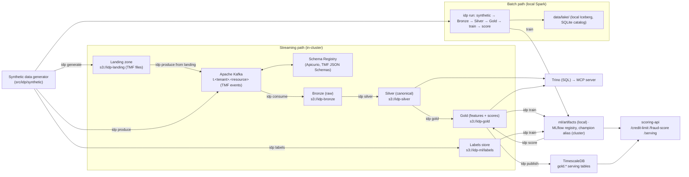
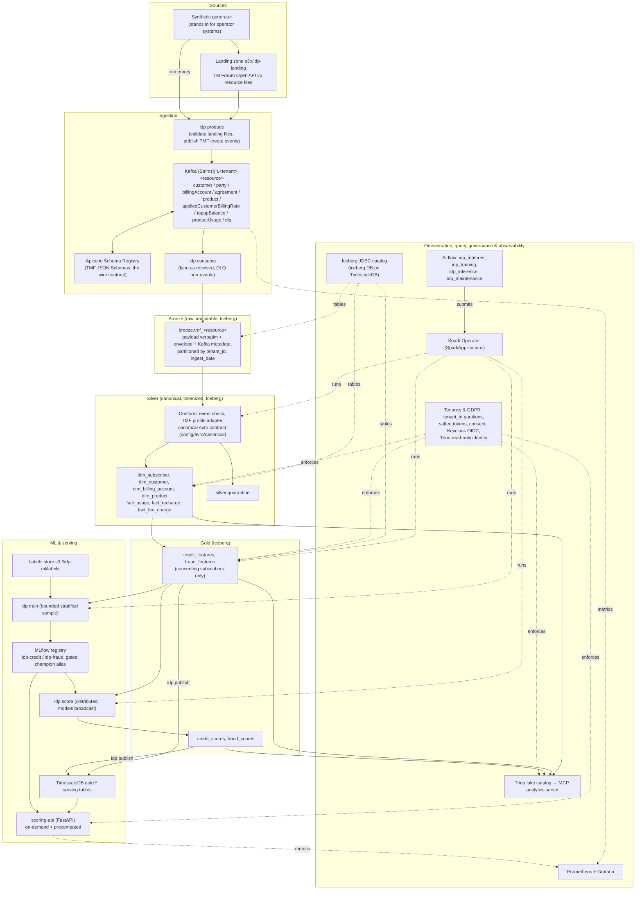
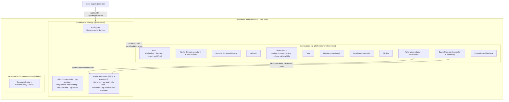

# Intelligent Data Platform

A telecom **data lakehouse** that ingests TM Forum entity/event data, curates it
through a **medallion architecture (Bronze → Silver → Gold)**, and serves two ML
use cases: **alternative credit-limit scoring** and **fraud detection**. It is
multi-tenant, GDPR-aware, batch-first, and Kubernetes-native (local **minikube**,
production **AWS EKS**).

- Full design: [`docs/architecture_and_implementation_plan.md`](docs/architecture_and_implementation_plan.md)
- Deployment details: [`deploy/README.md`](deploy/README.md) · Kafka setup: [`deploy/platform/kafka/README.md`](deploy/platform/kafka/README.md)

> **Engines.** Silver and Gold run on **Apache Spark**, with one implementation
> (`src/idp/transforms`) used by the CLI, the cluster, Airflow and the tests.
> Locally and in CI it runs as `local[*]`. In the cluster, Silver, Gold, Score,
> publish and maintenance run as **Spark Operator SparkApplications**: a driver plus
> executors, sized per stage in `spark.profiles` (ADR-0027, ADR-0029).
> scikit-learn fits the models on a bounded, stratified sample, and pandas scores
> one Spark partition at a time; no process holds a whole table.
> scikit-learn `HistGradientBoosting*` stands in for LightGBM/XGBoost. The lake is **Apache Iceberg** in a JDBC catalog: the
> platform Postgres in the cluster, a local SQLite file in dev/CI (ADR-0028). Flink is
> represented by the deployed services and the design docs.

---

## Table of Contents
1. [Introduction](#1-introduction)
   - [1.1 What this project is](#11-what-this-project-is)
   - [1.2 Platform services](#12-platform-services)
   - [1.3 Applications](#13-applications)
   - [1.4 System integration architecture](#14-system-integration-architecture)
   - [1.5 Logical architecture](#15-logical-architecture)
   - [1.6 Deployment architecture](#16-deployment-architecture)
2. [Project structure](#2-project-structure)
3. [Installation & deployment](#3-installation--deployment)
   - [3.1 Batch mode](#31-batch-mode-local-vs-production)
   - [3.2 Streaming mode](#32-streaming-mode-local-vs-production)
4. [Functional implementation](#4-functional-implementation)
   - [4.1 Bronze pipeline](#41-bronze-pipeline)
   - [4.2 Silver pipeline](#42-silver-pipeline-batch-vs-stream)
   - [4.3 Gold pipeline](#43-gold-pipeline-batch-vs-stream)
   - [4.4 ML algorithms](#44-ml-algorithms)
   - [4.5 Serving layer](#45-serving-layer)
   - [4.6 MCP analytics server](#46-mcp-analytics-server)

---

## 1. Introduction

### 1.1 What this project is

Telecoms hold rich behavioural data (usage, recharges, tenure) that can power
decisions traditional bureaus can't. This platform turns raw TM Forum
entity/event records into two decisioning products:

- **Alternative credit-limit** — a probability-of-default model plus affordability
  sizing, using recharge reliability, spend, and tenure as alternative-credit signals.
- **Fraud detection** — layered rules + gradient boosting + anomaly detection for
  SIM-box, recharge/card, and roaming fraud.

Data flows through a **medallion lakehouse**: **Bronze** (raw, immutable) →
**Silver** (clean, canonical, tenant-isolated, PII-tokenized) → **Gold**
(per-subscriber feature tables + ML scores). Two execution paths produce the same
layers with the same code: a **batch** path (local, Spark `local[*]`) and a
**streaming** path (Kafka → in-cluster jobs).

### 1.2 Platform services

Shared infrastructure, deployed by `make platform-services` (+ `make kafka`) into the
**`idp-platform`** namespace.

| Service | Purpose | Status in prototype |
|---|---|---|
| **MinIO** | S3-compatible object store; holds the lake (`idp-bronze` / `idp-silver` / `idp-gold`) | **Active** |
| **Apache Kafka** (Strimzi) | Event streaming backbone for the ingestion path | **Active** (streaming mode) |
| **Apicurio Schema Registry** | Each topic's TM Forum JSON Schema (the wire contract), Confluent-compatible API | **Active** (schemas registered) |
| **Nessie** | Git-like Iceberg catalog | Provisioned (not the lake's catalog: its REST catalog keeps only the current snapshot; ADR-0028) |
| **Trino** | Distributed SQL over the lake for ad-hoc queries | **Active** (query Silver/Gold) |
| **TimescaleDB** | Low-latency **Gold serving** store (indexed by `service_id`) | **Active** (`idp publish` mirrors Gold here) |
| **Keycloak** | OIDC identity: realm `idp` issues the scoring API's tenant-scoped tokens | **Active** (`make keycloak` + `make keycloak-token`) |
| **Apache Airflow** | Batch orchestration (schedules the medallion DAG) | **Active** (DAG in `pipelines/airflow`) |
| **MLflow** | Experiment tracking + model registry (versions, gated `champion` alias) | **Active** (`make mlflow` + `make mlflow-ui`) |
| **Prometheus + Grafana** | Metrics & dashboards; node-exporter + kube-state-metrics; K8s cluster + Kafka produce/consume dashboards | **Active** (`make monitoring` + `make grafana-ui`) |
| **Kafka UI** (Kafbat) | Web UI to manage topics/messages/schemas | **Active** (`make kafka-ui`) |


### 1.3 Applications

Workloads that use the platform. In the cluster they all run in the **`idp-app`**
namespace from the one `idp` image. The non-Spark stages are Kubernetes Jobs; the
Spark stages are Spark Operator `SparkApplication`s (a driver pod plus executor pods,
sized by `spark.profiles.<stage>`).

| Application | Kind | Stage | Purpose |
|---|---|---|---|
| **scoring-api** (FastAPI) | Deployment + Service | Serving | `POST /credit-limit` and `/fraud-score` (on-demand, the MLflow `champion` models) and `GET /serving/{table}/{tenant}/{service_id}` (precomputed rows from TimescaleDB). Requires a Keycloak token whose `tenant_id` claim scopes every call |
| **idp-generate** | Job | Source | Writes the synthetic source data as TM Forum resource files to `s3://idp-landing` |
| **idp-produce** | Job | Ingestion | Publishes in-memory synthetic data as TM Forum create events to the `t.<tenant>.<resource>` topics |
| **idp-produce-from-landing** | Job | Ingestion | Validates the landing files and publishes them as TM Forum create events |
| **idp-consume** | Job | Bronze | Drains the topics and lands each event as received in raw Bronze; messages that aren't events go to `t.<tenant>.dlq`. Doesn't chain into Silver |
| **idp-labels** | Job | ML | Seeds the labels/outcomes store `s3://idp-ml/labels` (training input) |
| **idp-silver** | SparkApplication | Silver | Conforms new Bronze events to the canonical model (failures to `silver.quarantine`) and builds the dimensions and facts |
| **idp-gold** | SparkApplication | Gold | Silver → `gold.credit_features` / `gold.fraud_features` |
| **idp-train** | SparkApplication | ML | Gold features + labels → new model versions in MLflow; `champion` only if the quality gate passes |
| **idp-score** | SparkApplication | Inference | Gold features + champions → `gold.credit_scores` / `gold.fraud_scores` |
| **idp-publish** | SparkApplication | Serving | Gold → TimescaleDB `gold.*` serving tables (staging load + atomic swap) |
| **idp-maintain** | SparkApplication | Operations | Compacts files, expires snapshots and removes orphan files on every lake table |

Outside the cluster:
- **`idp` CLI**: `generate`, `produce`, `consume`, `silver`, `gold`, `labels`, `train`,
  `score`, `publish`, `maintain`, `run` (the whole flow locally), `serve`, `mcp`, plus
  helpers (`spark-manifest`, `registry-schemas`, `archive-policy`).
- **MCP analytics server** (`make mcp`): a stdio server on the operator's host; its
  tools query Silver and Gold through Trino as a read-only identity (section 4.6).

### 1.4 System integration architecture



**Key idea:** both paths run the *same* stage functions (`to_silver()`, `to_gold()`,
`train()`, `to_scores()` in `pipeline.py`) over the same Spark transforms; they
differ only in transport (in-process vs Kafka), storage (local Iceberg vs MinIO) and
model store (`ml/artifacts` vs the MLflow registry). In the cluster, **training** is
its own stage: `idp train` learns from historical Gold features and the labels store
and registers the models, `idp score` applies the `champion` models to Gold, and the
scoring API loads the same champions for on-demand calls.

### 1.5 Logical architecture

The layers and the components that implement them. This is the design of
[`docs/architecture_and_implementation_plan.md`](docs/architecture_and_implementation_plan.md)
§1.2 as built; the table after the diagram lists where the build differs from the plan.



| Plan (§1.2) | As built |
|---|---|
| Apache NiFi lands, routes and validates files | `idp produce --from-landing` validates the TM Forum landing files and publishes them; a rejected file stops the run |
| Avro contracts in the Schema Registry | The wire contract is each topic's TMF JSON Schema in Apicurio; the canonical Avro contracts are enforced by Silver's conform step (ADR-0031, ADR-0032) |
| Kafka S3 sink into raw JSON/Avro Bronze files | `idp consume` appends each event to a raw Iceberg Bronze table (ADR-0028, ADR-0032) |
| Nessie as the Iceberg catalog | An Iceberg JDBC catalog on the platform Postgres; Nessie stays provisioned, unused (ADR-0028) |
| Great Expectations quality gates | Schema, tenant, reference and Avro-contract checks in the conform step, with failures in `silver.quarantine` |
| Feast feature store (offline Iceberg, online Timescale) | Gold Iceberg feature tables (offline) mirrored to TimescaleDB by `idp publish` (online); the feature contract lives in `common/feature_contract.py` |
| `subscriber_features_daily`, aggregates/KPIs | One row per subscriber in `credit_features` and `fraud_features`; KPIs come from the MCP tools over Trino |
| Keycloak + OPA row/column policies | Keycloak OIDC tokens scope the scoring API; Trino file-based access control limits the MCP identity to Silver and Gold reads. OPA isn't deployed |
| Flink real-time scoring | Deferred (ADR-0004): scoring is the batch `idp score` stage plus the on-demand API |

### 1.6 Deployment architecture



- **Namespace split:** platform services in `idp-platform`, application workloads in
  `idp-app`; apps reach services via cross-namespace DNS
  (`idp-kafka-kafka-bootstrap.idp-platform.svc`, `minio.idp-platform.svc`, …).
- **Who starts what in `idp-app`:**
  - `make app-deploy` applies the scoring-api (`deploy/app/overlays/<env>`);
  - the `make` stage targets apply the Jobs (`deploy/app/jobs/`) and the
    SparkApplications (`deploy/app/spark/`, rendered from `spark.profiles` by
    `make spark-manifests`) and wait for them;
  - Airflow submits the same SparkApplications. Its RBAC in `idp-app` only creates
    SparkApplications and reads their pods and logs; the non-Spark Jobs stay outside
    Airflow;
  - the Spark Operator, installed in `idp-platform`, watches `idp-app` and creates
    each application's `idp-<stage>-driver` pod, its executors and a UI service.
- **Tenant isolation** (`deploy/platform/base/`): per-tenant namespaces with
  `ResourceQuota`, `NetworkPolicy` (default-deny cross-tenant), and RBAC roles. Data
  isolation is by `tenant_id` partitions and scoped reads, since the stages serve
  every tenant from `idp-app`.
- **Overlays, split by team**: platform base in `deploy/platform/overlays/{local,aws}`
  (namespaces/RBAC/isolation); the scoring-api app in `deploy/app/overlays/{local,aws}`
  (`imagePullPolicy: Never` dev image locally; ECR image + IRSA on EKS). Two Argo CD
  apps in `deploy/platform/argocd` sync the platform base then the app.

---

## 2. Project structure

```
src/idp/                     # the platform package
  common/                    #   config, multi-tenancy guards, GDPR PII, S3/local storage,
                             #   model feature contract (feature_contract.py)
  synthetic/generator.py     #   synthetic data generator (labelled, multi-tenant)
  ingestion/                 #   source side: the TM Forum landing zone (landing.py) and the
                             #   profile-driven TMF writer/adapter (tmf/). Bronze itself is
                             #   written by pipeline.to_bronze (Iceberg), not here
  transforms/                #   Spark Silver/Gold (single engine): silver.py, features.py,
                             #   tokens.py, session.py, lake.py (Iceberg writes),
                             #   incremental.py (incremental Silver facts)
  ml/                        #   credit_model.py (PD + limit), fraud_model.py (rules+GBM+iforest)
  streaming/                 #   Kafka producer.py + consumer.py
  serving/api.py             #   FastAPI scoring service
  mcp/                       #   MCP analytics server + tools
  pipeline.py                #   stage functions (to_silver/to_gold/to_scores/train/...) + local run()
  cli.py                     #   `idp` entrypoint
config/                      # platform.yaml, Avro contracts (config/avro: canonical/, silver/), TM Forum schemas,
                             #   extensions and mapping profiles (config/tmf)
data_samples/                # one TM Forum Open API v5 sample per landing resource type
deploy/                      # split by owning team (ADR-0018)
  platform/                  #   PLATFORM TEAM — shared infrastructure
    base/ overlays/ argocd/  #     namespaces, RBAC, isolation; base local/aws overlays; GitOps
    kafka/                   #     Kafka cluster, schema registry, topics, admin UI
    keycloak/ timescaledb/   #     per-service manifests
    trino/ nessie/ airflow/  #     per-service Helm values / DAG image
    monitoring/              #     Prometheus/Grafana values, dashboards, Kafka PodMonitor
    install-infra.sh *-tune.sh #   install all services (Helm) + self-healing reinstalls
  app/                       #   APPLICATION TEAM — workloads on the platform
    deployment/              #     scoring-api base (Deployment/Service)
    overlays/local|aws/      #     env patches for scoring-api (dev image / ECR+IRSA)
    jobs/                    #     the non-Spark stages' Jobs: generate/produce/consume/labels
    spark/                   #     the Spark stages' SparkApplications (the one copy; `make
                             #     spark-manifests`), also baked into the Airflow DAG image
pipelines/airflow/dags/      # Airflow DAGs for the batch pipeline (Spark manifests come from deploy/app/spark/)
tests/                       # 63 pytest tests across every layer
docs/                        # architecture & implementation plan
Makefile                     # all workflows (run `make help`)
Dockerfile                   # scoring-api / jobs image (idp package)
```

Run `make help` to list every target with a description.

---

## 3. Installation & deployment

**Prerequisites (local):** Python 3.10+, a **JDK 11 or 17** (Silver/Gold run on
Spark; e.g. Temurin 17 with `JAVA_HOME` set — `make install` checks for it),
Docker, `minikube`, `kubectl`, `helm`, `kustomize`. A comfortable minikube is `--cpus=8 --memory=16384` — the full stack
is heavy; under-provisioning causes pods to OOM/crashloop.

There are **two execution modes**. Batch is the simplest and always works;
streaming exercises the deployed Kafka + MinIO.

### 3.1 Batch mode (local vs production)

Batch = one process does synthetic → Bronze → Silver → Gold **and trains models**.

**Local (no cluster needed):**
```bash
make install      # create .venv, install package + dev deps
make test         # 63 tests (~30s)
make run          # full pipeline -> writes data/lake/{bronze,silver,gold}/ + ml/artifacts/
make serve        # scoring API at http://localhost:8000
```
`make run` prints out-of-sample metrics, e.g.:
```json
{ "counts": {"subscribers": 1000, "usage_events": 1000000, "recharge_events": 31000},
  "credit_metrics": {"auc": 0.72, "ks": 0.36}, "fraud_metrics": {"pr_auc": 0.68, "precision_at_20": 1.0} }
```

**Production:** the medallion is run as **separate stages** (not one monolith) —
Silver/Gold orchestrated by Airflow (`pipelines/airflow/dags/idp_medallion_dag.py`)
and Spark, reading and writing Iceberg tables in the lake's JDBC catalog. `idp run`
(below) is for local dev/testing and offline model training, not production ELT.

> **Is batch mode obsolete?** No — its role changes. The *medallion transforms*
> are now the standalone stages (`idp silver`, `idp gold`) used by both on-demand
> and orchestrated runs, so there is **no duplicated logic**. `idp run` remains
> useful as (a) the **local dev/test harness** (runs the whole flow with no
> cluster) and (b) the **training path** — training needs ground-truth labels
> that never enter the lake, so it stays a distinct concern (`idp train`). `run`
> simply *composes* `to_bronze → to_silver → train → to_gold` locally.

### 3.2 Streaming mode (local vs production)

Streaming = synthetic data flows through **Kafka** into the lake on **MinIO**.

**Local (minikube) — one-time platform bring-up:**
```bash
make mk-up                              # start minikube (ingress, metrics-server, storage)
make image                              # build the idp/scoring-api:dev image into minikube
make platform-base                      # namespaces (idp-platform, idp-app, tenants), RBAC, isolation
make platform-services                  # install platform services (MinIO, Kafka operator, Trino, ...)
make app-deploy                         # deploy/redeploy scoring-api into idp-app (rolls pods to the new image)
make lake-catalog                       # the lake's Iceberg catalog database (`iceberg` in TimescaleDB)
make kafka                              # Kafka cluster + Schema Registry + topics + TMF topic schemas
```
Health checks & fixes if a component is unhappy:
`make strimzi-fix` · `make trino-fix` · `make nessie-fix` (see [`deploy/README.md`](deploy/README.md)).

**Run the medallion stages — each is a separate job (separation of concerns):**
```bash
make stream        # 1) produce -> Kafka, then consume -> BRONZE (S3). Bronze only.
                   #    (or: make stream-from-landing — via the s3://idp-landing source files)
make silver        # 2) Silver stage: Bronze (S3) -> canonical Silver (S3)
make gold          # 3) Gold stage:  Silver (S3) -> feature tables ONLY (S3)
make labels        # 4) Seed the labels/outcomes store -> s3://idp-ml/labels (training input; once per
                   #    dataset, not in Airflow; any time before train, independent of Gold)
make train         # 5) Train stage (SparkApplication): Gold features + labels -> models (MLflow registry)
make score         # 6) Score stage: Gold features + models -> credit/fraud SCORES (S3)
make publish       # 7) Serving stage: Gold (S3) -> TimescaleDB (indexed by service_id)
make serve-cluster # 8) Port-forward the cluster's scoring API (127.0.0.1:18000) to query it
```
> **Training vs scoring are separate** (phase-13). `train` (fit) learns from
> **historical Gold features + the labels store** — no synthetic regeneration — and
> registers a new model version in the MLflow registry, which becomes `champion`
> only if it passes its quality gate. `score` (inference) applies the `champion`
> models to the latest Gold features to produce
> `credit_scores`/`fraud_scores`. Skip `score` (or `train`) and Gold/TimescaleDB
> hold **features only** — which is why a `gold.credit_features`-only TimescaleDB
> means scoring hasn't run. In Airflow this is **three dataset-driven DAGs**:
> `idp_features` (`silver → gold`), `idp_training` (`train`), and
> `idp_inference` (`score → publish`) — the last is scheduled on the *gold-features*
> **or** *model* dataset, so it re-runs automatically when either refreshes (a new
> model auto-re-scores; no manual second pass). `make airflow-trigger` unpauses all
> three and kicks features + training. The training DAG doesn't seed labels: run
> `make labels` once first (it stands in for an outcomes feed), or `train` fails
> with "seed labels" and no model is produced.
- `idp-produce` publishes TM Forum create events to `t.<tenant>.<resource>` topics
  (small demo volume via `IDP_SUBSCRIBERS`/`IDP_DAYS`).
- `idp-consume` drains topics and writes **only raw Bronze**, the events as
  received.
- `idp-silver` (a SparkApplication, `make silver`) reads Bronze → writes Silver.
- `idp-gold` (a SparkApplication, `make gold`) reads Silver → writes the Gold
  feature tables only.
- Models and scores: `make labels` (once), then `make train` registers the models
  and `make score` writes `credit_scores` / `fraud_scores` from the champions.
  Without `train` and `score`, Gold holds feature tables only.

#### Ingestion in detail

`make stream` and `make stream-from-landing` are the two ways into Bronze. Both run
as Kubernetes Jobs in `idp-app`, so they use in-cluster DNS (reaching Kafka from a
Mac through minikube is unreliable), and both stop at Bronze.

**`make stream`** runs `idp-produce`, **waits for it to finish**, then runs
`idp-consume` (ordering matters):
- `idp-produce` publishes the synthetic data as TM Forum create events to
  `t.<tenant>.<resource>` topics (small default volume: 150 subscribers × 14
  days, via env, to fit memory). See "Kafka carries TM Forum events" below.
- `idp-consume` drains the topics and appends each event, as received, to the raw
  Iceberg Bronze tables on MinIO (Bronze only; Silver conforms them, and Gold is
  a separate stage).

**Or stream through the landing zone** (source files → landing → Kafka → Bronze,
the path the architecture plan describes for NiFi):
```bash
make stream-from-landing   # generate -> s3://idp-landing -> produce --from-landing -> consume
```
- `idp-generate` writes the synthetic source files as **TM Forum Open API v5
  resources** to `s3://idp-landing/tenant=<id>/<resource>.json`, one tenant at a
  time (see "Landing files are TM Forum resources" below).
- `idp-produce-from-landing` checks every file and publishes its resources, as
  they are, as TMF create events. A file is **not published** when its folder
  names an unknown tenant, it isn't a known resource file, a resource fails its
  schema or belongs to another tenant (`tenantId`), it depends on a rejected file
  (e.g. `customer.json`), or it holds a reference that doesn't resolve. The Job
  then fails and consume doesn't run.
- `idp-consume` lands the records in Bronze, exactly as with `make stream`: both
  sources send the same messages (apart from `eventTime`).
- `make stream-replay` re-publishes the landing files already there, without
  regenerating them (replay). `make generate-job` writes them only.
- Inspect the source files: `make minio-ls` (the `idp-landing` bucket). Locally,
  `idp generate` writes them to `data/landing/`, and
  `idp produce --from-landing` publishes them.
- Run one streaming target at a time. They share the topics and the consumer.

**Landing files are TM Forum resources** (REQ-BRZ-03/05/06). Each tenant folder
holds one JSON array per resource type:

| File | TMF API | Canonical entity |
|---|---|---|
| `individual.json`, `organization.json` | TMF632 Party (v5) | parties |
| `customer.json` | TMF629 Customer (v5), the party role `customer` | customers (party, segment, since-date, billing account) |
| `billingAccount.json` | TMF666 Account (v5), referencing its paying party | billing_accounts |
| `agreement.json` | TMF651 Agreement (v4.0 shape, v5 conventions) | agreements |
| `product.json` | TMF637 Product Inventory (v5) | products |
| `appliedCustomerBillingRate.json` | TMF678 Customer Bill (v5) | fee_charges |
| `topupBalance.json` | TMF654 Prepay Balance (v4.0 shape, v5 conventions) | recharge_events |
| `productUsage.json` | TMF635 Usage (v5), `usageType` voice/data | voice_events, data_events |

- **One mapping, both ways.** `config/tmf/profiles/standard.yaml` says where each
  canonical field lives (a standard field, a typed characteristic, or an extension
  attribute). `idp generate` and `idp produce` write with it, and Silver's conform
  step adapts back with it, so the round trip is exact and Silver keeps the
  canonical model.
- **Payer and customer.** A billing account references the party that pays it
  (`relatedParty` with role `payer`, an Individual or Organization). A Customer
  (the party role `customer`) engages that party, holds the billing account, and
  carries the segment and the since-date. An agreement references its Customer
  (`engagedParty` with role `customer`) and gets its billing account through it.
  `IDP_TMF_PROFILE` (or `tmf.profile`) selects another profile.
- **Extensions.** Every resource is the platform subtype `Idp<Resource>`
  (`@type`, `@baseType`, `@schemaLocation`) adding `tenantId`; BillingAccount also
  carries `validFor` (TMF666 has none), and TopupBalance `rechargeType` and its
  agreement (TMF654 has no characteristics). A
  customer profile adds its own `@type` subtypes with their JSON Schemas in
  `config/tmf/extensions/`, without changing standard fields.
- **Validation.** Resources are checked against the TMF schemas vendored (pinned to
  upstream commits) in `config/tmf/schemas/` plus their extension schemas;
  `config/tmf/vendor_schemas.py` regenerates them. Examples: `data_samples/`.
- **Customer role.** Accounts and agreements reference a `Customer` (TMF629
  `PartyRole`), whose `engagedParty` is the Individual or Organization. The
  adapter resolves these references per tenant.
- **Organizations.** Company accounts' parties are `Organization`s, so their
  canonical `first_name`/`last_name`/`date_of_birth` are null (no model feature
  uses them).
- Look at a file: `make landing-show ENTITY=productUsage LINES=40`.

**Kafka carries TM Forum events** (REQ-STR-01/02/03). Each resource is published
as its TMF create event, on a topic per resource:

| Topic `t.<tenant>.…` | Event(s) | Notes |
|---|---|---|
| `customer` | `CustomerCreateEvent` | published first |
| `party` | `IndividualCreateEvent`, `OrganizationCreateEvent` | |
| `billingAccount`, `agreement`, `product` | `<Resource>CreateEvent` | |
| `appliedCustomerBillingRate` | `AppliedCustomerBillingRateCreateEvent` | fee charges |
| `topupBalance` | `TopupBalanceCreateEvent` | recharges |
| `productUsage` | `ProductUsageCreateEvent` | voice and data (`usageType`), 6 partitions |
| `dlq` | the original message | headers `idp.reason`, `idp.source.topic/partition/offset` |

```json
{"@type": "ProductUsageCreateEvent", "eventType": "ProductUsageCreateEvent",
 "eventId": "3f0c…", "eventTime": "2026-10-02T06:12:33.123Z",
 "event": {"productUsage": {"@type": "IdpProductUsage", "id": "tenant_a-agr-000000-v-0-0",
                            "tenantId": "tenant_a", "usageType": "voice", …}}}
```

- **Keys and ids.** A message is keyed by the subscriber's MSISDN where the
  resource has one, else by its id (customers by id). `eventId` is derived from
  the tenant, resource type and id, so re-publishing a resource gives the same id.
- **Raw Bronze.** The consumer lands every event as received, one Bronze table per
  topic (`bronze.tmf_<resource>`). It doesn't validate or resolve anything: Silver
  does (see 4.2), so a customer published in an earlier run always resolves.
- **Dead letters.** Only a message that can't be stored as an event (not a JSON
  object with `eventType`, `eventId` and one resource in `event`) goes to
  `t.<tenant>.dlq` with the reason. The rest is landed, and the consume Job fails,
  which stops the make chain before Silver. Invalid, foreign or dangling events
  are landed and then quarantined by Silver.
- **Two contracts.** The wire contract is each topic's TMF JSON Schema, registered
  in Apicurio as `<topic>-value` (schema type JSON) by `make schemas`
  (`idp registry-schemas` writes them). The canonical contract is
  `config/avro/canonical/*.avsc`, one Avro schema per canonical entity, field for
  field as Silver's conform step produces it; the conform step enforces it.
  `config/avro/silver/` documents every Silver table (dimensions, facts,
  quarantine) as Silver stores it: tokenized identifiers, UTC timestamps.

> Tip: the default synthetic volume (~1M usage events) is a lot to stream on a
> small node. For a quicker demo, lower `synthetic.subscribers_per_tenant` and
> `synthetic.days` in `config/platform.yaml` before `make stream`.

**Verify:**
```bash
kubectl -n idp-app logs job/idp-produce         # per-topic message counts
kubectl -n idp-app logs job/idp-consume         # bronze counts
kubectl -n idp-app logs idp-silver-driver       # silver counts (Spark driver; also idp-gold-driver, idp-score-driver, …)
kubectl -n idp-app get sparkapplications        # each Spark stage's final state
make kafka-ui                                   # browse topics/messages/schemas
make minio-ls                                   # objects in idp-bronze / idp-silver / idp-gold
make minio-reset                                # clean re-run: recreate the buckets AND clear the Iceberg catalog
```

**Production (orchestrated Silver/Gold):**
- **Airflow** — three dataset-driven DAGs (`idp_features`: `silver >> gold`;
  `idp_inference`: `score >> publish`; `idp_training`: `train`) plus the
  daily `idp_maintenance` DAG (`idp maintain`: compaction, snapshot expiry, orphan
  cleanup; it triggers nothing). **Airflow is the orchestrator, and every stage
  runs the `idp` image.**
  - **Every task is a Spark application:** silver, gold, score, publish, maintain
    and train are submitted as SparkApplications (`SparkKubernetesOperator`) and
    fail if the application fails. No task launches a pod of its own, so Airflow's
    RBAC in `idp-app` only submits SparkApplications and reads their pods' logs.
  - The non-Spark stages (generate, produce, consume, labels) run from `make` as
    Kubernetes Jobs, outside Airflow. Seed labels with `make labels` before the
    first training run.
  - The code is the same as `idp silver` / `idp gold` / …; there is no engine
    switch (ADR-0027).
  - `publish` (Gold→TimescaleDB) stays a **separate** task.
  Wire + trigger:
  ```bash
  make airflow-wire       # build DAG image into minikube + install Airflow + RBAC
  make airflow-trigger    # or: make airflow-ui  then Trigger in the UI
  ```
  `airflow-wire` (see [`deploy/platform/airflow/`](deploy/platform/airflow)):
  - **Bakes the DAGs into a local image** (`deploy/platform/airflow/Dockerfile`, built into
    minikube) instead of git-sync — the repo is private, so git-sync-init can't
    clone it without credentials and crashloops with an auth error.
  - Pins the chart to `1.15.0` (Airflow 2.9.3 — so the UI service is
    `airflow-webserver`; Airflow 3.x charts rename it to `airflow-api-server`).
  - Reuses the in-cluster **TimescaleDB** as Airflow's metadata store (a dedicated
    `airflow` database it creates on first run), disabling the chart's bundled
    PostgreSQL/Redis — the retired Bitnami images no longer pull, which otherwise
    leaves `run-airflow-migrations` hanging and the init containers in
    `CrashLoopBackOff`.
- **Spark in the cluster (ADR-0029).** `make silver|gold|score|publish|maintain|train`
  each render the stage's SparkApplication from its profile
  (`idp spark-manifest <stage>`), apply it, and wait for `COMPLETED` or `FAILED`.
  - **Entrypoints:** `pipelines/spark/<stage>_job.py`, thin wrappers over the same
    `idp` stages.
  - **Scaling:** raise `spark.profiles.<stage>.executor.instances` (or memory),
    then run `make mk-check` and `make spark-manifests` (it rewrites the one copy,
    `deploy/app/spark/<stage>.yaml`), and `make airflow-reload` for the DAGs, whose
    image bakes that folder in. There's no code change.
  - **Distributed stages:** scoring runs per partition with the models broadcast,
    and publish loads staging tables over JDBC and swaps them in atomically.
  - **Training** fits on at most `ml.train_max_rows` rows, sampled per
    (tenant, label).
- **Upgrading from the engine switch:** remove the old Airflow Variables and script
  ConfigMaps once (`airflow variables delete idp_silver_engine` / `idp_gold_engine`
  in the scheduler; `kubectl -n idp-app delete configmap idp-silver-spark
  idp-gold-spark`) — see [`deploy/README.md`](deploy/README.md).
- **Full step-by-step (both):** [`docs/triggering.md`](docs/triggering.md).
- EKS: `deploy/platform/overlays/aws` (ECR, IRSA, S3, External Secrets) via Argo CD; the
  stages use the same Iceberg JDBC catalog (on RDS Postgres). See plan §2B.

---

## 4. Functional implementation

**Separation of concerns.** Each medallion stage is an independent function in
`pipeline.py` that reads its input layer and writes its output layer, exposed as a
distinct CLI command / job:

| Stage | Function | CLI / Job | Reads | Writes |
|---|---|---|---|---|
| Bronze | `to_bronze` | `idp consume` | Kafka | `s3://idp-bronze` |
| Silver | `to_silver` | `idp silver [--full-refresh]` | new Bronze snapshots | `s3://idp-silver` |
| Gold | `to_gold` | `idp gold` | `s3://idp-silver` | `s3://idp-gold` |
| Serving | `publish_serving` | `idp publish` | `s3://idp-gold` | **TimescaleDB** (`gold.*` tables) |
| ML train | `train` | `idp train` | Gold features + labels | MLflow registry (`idp-credit`/`idp-fraud`), else `s3://idp-ml/*.joblib` |

`idp run` is the **local dev orchestrator** — it composes the same stage functions
end-to-end against local storage (see the note at the end of §4).

### 4.1 Bronze pipeline

**Purpose:** capture the source events **as received**, immutably and
tenant-partitioned (REQ-BRZ-01). Bronze is raw: it doesn't parse, validate, adapt or
de-duplicate. Conforming to the canonical model is Silver's job (4.2), so a
mapping fix can always be replayed from Bronze. **Bronze is the only thing the
consumer does**; it doesn't chain into Silver or Gold.

- `streaming/consumer.py:consume_to_bronze()` drains every
  `t.<tenant>.<resource>` topic and builds one raw row per message
  (`ingestion/raw.py:event_row`): the value verbatim as `payload`, plus `tenant_id`
  (from the topic), `event_id`, `event_type`, `event_time`, `resource_type`,
  `resource_id` and the Kafka topic, partition, offset and key. It **returns** the
  rows per table and the dead letters (messages that aren't events at all).
- `idp consume` (`cli.py`) then calls `pipeline.to_bronze()`, which appends each
  topic's rows to its Iceberg table `bronze.tmf_<resource>` (`tmf_party`,
  `tmf_customer`, `tmf_billing_account`, `tmf_agreement`, `tmf_product`,
  `tmf_applied_customer_billing_rate`, `tmf_topup_balance`, `tmf_product_usage`) as
  one snapshot. The tables are partitioned by `(tenant_id, ingest_date)`, and every
  row carries `_ingested_at`. Dead letters go to `t.<tenant>.dlq`. Kafka offsets are
  committed only after the append and the DLQ write, so a crash replays and never
  loses events. `idp consume` exits 1 when anything was dead-lettered. That's the
  end of the Bronze job.
- `idp run` and the tests land the same rows from a generated dataset
  (`ingestion/raw.py:raw_events`), so every path writes identical Bronze.
- Every record is **tenant-stamped** at ingestion (`common/tenancy.py`), the
  leading partition column that guarantees physical isolation.

#### The `idp-bronze` bucket: what's in it

`idp-bronze` is the **Bronze layer's bucket**. It holds the raw, append-only
record of everything ingested, as Iceberg tables. (Source files waiting to be
published live in `idp-landing`; Silver and Gold have their own buckets,
ADR-0008.) Every topic is one Iceberg table, `bronze.tmf_<resource>`, stored under
`tables/<table>/`. Here is `tmf_billing_account` after its first landing:

```
idp-bronze/tables/tmf_billing_account/
├── data/                                         <- the records (Parquet)
│   ├── tenant_id=tenant_a/ingest_date=2026-09-28/00000-1-02df54c1-….parquet
│   └── tenant_id=tenant_b/ingest_date=2026-09-28/00000-0-02df54c1-….parquet
└── metadata/                                     <- how to read them (Iceberg)
    ├── 00000-8737….metadata.json                 table created (schema, location)
    ├── 00001-9a9e….metadata.json                 partition spec added (tenant_id, ingest_date)
    ├── 00002-0f16….metadata.json                 first append committed = CURRENT version
    ├── snap-6417943028689728948-0-02df54c1-….avro   manifest list of snapshot 6417…
    └── 02df54c1-…-m0.avro                        manifest: the data files that snapshot added
```

| Path | What it is |
|---|---|
| `data/tenant_id=<t>/ingest_date=<d>/` | **Partitions.** `tenant_id` comes first, so each tenant's records sit in their own files (physical tenant isolation, REQ-FND-02). `ingest_date` is the UTC day the batch landed. Readers filter on both without opening other tenants' or other days' files. |
| `00000-<n>-<write-uuid>.parquet` | **Data files.** One file per partition per commit. `<n>` is the number of the write task that produced it (here `1` and `0`, one per tenant partition), and `<write-uuid>` ties the file to the commit that wrote it (the same uuid as that commit's manifest and manifest list). The columns are the raw event row (the `payload` and its envelope and Kafka columns), plus `_ingested_at` (the UTC landing time) and `ingest_date`. |
| `NNNNN-<uuid>.metadata.json` | **Table metadata versions.** Each commit writes a new version with the schema, the partition spec, the table properties and the snapshot history. The first landing makes three versions: create the table (`00000`), add the partition spec (`00001`), and append (`00002`). Later appends add one each. |
| `snap-<snapshot-id>-<attempt>-<commit-uuid>.avro` | **Manifest list.** One per snapshot (commit). It lists that snapshot's manifests. |
| `<commit-uuid>-m<k>.avro` | **Manifest.** It lists data files, with their partition values, row counts and column stats, so a query can skip files without opening them. |

**How a reader finds the data.** The Iceberg catalog (the `iceberg` database on
TimescaleDB; locally `data/lake/catalog.db`) records only one thing per table: the
path of its *current* `metadata.json` (here `00002-…`). A reader follows it:
current metadata → current snapshot → manifest list → manifests → the Parquet
files. Nothing lists the directories. So:
- **A commit is atomic.** New files are invisible until the catalog pointer moves
  to the new `metadata.json`. A reader sees the table before or after an append,
  never half of it.
- **Old files stay until maintenance.** Every append adds files and a snapshot;
  nothing is rewritten. `idp maintain` compacts small files and expires old
  snapshots. Bronze records themselves are never deleted, and old objects can be
  moved to a colder storage class (`make lake-archive-policy`).
- **Bucket and catalog must match.** If the bucket is emptied but the catalog
  isn't, the catalog points at deleted `metadata.json` files, and every stage fails
  with `FileNotFoundError`. `make minio-reset` resets both together (see
  `deploy/README.md`, Troubleshooting).
- **Silver reads Bronze by snapshot.** Each `idp consume` (or `idp run`) appends
  one snapshot per table. Incremental Silver
  remembers the last Bronze snapshot it processed (its streaming checkpoint in
  `idp-silver/_checkpoints/`), and next time reads only the files that later
  snapshots added.

To look inside: `make minio-ls` lists the objects. To read a table rather than its
files, use Spark or `pyiceberg`, for example
`catalog.read_table(cfg, "bronze", "tmf_billing_account")` in `idp.common.catalog`.

### 4.2 Silver pipeline (batch vs stream)

**Purpose:** conform the raw TMF events to the canonical model, then turn them
into clean, joinable, PII-safe tables. The stage is `pipeline.to_silver()`: it
**reads raw Bronze from the lake** (`s3a://idp-bronze`, or the local
`data/lake/bronze`), conforms it (`transforms/conform.py`), applies the Spark
transforms in `transforms/silver.py`, and **writes Silver**
(`s3://idp-silver` / `data/lake/silver`). The code is identical for on-demand
(`idp silver`), orchestrated (Airflow), and local (`idp run`) — only the trigger
and the Spark master differ.

**Conform (REQ-SLV-09).** Each raw event is checked (a create event of its
table's resource type, its resource valid against the TMF and extension schemas,
its `tenantId` equal to the event's tenant), adapted with the mapping profile
(`ingestion/tmf/`, resolving an agreement's customer against the tenant's
customers in Bronze), and checked against its canonical Avro contract
(`config/avro/canonical/`). An event that fails goes to **`silver.quarantine`** (tenant,
source table, `event_id`, resource, reason, times) and nowhere else; the run
reports the count per source and doesn't fail. Reasons name fields and rules,
never values, and the quarantine holds no payload, so it carries no PII; the event
itself is in Bronze, found by `event_id`. After a fix, `--full-refresh` conforms it
again.

**Latest version (REQ-SLV-10).** For the reference entities (parties, customers,
billing accounts, agreements, products), Silver uses the latest event per
`(tenant_id, id)` by `event_time`, then landing time, then offset, whatever order
Bronze holds them in. `event_time` is the publish time, so re-publishing an old
landing file (`make stream-replay`) makes its versions the latest. Events (usage,
recharges, fee charges) are immutable: the first one per id is kept.

**Incremental.** The reference entities are conformed on the driver and the
dimensions rebuilt in full each run (bounded by the subscriber count). The event
facts (`fact_usage`, `fact_recharge`, `fact_fee_charge`) process only the raw
events appended since the last run: Structured Streaming with `Trigger.Once` and a
checkpoint per fact under `<silver>/_checkpoints/`, each batch conformed on the
executors (`mapInPandas`) and `MERGE`d insert-if-absent on `(tenant_id, id)`. A
failed run resumes without loss or duplicates. `idp silver --full-refresh` resets
the checkpoints, the facts and the quarantine, and replays all of Bronze.

**Performance.** Each Spark stage's shuffle parallelism comes from its profile
(`spark.profiles.<stage>` in `config/platform.yaml`, REQ-ORC-07): the optional
`shuffle_partitions`, else twice the executor cores (4 for Silver on minikube), or
twice the local cores. That matters most for the streaming facts, which get no
adaptive coalescing: Spark's default of 200 partitions ran hundreds of tiny tasks
per batch. Each fact batch is also repartitioned to the executor cores before
conforming, so the Python work runs on every core. A streaming checkpoint keeps the
partition count it started with, so after changing a profile run
`make silver-full-refresh` once.

**Transformations:**
- **Id canonicalization:** strip `UUID(...)` wrappers (as some operator feeds send
  ids) from entity and relationship ids so relationships join their targets.
  (The adapter in `ingestion/tmf/` turns the TMF resources into canonical records
  during conforming; the steps below curate those records.)
- **Money normalization:** `gross_amount = net_amount + tax_amount`.
- **GDPR PII tokenization** (`common/pii.py`): MSISDN/IMSI/IMEI/other-party →
  `tok_<sha256(per-tenant-salt + value)>`. Deterministic per tenant, so tokens
  join across tables while raw identifiers never land in Silver.
- **Dedup** on natural keys; timestamps normalized to UTC.

**Silver tables (the "Data"):**

| Table | Grain | Built by | Notable columns |
|---|---|---|---|
| `dim_subscriber` | 1 row / MSISDN | `build_dim_subscriber` | customer_id, account_id, account_type, segment (the customer's), customer_tenure_days (computed from the customer's since-date), num_products, has_device_agreement, consent flags |
| `dim_customer` | 1 row / customer | `build_dim_customer` | party_id, party_type, role, segment, status, valid_from |
| `dim_billing_account` | 1 row / billing account | `build_dim_billing_account` | account_type, lifecycle_status, valid_from, payer_party_id, is_company |
| `dim_product` | 1 row / product | `build_dim_product` | agreement_id, product_type, name, category, monthly_fee |
| `fact_usage` | 1 row / usage event | `build_fact_usage` | event_type, started_at, gross_amount, qty, is_roaming, traffic_case, other_party_number |
| `fact_recharge` | 1 row / recharge | `build_fact_recharge` | created_at, amount, payment_method, status, failure_reason_code |
| `fact_fee_charge` | 1 row / fee charge | `build_fact_fee_charge` | charge_type, amount, charged_at, product_name, category, agreement_id |
| `quarantine` | 1 row / failed event | `conform` | source_table, event_id, resource_type, resource_id, reason, quarantined_at |

Output: Iceberg tables `silver.*`, locally under `data/lake/silver/tables/` and in
the cluster under `s3://idp-silver/tables/`. The facts are partitioned by
`(tenant_id, day(event time))`, and `dim_subscriber` by `tenant_id`. Each run
commits atomically, so readers never see a partial write.

#### The `idp-silver` bucket: what's in it

`idp-silver` is the **Silver layer's bucket**: the curated, canonical, PII-tokenized
tables that Gold, the ML stages and the MCP analytics read. It has two top-level
folders:

```
idp-silver/
├── tables/                          <- the four Silver Iceberg tables
│   ├── dim_subscriber/              1 row per subscriber; rebuilt in full each run
│   ├── fact_usage/                  voice + data usage events; incremental
│   ├── fact_recharge/               recharges; incremental
│   └── fact_fee_charge/             product fee charges; incremental
└── _checkpoints/                    <- how far incremental Silver has read Bronze
    ├── fact_usage/voice_events/     one checkpoint per (fact, Bronze source)
    ├── fact_usage/data_events/
    ├── fact_recharge/recharge_events/
    └── fact_fee_charge/fee_charges/
```

**`tables/<table>/`** has the same Iceberg layout as Bronze (see the `idp-bronze`
section above): `data/` holds Parquet files, and `metadata/` holds the
`metadata.json` versions, manifest lists (`snap-….avro`) and manifests
(`…-m0.avro`). What differs in Silver:

| | `dim_subscriber` | `fact_usage` / `fact_recharge` / `fact_fee_charge` |
|---|---|---|
| Partitioning | `tenant_id` | `tenant_id`, then **day** of the event time (`started_at_day`, `created_at_day`, `charged_at_day`) |
| Example path | `data/tenant_id=tenant_a/00000-13-…-00002.parquet` | `data/tenant_id=tenant_a/created_at_day=2026-01-03/00164-1054-…-00002.parquet` |
| How it's written | **Rebuilt in full** from the Bronze reference tables each run: an `overwrite` snapshot replaces the tenants' rows | **Incremental**: each run `MERGE`s only the new Bronze records, inserting a record only if its `(tenant_id, id)` isn't there yet. Each run adds an `append` snapshot, with no rewrite of existing files. |
| Why this partitioning | One small row per subscriber; per-tenant reads | The day partition lets feature windows (7/30/90 days) and the MCP time-range tools skip whole days |

- **File names.** Spark writes these files, so the names differ from Bronze's
  (which pyiceberg writes): `<spark partition>-<task>-<write id>-<n>.parquet`.
  Files from one commit share the write id.
- **The first snapshot is empty.** A table's first snapshot is an empty `append`
  (`rows +0`). The table is created from the output schema, then the first batch
  is merged in. `make lake-table-show TABLE=silver.fact_recharge` shows it.

**`_checkpoints/<fact>/<source>/`** is Spark Structured Streaming's bookkeeping for
incremental Silver. It isn't table data: it records which **Bronze** snapshots have
already been merged into that fact.

| File | Content (example from `fact_recharge/recharge_events`) |
|---|---|
| `metadata` | the stream's id |
| `sources/0/offsets/0` | where the stream **started**: the first Bronze snapshot it saw, `{"snapshot_id": 323716817858676295, "position": 0}` |
| `offsets/<n>` | the end point of batch `n`: the Spark settings, then `{"snapshot_id": 323716817858676295, "position": 2}`. That's the current snapshot of `bronze.recharge_events`; `position` 2 means both of its files have been read |
| `commits/<n>` | written only **after** batch `n`'s `MERGE` committed. An `offsets/<n>` without `commits/<n>` means the batch failed, and the next run redoes it (exactly once) |

On the next `idp silver`, each stream resumes after its last committed offset and
reads only the Bronze snapshots appended since. Other consequences:
- **Checkpoints and tables go together.** `idp silver --full-refresh` deletes the
  checkpoints and empties the facts, then replays all of Bronze. Deleting
  checkpoints by hand without emptying the facts isn't harmful, since the `MERGE`
  skips existing keys, but it makes the next run re-read all of Bronze.
- **Maintenance respects the checkpoints.** `idp maintain` never expires a Bronze
  snapshot that one of these offsets still references (REQ-ORC-06).
- **One Silver run at a time.** Only one streaming query may use a checkpoint at
  once. That's why the Airflow features DAG runs with `max_active_runs=1`, and why
  a manual `make silver` shouldn't overlap it.
- **A bucket reset loses them too.** `make minio-reset` recreates `idp-silver`,
  which removes the checkpoints, and clears the catalog. The next Silver run then
  starts from all of Bronze.

### 4.3 Gold pipeline (batch vs stream)

**Purpose:** analytics-ready, per-subscriber tables for ML and serving. The stage
is `pipeline.to_gold()`: it **reads Silver from the lake**, builds the feature
tables on Spark (`transforms/features.py`), and **writes Gold** (`s3://idp-gold` /
`data/lake/gold`). Gold is **features only**; scores are written by the separate
Score stage (`idp score`, REQ-ML-07). The same code runs for `idp gold`, the
Airflow `gold` task and `idp run`.

**Shared aggregates.** The credit and fraud tables use the same recharge and usage
aggregates. A Gold run builds them, and the fee aggregates, once
(`features.shared_aggregates`), caches them for the two writes, and reads each
table's reference time in one scan. The usage aggregation, with its exact distinct
counts, used to run once per table.

**Features** (`transforms/features.py`, aggregated per `(tenant_id, service_id)`
over the configured 7/30/90-day windows; the ordered model feature lists are
`idp.common.feature_contract.CREDIT_FEATURES` / `FRAUD_FEATURES`):

| Feature set | Signals |
|---|---|
| **Credit** (`build_credit_features`) | recharge success rate, avg/total/max recharge, windowed recharge totals, `days_since_last_recharge`, `share_credit_card`, ARPU, `spend_to_recharge_ratio`, `customer_tenure_days`, products |
| **Fraud** (`build_fraud_features`) | `calls_per_active_day`, `originating_ratio` (SIM-box), `unique_called_numbers`, `roaming_share`, `failed_recharge_count`, per-tenant `recharge_amount_zscore` |

The join that makes this work: the tokenized `service_id` is identical in
`dim_subscriber` and the facts (same tenant salt), so facts aggregate back onto
the dimension without exposing the raw MSISDN.

#### The `idp-gold` bucket: what's in it

`idp-gold` is the **Gold layer's bucket**: one analytics-ready row per subscriber
(the model features), plus the history of every scoring run. The ML stages and the
serving copy in TimescaleDB are built from it. Everything is under `tables/`:

```
idp-gold/tables/
├── credit_features/     1 row per (tenant_id, service_id): credit-model features   <- idp gold
├── fraud_features/      1 row per (tenant_id, service_id): fraud-model features    <- idp gold
├── credit_scores/       credit limit + default probability, one set per scoring run <- idp score
└── fraud_scores/        fraud score + flag, one set per scoring run                <- idp score
```

Each table has the Iceberg layout described for `idp-bronze`: `data/` holds
Parquet files, and `metadata/` holds the `metadata.json` versions, manifest lists
and manifests. What differs in Gold:

| | `credit_features` / `fraud_features` | `credit_scores` / `fraud_scores` |
|---|---|---|
| Written by | `idp gold` (Spark), from Silver | `idp score` (pandas + the trained models), from the feature tables |
| Partitioning | `tenant_id` → `data/tenant_id=tenant_a/…parquet` | `tenant_id`, then **day** of `scored_at` → `data/tenant_id=tenant_a/scored_at_day=2026-09-28/…parquet` |
| How it's written | **Full recompute**, each run: the tenant partitions are overwritten atomically, so each run adds an `overwrite` snapshot | **Append**: each run adds its rows, stamped with the run's `scored_at`, as one snapshot. Old runs stay. |
| Content | the current features; no history in the table's current state | every scoring run: the history behind the MCP 7/15/30-day score distributions |
| Key | `(tenant_id, service_id)`, unique | `(tenant_id, service_id, scored_at)` |

What that looks like in practice:
- **Feature files pile up until maintenance.** Each `idp gold` writes a new file per
  tenant partition and a new `overwrite` snapshot. The previous run's files leave
  the current table, but they stay in the bucket because the older snapshot still
  references them (time travel). So `credit_features/data/tenant_id=tenant_a/` holds
  one file per run. `idp maintain` expires the old snapshots and deletes their
  files. `make lake-table-show TABLE=gold.credit_features` shows each run as an
  `overwrite` with the same 269 rows.
- **Consent is applied here.** Gold keeps only subscribers who consent to analytics
  (`consent_analytics`, REQ-FND-05). That's why Gold has fewer rows than Silver's
  `dim_subscriber` (e.g. 269 of 300), and why the scores and serving tables have
  that count too.
- **Scores need a model.** `idp score` loads the trained models from `idp-ml`
  (`make train`). Without them it writes nothing and says so, so the score tables
  are missing after a reset until `make labels` and `make train` have run.
- **Serving reads the latest run only.** `idp publish` copies the feature tables and
  each tenant's **latest** scoring run (the maximum `scored_at`) into TimescaleDB
  (`gold.*` tables, keyed by `(tenant_id, service_id)`), replacing the previous
  copy. The full score history stays in the lake, and only the MCP score tools read
  it.

What's *not* in this bucket: the trained models and the labels. They live in
`idp-ml` (the MLflow registry's artifacts under `s3://idp-ml/mlflow/`, or
`s3://idp-ml/*.joblib` without a registry, and `s3://idp-ml/labels/`), deliberately
outside the lake, so that labels never leak into features or serving (REQ-ML-06).

### 4.4 ML algorithms

**Credit-limit** (`ml/credit_model.py`) — two-stage:
1. **PD model**: gradient-boosted classifier (`HistGradientBoostingClassifier`,
   a drop-in for LightGBM/XGBoost) predicting probability of default; a logistic
   scorecard is trained alongside as an interpretable baseline. Features include
   recharge, usage/spend, tenure **and product fee-charge signals** (fee total /
   recurring / overage — attributed to a subscriber via the product's agreement).
2. **Limit sizing**: `recommended_limit = affordability(recharge, tenure) × (1 − PD)`,
   clipped to policy bands. Metrics: AUC, KS, Gini (out-of-sample holdout).
3. **Adverse-action reason codes** (`reason_codes`): top features raising the PD,
   via SHAP (`TreeExplainer`) when the optional `shap` extra is installed, else the
   logistic-scorecard contributions. Returned in the `/credit-limit` response.

**Fraud** (`ml/fraud_model.py`) — layered hybrid, fused into one score:
- **Rules** (`rule_flags`): SIM-box / recharge-burst / roaming thresholds (zero training).
- **Supervised**: gradient-boosted classifier with balanced weights, optimized for PR-AUC.
- **Anomaly**: `IsolationForest` for novel/unlabelled fraud.
- Fusion: `0.6·proba + 0.2·anomaly + 0.2·rules`. Metrics: PR-AUC, precision@k.

**Training vs. inference (phase-13).** `train` (fit) is a separate offline job that
reads **historical Gold features + a labels/outcomes store** (`s3://idp-ml/labels`,
kept out of the serving path so labels never leak) and writes a model — it does
**not** regenerate synthetic data. `score` (inference) applies the model to the
latest Gold features to produce `credit_scores`/`fraud_scores`; `to_gold` builds
features only.

**Model registry (REQ-ML-04).** With `IDP_MLFLOW_TRACKING_URI` set (as in the
cluster), `train` logs one MLflow run (parameters, both models' hold-out metrics, the
`idp` version and git SHA) and registers new versions of `idp-credit` and
`idp-fraud` (`ml/registry.py`). A version moves the `champion` alias only if it
passes its gate: credit AUC ≥ `credit.min_auc` (0.55), fraud PR-AUC ≥
`fraud.min_pr_auc_lift` (1.5) × the hold-out fraud rate. A failing version is
registered with its metrics and leaves the champion alone. `score` loads the
champions (and skips a model that has none yet), and the scoring API re-checks
`champion` every `mlflow.refresh_seconds` (60), so it serves a newly promoted model
without a restart and keeps the cached one if the registry is unreachable. Without a
tracking URI (local dev, tests), models are joblib files in `s3://idp-ml` or the
local ML dir, and the latest trained model is used. The labels store stays under
`s3://idp-ml/labels`, seeded by `make labels`. `train` runs as a SparkApplication:
the join with the labels and the stratified sample run on the executors, and the
driver fits the models on the bounded sample. Orchestrated
as **three dataset-driven DAGs**: `idp_features` (`silver → gold`), `idp_training`
(`train`), and `idp_inference` (`score → publish`) — inference is scheduled
on the gold-features **or** model dataset, so a new model or fresh features
auto-re-scores with no manual re-run.

### 4.5 Serving layer

Two serving paths:

**1. On-demand scoring** — `serving/api.py`, a **FastAPI** service (`scoring-api`,
namespace `idp-app`) that computes a score from features using the loaded models:

| Endpoint | Returns |
|---|---|
| `GET /health` | liveness |
| `POST /credit-limit` | `{pd, affordability_base, recommended_limit}` computed from features |
| `POST /fraud-score` | `{fraud_proba, anomaly_score, rule_score, fraud_score}` |
| `GET /serving/{table}/{tenant_id}/{service_id}` | a **precomputed** Gold row from TimescaleDB |

The `features` map uses the model's feature names
(`common/feature_contract.py`). A missing feature is scored as 0; a name outside
the contract is refused with HTTP 422 naming it, so a misspelled or renamed
feature (such as the former `account_tenure_days`, now `customer_tenure_days`)
can't silently score as 0.

**2. Precomputed serving (TimescaleDB)** — `pipeline.publish_serving()`
(`idp publish`, stage 4) mirrors the Gold tables into **TimescaleDB**
(`serving/timescale.py`), replacing each table and indexing it by
`(tenant_id, service_id)`. Dashboards/APIs then read a ready-made score with a
single indexed lookup instead of recomputing — the plan's Gold serving layer
(Q4/Q6). The `GET /serving/...` endpoint above reads from it.

**Two kinds of inference call.** *Inference* is running a trained model on a
subscriber's features to get a score. The platform offers it two ways:

| | On-demand (`POST /credit-limit`, `POST /fraud-score`) | Precomputed (`GET /serving/{table}/{tenant}/{service_id}`) |
|---|---|---|
| When the model runs | at request time, in the API, on the features the caller sends | ahead of time, in `make score`, for every consenting subscriber in Gold |
| What the call does | loads the champion model (once) and scores the request body | reads the stored row from TimescaleDB with one indexed lookup; no model involved |
| Freshness | as fresh as the caller's features | as of the last `make score` + `make publish` (`scored_at` in the row) |
| Typical use | what-if and new data: an application with features not in the lake yet, a simulation | known subscribers: a checkout or top-up screen, a CRM, dashboards; fast, cheap, and the same number analytics sees |
| Cost and latency | one model run per call | milliseconds, independent of model size |

Both run the same model code (`CreditLimitModel.recommend_limit`,
`FraudModel.score`), so a credit score is the same either way for the same features.
A fraud score's `anomaly_score` needs a population to scale against: `make score`
scales by the min/max over the subscribers it scores, and a single on-demand request
uses the **training population's range, stored with the model** at `make train`
(clipped to 0–1). So the two agree closely but can differ slightly when today's
population isn't the training one. A model trained before the range was stored
returns `anomaly_score` 0 on demand until it's retrained. Serving holds only each
tenant's latest score run; `gold.credit_scores` / `gold.fraud_scores` in the lake
keep every run for history. `make score` and `make publish` refresh it (after
`make train` when the models change).

```bash
TOKEN=$(make -s keycloak-token TENANT=tenant_a)
curl -s localhost:18000/serving/credit_scores/tenant_a/tok_5bf6544411eb5a3d64d7316d -H "Authorization: Bearer $TOKEN"
# {"tenant_id":"tenant_a","service_id":"tok_5bf6544411eb5a3d64d7316d","pd":0.2251,
#  "affordability_base":152.08,"recommended_limit":117.85,"scored_at":"2026-10-03T13:57:29.693354"}
```

**Reading a credit score** (`credit_scores`):

| Field | Meaning | Example `tok_5bf6…` |
|---|---|---|
| `pd` | probability of default (0–1): *will they repay?* | 0.2251, about a 23% estimated chance of default |
| `affordability_base` | capacity from behaviour alone: *how much can they handle?* `3 × avg successful recharge × tenure factor (tenure days / 365, capped at 1) × recharge success rate × 1.3 for companies`, clipped to 5–500 | 3 × 42.89 × 1.0 (864 days) × 0.909 × 1.3 (a company) = **152.08** |
| `recommended_limit` | the offer: capacity reduced by risk, `affordability_base × (1 − pd)`, clipped to 5–500 | 152.08 × 0.7749 = **117.85** |

So this subscriber can afford about 152 by their recharge pattern, but carries
moderate default risk, so the default offer is about 118. A risk team can apply its
own policy on the separate fields (e.g. decline above a `pd` cut-off, or cap new
customers) without retraining; the on-demand `POST /credit-limit` also returns
`reason_codes`, the features that push `pd` up.

**Reading a fraud score** (`fraud_scores`): three detectors fused into one
`fraud_score = 0.6 × fraud_proba + 0.2 × anomaly_score + 0.2 × rule_score`
(0–1, higher is more suspicious).

| Field | Meaning |
|---|---|
| `fraud_proba` | supervised model: probability the subscriber looks like known fraud (trained on labels) |
| `anomaly_score` | IsolationForest: how unusual the behaviour is vs the population (0–1; scaled over the scored table, or over the training population for an on-demand call), catches new patterns |
| `rule_score` | 1 when a deterministic rule fires: SIM-box (≥ 90% originating calls *and* ≥ 200 calls per active day), a burst of ≥ 5 failed recharges, or roaming share ≥ 50%; else 0 |
| `fraud_score` | the fused score used for decisions |

| Subscriber | `fraud_proba` | `anomaly_score` | `rule_score` | `fraud_score` | Reading |
|---|---|---|---|---|---|
| `tok_5bf6…` | 0.0003 | 0.2405 | 0 | **0.0483** | normal: the model sees no fraud pattern, behaviour is ordinary, no rule fires |
| `tok_5e01…` | 0.9985 | 0.3837 | 1 | **0.8759** | high risk: the model is near-certain, and the failed-recharge rule fired (5 failed recharges; its max recharge is also 3.6 standard deviations above the tenant's) |

A threshold turns the score into an action; it's a policy choice, not part of the
model. For example, review at ≥ 0.5 and block at ≥ 0.9: in the run above that's 12
of tenant_a's 136 consenting subscribers to review (the median score is 0.03).
`rule_score` makes the decision explainable: when it's 1, the fired rule is the
first thing to check.

**Tenant isolation at the edge (REQ-SRV-03).** In the cluster every endpoint except
`/health` needs a Bearer access token from the Keycloak realm `idp`. The API checks
its signature against the realm's keys (JWKS), its issuer, audience
(`idp-scoring-api`) and expiry, and serves only the token's `tenant_id` claim:
- no or an invalid token → `401`; a valid token without `tenant_id` → `403`
- a body or path `tenant_id` that differs from the token's → `403` (the body's
  `tenant_id` may be omitted; the token decides)
- Keycloak unreachable → `503`, never an unauthenticated pass-through

Models are loaded lazily; scoring endpoints return `503` until models are trained,
and the serving endpoint returns `503` until TimescaleDB is enabled.

Run locally: `make serve` (auth is off locally, `auth.enabled: false`, so the body's
`tenant_id` is used) then:
```bash
curl -s localhost:8000/health
curl -s -X POST localhost:8000/credit-limit -H 'content-type: application/json' \
  -d '{"tenant_id":"tenant_a","service_id":"tok_demo","features":{"recharge_avg_amount":40,"customer_tenure_days":500,"recharge_success_rate":0.95}}'
```
In the cluster, get a tenant's token first (`deploy/README.md`, "Calling the scoring
API"):
```bash
TOKEN=$(make -s keycloak-token TENANT=tenant_a)
make serve-cluster &        # = kubectl -n idp-app port-forward svc/scoring-api 18000:80
curl -s -X POST localhost:18000/credit-limit -H "Authorization: Bearer $TOKEN" \
  -H 'content-type: application/json' -d '{"service_id":"tok_demo","features":{"recharge_avg_amount":40}}'
```
Inspect the TimescaleDB serving tables: `make timescale-psql`.

### 4.6 MCP analytics server

A [Model Context Protocol](https://modelcontextprotocol.io) server exposes the
curated lake to AI agents (e.g. Claude Desktop) as **seven read-only, tenant-scoped
analytics tools** — five over the Silver tables, two over the Gold score tables.
Every tool takes a `tenant_id`, reads only that tenant's data, and returns compact
aggregated JSON — never raw PII, never cross-tenant (`src/idp/mcp/`, ADR-0030).

The tools ask **Trino**: its `lake` catalog reads the same Iceberg catalog rows and
tables the stages commit. Filtering, grouping, sums, histograms and percentiles run
in Trino over the tenant's partitions (the tenant is always a bound parameter), and
only the aggregated rows come back to the MCP process. The tools connect as
`idp-mcp`, a user Trino's access control limits to `SELECT` on `lake.silver` and
`lake.gold`, so the engine itself refuses writes and Bronze reads.

```
Claude Desktop --stdio--> idp mcp --SQL (idp-mcp, ?-bound tenant)--> Trino `lake`
                                                                      |  catalog rows: Postgres `iceberg`
                                                                      v  data: s3://idp-silver, idp-gold
```

| Tool | Answers |
|---|---|
| `analyze_subscribers_tool` | subscription vs device counts, business-line mix, roamer/non-roamer split |
| `analyze_usage_events_tool` | event counts, revenue & duration per event type, usage over time |
| `analyze_recharges_tool` | total/avg/count top-ups, splits by recharge type / payment method / time |
| `analyze_recharge_anomalies_tool` | amount & volume spikes, subscriber-day anomalies, weekly/monthly views |
| `analyze_fee_charges_tool` | product fee revenue, revenue distribution, charge-type & product/category/month/quarter breakdowns |
| `analyze_fraud_score_tool` | fraud probability, rule-score & fused fraud-score distributions over the last 7/15/30 days |
| `analyze_credit_score_tool` | probability-of-default, affordability, recommended-limit & affordability-vs-limit gap distributions over 7/15/30 days |

> The two score tools read the Gold `fraud_scores` / `credit_scores` tables written
> by `idp score`. Meaningful 7/15/30-day windows need accumulated timestamped score
> history (multiple `idp score` runs); with a single snapshot every window shows the
> same distribution and the result says so.

**Prerequisites.** The `mcp` package (installed by `make install`), a lake with
Silver (and, for the score tools, Gold) in the cluster (`make stream`, `make silver`,
and the Gold/Score stages), and Trino deployed with the `lake` catalog
(`make trino-fix`; it installs `deploy/platform/trino/lake.properties` and the
access rules in `rules.json`).

**Step 1 — forward Trino to your host** (keep it running in its own terminal):
```bash
make trino-api        # = kubectl -n idp-platform port-forward svc/trino 8085:8080
```
Host port 8085, because `kafka-ui` and the Airflow webserver already forward 8080.
`config/platform.yaml` (`trino:`) defaults to `127.0.0.1:8085` as `idp-mcp`;
`IDP_TRINO_HOST`/`PORT`/`USER`/`CATALOG` override it.

**Step 2 — verify the tools return data:**
```bash
make mcp-smoke        # calls all seven tools for each tenant; non-zero exit on any error
```
Expected (abridged):
```
>> Trino at http://127.0.0.1:8085 as idp-mcp (catalog lake)
ok   tenant_a analyze_subscribers_tool: 1645 subscribers (1719 ms)
ok   tenant_a analyze_usage_events_tool: 345029 usage events (2406 ms)
...
ok   tenant_b analyze_credit_score_tool: 399 scores in 30d (1043 ms)
```

**Step 3 — start the server (stdio):**
```bash
make mcp                     # = idp mcp ; a stdio MCP server for a client to launch
```
The server speaks MCP over stdio, so it is normally **launched by a client**, not
used standalone. Three ways to connect:

- **Claude Desktop** — print a ready-made config and paste it in:
  ```bash
  make mcp-config            # prints the "mcpServers" block (absolute python path + Trino env)
  ```
  Add it to `claude_desktop_config.json` (macOS:
  `~/Library/Application Support/Claude/`, Windows: `%APPDATA%\Claude\`) and restart
  Claude Desktop. The config needs no lake or MinIO credentials, only the Trino
  endpoint; `make trino-api` must be running whenever Claude Desktop launches the
  server. Then ask Claude, e.g. *"Using idp-analytics, what's the roamer split and
  top products by fee revenue for tenant_a?"*
- **MCP Inspector** (interactive UI, needs Node/npx):
  ```bash
  .venv/bin/mcp dev src/idp/mcp/server.py
  ```
- **Register into Claude Desktop automatically** (equivalent to Step-by-hand):
  ```bash
  .venv/bin/mcp install src/idp/mcp/server.py --name idp-analytics
  ```

**Errors are results, not exceptions.** A missing or unknown tenant returns the
tenants that exist and asks the client to ask you which one; an unreachable Trino
(e.g. `make trino-api` not running) returns an `error` naming the endpoint as
`source`, never an empty "0".

**Exactness.** The tools reproduce the pandas implementations they replaced, which
are kept as the test oracle (`tests/mcp_reference.py`): counts, sums, means,
histograms, and exact medians and percentiles (window-function order statistics in
Trino). REQ-MCP-09 would allow ±1% rank error; Trino's `approx_percentile` exceeded
that on small or discrete data, so the tools don't use it.

**Integration tests.** `make mcp-trino-test` starts a disposable Trino + Postgres +
MinIO stack (`deploy/dev/trino-compose.yaml`, offset ports 18080/15432/19000) with
the cluster's catalog file and rules, builds a two-tenant lake in it through the real
stages, and compares every tool with the oracle, checks the IO plan's tenant
constraint and the rows fetched, and checks that `idp-mcp` can't write
(`pytest -m trino`; the default `pytest` run skips them). `make trino-stack-down`
removes the stack.

Make targets: `make mcp` (start), `make mcp-smoke` (verify against Trino),
`make mcp-config` (Claude Desktop config), `make trino-api` (forward Trino),
`make mcp-trino-test` (integration tests).

---

## Testing

```bash
make test        # 63 pytest tests
```
Covers synthetic generation & referential integrity, tenant isolation, GDPR
tokenization, the TM Forum landing format (schemas, profile round trip, samples),
raw Bronze, Silver's conform step (quarantine, latest version), ingestion,
Silver curation, feature engineering, both ML models, the streaming
`process_bronze`, the end-to-end batch pipeline, and the scoring API.

## Further reading
- [`docs/architecture_and_implementation_plan.md`](docs/architecture_and_implementation_plan.md) — full architecture, ML design, phased plan
- [`deploy/README.md`](deploy/README.md) — deployment, overlays, troubleshooting
