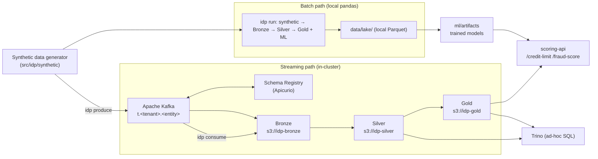
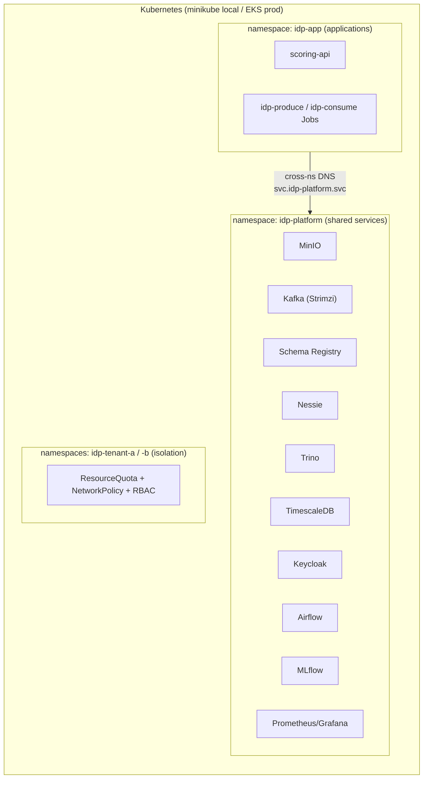

# Intelligent Data Platform

A telecom **data lakehouse** that ingests TM Forum entity/event data, curates it
through a **medallion architecture (Bronze → Silver → Gold)**, and serves two ML
use cases: **alternative credit-limit scoring** and **fraud detection**. It is
multi-tenant, GDPR-aware, batch-first, and Kubernetes-native (local **minikube**,
production **AWS EKS**).

- Full design: [`docs/architecture_and_implementation_plan.md`](docs/architecture_and_implementation_plan.md)
- Deployment details: [`deploy/README.md`](deploy/README.md) · Kafka setup: [`deploy/kafka/README.md`](deploy/kafka/README.md)

> **Prototype scope.** The pipeline *logic* (`src/idp`) is implemented in Python
> (pandas + scikit-learn) so the whole flow is unit-testable and runnable without
> a cluster. The production engines from the plan (Spark, Flink, Iceberg) are
> represented by the deployed services and the design docs; scikit-learn
> `HistGradientBoosting*` stands in for LightGBM/XGBoost.

---

## Table of Contents
1. [Introduction](#1-introduction)
   - [1.1 What this project is](#11-what-this-project-is)
   - [1.2 Platform services](#12-platform-services)
   - [1.3 Applications](#13-applications)
   - [1.4 System integration architecture](#14-system-integration-architecture)
   - [1.5 Deployment architecture](#15-deployment-architecture)
2. [Project structure](#2-project-structure)
3. [Installation & deployment](#3-installation--deployment)
   - [3.1 Batch mode](#31-batch-mode-local-vs-production)
   - [3.2 Streaming mode](#32-streaming-mode-local-vs-production)
4. [Functional implementation](#4-functional-implementation)
   - [4.1 Bronze pipeline](#41-bronze-pipeline)
   - [4.2 Silver pipeline](#42-silver-pipeline-batch-vs-stream)
   - [4.3 Gold pipeline](#43-gold-pipeline-batch-vs-stream)
   - [4.4 ML algorithms](#44-ml-algorithms)
   - [4.5 Serving layer](#45-serving-layer)

---

## 1. Introduction

### 1.1 What this project is

Telecoms hold rich behavioural data (usage, recharges, tenure) that can power
decisions traditional bureaus can't. This platform turns raw TM Forum
entity/event records into two decisioning products:

- **Alternative credit-limit** — a probability-of-default model plus affordability
  sizing, using recharge reliability, spend, and tenure as alternative-credit signals.
- **Fraud detection** — layered rules + gradient boosting + anomaly detection for
  SIM-box, recharge/card, and roaming fraud.

Data flows through a **medallion lakehouse**: **Bronze** (raw, immutable) →
**Silver** (clean, canonical, tenant-isolated, PII-tokenized) → **Gold**
(per-subscriber feature tables + ML scores). Two execution paths produce the same
layers: a **batch** path (local pandas) and a **streaming** path (Kafka → in-cluster jobs).

### 1.2 Platform services

Shared infrastructure, deployed by `make infra` (+ `make kafka`) into the
**`idp-platform`** namespace.

| Service | Purpose | Status in prototype |
|---|---|---|
| **MinIO** | S3-compatible object store; holds the lake (`idp-bronze` / `idp-silver` / `idp-gold`) | **Active** |
| **Apache Kafka** (Strimzi) | Event streaming backbone for the ingestion path | **Active** (streaming mode) |
| **Apicurio Schema Registry** | Avro schema management, Confluent-compatible API | **Active** (schemas registered) |
| **Nessie** | Git-like Iceberg catalog | Provisioned (Iceberg is the prod target; prototype writes plain Parquet) |
| **Trino** | Distributed SQL over the lake for ad-hoc queries | **Active** (query Silver/Gold) |
| **TimescaleDB** | Time-series DB for low-latency Gold serving | Provisioned (serving target) |
| **Keycloak** | OIDC identity for multi-tenant RBAC | Provisioned (RBAC design, §1.5) |
| **Apache Airflow** | Batch orchestration (schedules the medallion DAG) | Provisioned (DAG in `pipelines/airflow`) |
| **MLflow** | Experiment tracking + model registry | Provisioned (registry target) |
| **Prometheus + Grafana** | Metrics & dashboards | Provisioned (observability) |
| **Kafka UI** (Kafbat) | Web UI to manage topics/messages/schemas | Optional (`make kafka-ui`) |

> "Provisioned" = installed and part of the target architecture, but not yet
> wired into the runnable pandas prototype. This is called out honestly so you
> know what's exercised end-to-end today.

### 1.3 Applications

Workloads that use the platform, deployed into the **`idp-app`** namespace.

| Application | Purpose |
|---|---|
| **scoring-api** (FastAPI) | On-demand `/credit-limit` and `/fraud-score` endpoints; loads trained models |
| **idp-produce** (K8s Job) | Generates synthetic data and publishes it to `t.<tenant>.<entity>` Kafka topics |
| **idp-consume** (K8s Job) | Drains topics → Bronze → Silver → Gold (writes to MinIO) |
| **`idp` CLI** | `generate` · `run` (batch) · `produce` / `consume` (streaming) · `serve` |

### 1.4 System integration architecture



**Key idea:** both paths run the *same* curation and feature logic
(`curate()`, `build_*_features()`); they differ only in transport (in-process vs
Kafka) and storage (local dirs vs MinIO). ML **training** happens on the batch
path (it needs labels); the streaming path builds Gold feature tables and
**applies** already-trained models.

### 1.5 Deployment architecture



- **Namespace split** (per your recommendation): platform services in
  `idp-platform`, application workloads in `idp-app`; apps reach services via
  cross-namespace DNS (`idp-kafka-kafka-bootstrap.idp-platform.svc`).
- **Tenant isolation** (`deploy/base/`): per-tenant namespaces with
  `ResourceQuota`, `NetworkPolicy` (default-deny cross-tenant), and RBAC roles.
- **Overlays**: `deploy/overlays/local` (minikube, `imagePullPolicy: Never`) and
  `deploy/overlays/aws` (EKS, ECR image, IRSA) — same Kustomize base; Argo CD app
  in `deploy/argocd`.

---

## 2. Project structure

```
src/idp/                     # the platform package
  common/                    #   config, multi-tenancy guards, GDPR PII, S3/local storage
  synthetic/generator.py     #   synthetic data generator (labelled, multi-tenant)
  ingestion/bronze.py        #   Bronze: raw, immutable, tenant-partitioned Parquet
  curation/                  #   Silver: JSON:API unwrap (jsonapi.py) + canonical tables (silver.py)
  features/                  #   Gold features: credit_features.py, fraud_features.py, base.py
  ml/                        #   credit_model.py (PD + limit), fraud_model.py (rules+GBM+iforest)
  streaming/                 #   Kafka producer.py + consumer.py
  serving/api.py             #   FastAPI scoring service
  pipeline.py                #   batch run() + streaming process_bronze()
  cli.py                     #   `idp` entrypoint
config/                      # platform.yaml + Avro schema contracts (config/avro)
data_samples/                # reference TM Forum JSON:API documents
deploy/                      # Kustomize base + overlays, Helm values, Kafka setup, tuning scripts
  base/ overlays/ argocd/    #   namespaces, RBAC, isolation, scoring-api; local/aws overlays
  kafka/                     #   Kafka cluster, schema registry, topics, streaming Jobs, UI
  install-infra.sh           #   installs all platform services (Helm)
  *-values.yaml *-tune.sh    #   Trino/Nessie tuning + self-healing reinstalls
pipelines/airflow/dags/      # Airflow DAG for the batch pipeline
tests/                       # 63 pytest tests across every layer
docs/                        # architecture & implementation plan
Makefile                     # all workflows (run `make help`)
Dockerfile                   # scoring-api / jobs image (idp package)
```

Run `make help` to list every target with a description.
### Path B — streaming through your deployed Kafka
0. **Prereqs**: platform deployed (`make infra`), Kafka up with topics (`make kafka`).

1. **Rebuild the app image with the streaming deps** (kafka-python, s3fs) and
   load it into minikube:
   ```bash
   make image
   ```
2. **Produce + consume** (two Kubernetes Jobs in the **`idp-app`** namespace, so
   they use in-cluster DNS — external Kafka access from a Mac/minikube is
   unreliable). `make stream` runs produce, **waits for it to finish**, then
   runs consume (ordering matters):
   ```bash
   make stream
   ```
   - `idp-produce` publishes synthetic records to `t.<tenant>.<entity>` topics
     (small default volume: 150 subscribers × 14 days, via env, to fit memory).
   - `idp-consume` drains the topics → Bronze → Silver → Gold, written to MinIO.
3. **Watch / verify** (jobs are in `idp-app`):
   ```bash
   kubectl -n idp-app logs -f job/idp-produce      # per-topic message counts
   kubectl -n idp-app logs -f job/idp-consume      # bronze/silver/gold counts
   ```
   - In **Kafka UI** (`make kafka-ui`) you'll see messages in the topics.
   - Inspect the lake in MinIO (one bucket per layer):
     ```bash
     make minio-ls          # lists idp-bronze / idp-silver / idp-gold
     make minio-console     # web UI at http://localhost:9001 (minioadmin/minioadmin123)
     ```

> **Namespaces:** platform services (Kafka, MinIO, Trino, Nessie…) run in
> `idp-platform`; application workloads (scoring API, streaming jobs) run in
> `idp-app` and reach the platform via cross-namespace DNS
> (`<svc>.idp-platform.svc`).

> Tip: the default synthetic volume (~1M usage events) is a lot to stream on a
> small node. For a quicker demo, lower `synthetic.subscribers_per_tenant` and
> `synthetic.days` in `config/platform.yaml` before `make stream`.

---

## 3. Installation & deployment

**Prerequisites (local):** Python 3.10+, Docker, `minikube`, `kubectl`, `helm`,
`kustomize`. A comfortable minikube is `--cpus=8 --memory=16384` — the full stack
is heavy; under-provisioning causes pods to OOM/crashloop.

There are **two execution modes**. Batch is the simplest and always works;
streaming exercises the deployed Kafka + MinIO.

### 3.1 Batch mode (local vs production)

Batch = one process does synthetic → Bronze → Silver → Gold **and trains models**.

**Local (no cluster needed):**
```bash
make install      # create .venv, install package + dev deps
make test         # 63 tests (~30s)
make run          # full pipeline -> writes data/lake/{bronze,silver,gold}/ + ml/artifacts/
make serve        # scoring API at http://localhost:8000
```
`make run` prints out-of-sample metrics, e.g.:
```json
{ "counts": {"subscribers": 1000, "usage_events": 1000000, "recharge_events": 31000},
  "credit_metrics": {"auc": 0.72, "ks": 0.36}, "fraud_metrics": {"pr_auc": 0.68, "precision_at_20": 1.0} }
```

**Production (as an in-cluster job / Airflow):** the same `idp run` runs in a pod
using the `idp` image, writing to MinIO/S3 (set `IDP_S3_ENDPOINT`, creds). In the
target architecture this is a Spark job scheduled by the Airflow DAG in
`pipelines/airflow/dags/idp_batch_dag.py`, writing Iceberg tables via Nessie.

### 3.2 Streaming mode (local vs production)

Streaming = synthetic data flows through **Kafka** into the lake on **MinIO**.

**Local (minikube) — one-time platform bring-up:**
```bash
make mk-up                              # start minikube (ingress, metrics-server, storage)
make image                              # build the idp/scoring-api:dev image into minikube
kubectl apply -k deploy/overlays/local  # namespaces (idp-platform, idp-app, tenants), RBAC, scoring-api
make infra                              # install platform services (MinIO, Kafka operator, Trino, ...)
make nessie-fix                         # ensure Nessie is healthy (in-memory store)
make kafka                              # Kafka cluster + Schema Registry + topics + Avro schemas
```
Health checks & fixes if a component is unhappy:
`make strimzi-fix` · `make trino-fix` · `make nessie-fix` (see [`deploy/README.md`](deploy/README.md)).

**Run the streaming pipeline:**
```bash
make stream        # idp-produce (waits for completion) then idp-consume, in idp-app
```
- `idp-produce` publishes synthetic records to `t.<tenant>.<entity>` topics
  (small demo volume via `IDP_SUBSCRIBERS`/`IDP_DAYS`).
- `idp-consume` drains topics → Bronze → Silver → Gold on MinIO.

**Verify:**
```bash
kubectl -n idp-app logs -f job/idp-produce      # per-topic message counts
kubectl -n idp-app logs -f job/idp-consume      # bronze/silver/gold counts
make kafka-ui                                   # browse topics/messages/schemas
make minio-ls                                   # objects in idp-bronze / idp-silver / idp-gold
make minio-reset                                # empty the lake buckets for a clean re-run
```

**Production (AWS EKS):** deploy with `deploy/overlays/aws` (ECR image, IRSA, S3
buckets, External Secrets) via Argo CD (`deploy/argocd/application.yaml`). The
streaming Jobs become long-running Flink/Kafka-Connect consumers writing Iceberg;
the batch DAG runs on Airflow. See the plan §2B.

---

## 4. Functional implementation

Entry points: batch = `pipeline.run()`; streaming = `pipeline.process_bronze()`
(called by `idp consume`). Both reuse the same curation/feature code.

### 4.1 Bronze pipeline

**Purpose:** capture raw records immutably, tenant-partitioned.

- **Streaming** (`streaming/consumer.py` → `ingestion`/`storage`): `consume_to_bronze()`
  subscribes to all `t.<tenant>.<entity>` topics, deserializes JSON, groups messages
  back into per-entity frames, and writes Parquet to `s3://idp-bronze/<entity>/`
  partitioned by `tenant_id`.
- **Batch** (`ingestion/bronze.py`): `ingest()` persists the generated frames to
  `data/lake/bronze/<entity>/` partitioned by `tenant_id`.
- Every record is **tenant-stamped** at ingestion (`common/tenancy.py`), the leading
  partition column that guarantees physical isolation.

### 4.2 Silver pipeline (batch vs stream)

**Purpose:** turn raw per-entity records into clean, canonical, joinable,
PII-safe tables. Implemented once in `curation/silver.py:curate()` and used by
**both** paths — batch and stream produce identical Silver.

**Transformations:**
- **JSON:API unwrap** (`curation/jsonapi.py`): flatten `data.attributes`, strip
  `UUID(...)` wrappers, normalize money.
- **Money normalization:** `gross_amount = net_amount + tax_amount`.
- **GDPR PII tokenization** (`common/pii.py`): MSISDN/IMSI/IMEI/other-party →
  `tok_<sha256(per-tenant-salt + value)>`. Deterministic per tenant, so tokens
  join across tables while raw identifiers never land in Silver.
- **Dedup** on natural keys; timestamps normalized to UTC.

**Silver tables (the "Data"):**

| Table | Grain | Built by | Notable columns |
|---|---|---|---|
| `dim_subscriber` | 1 row / MSISDN | `build_subscriber_dim` | account_type, segment, tenure_days, num_products, has_device_agreement, consent flags |
| `fact_usage` | 1 row / usage event | `build_fact_usage` | event_type, started_at, gross_amount, qty, is_roaming, traffic_case, other_party_number |
| `fact_recharge` | 1 row / recharge | `build_fact_recharge` | created_at, amount, payment_method, status, failure_reason_code |

Output: batch → `data/lake/silver/`; stream → `s3://idp-silver/`, both partitioned by `tenant_id`.
Production target: Iceberg tables (ACID/upsert/schema-evolution) via Nessie + Spark/Flink.

### 4.3 Gold pipeline (batch vs stream)

**Purpose:** analytics-ready, per-subscriber tables for ML and serving.

- **Batch** (`pipeline.run`): builds feature tables **and trains + scores** models,
  writing `credit_scores` / `fraud_scores` to `data/lake/gold/`.
- **Stream** (`pipeline.process_bronze`): builds the **feature tables** and, if
  trained models exist in `ml/artifacts`, appends scores — but does **not train**
  (Kafka carries no labels). Writes to `s3://idp-gold/`.

**Features** (`features/`, aggregated per `(tenant_id, service_id)` over 7/30/90-day
windows in `features/base.py`):

| Feature set | Signals |
|---|---|
| **Credit** (`credit_features.py`) | recharge success rate, avg/total/max recharge, windowed recharge totals, `days_since_last_recharge`, `share_credit_card`, ARPU, `spend_to_recharge_ratio`, tenure, products |
| **Fraud** (`fraud_features.py`) | `calls_per_active_day`, `originating_ratio` (SIM-box), `unique_called_numbers`, `roaming_share`, `failed_recharge_count`, per-tenant `recharge_amount_zscore` |

The join that makes this work: the tokenized `service_id` is identical in
`dim_subscriber` and the facts (same tenant salt), so facts aggregate back onto
the dimension without exposing the raw MSISDN.

### 4.4 ML algorithms

**Credit-limit** (`ml/credit_model.py`) — two-stage:
1. **PD model**: gradient-boosted classifier (`HistGradientBoostingClassifier`,
   a drop-in for LightGBM/XGBoost) predicting probability of default; a logistic
   scorecard is trained alongside as an interpretable baseline.
2. **Limit sizing**: `recommended_limit = affordability(recharge, tenure) × (1 − PD)`,
   clipped to policy bands. Metrics: AUC, KS, Gini (out-of-sample holdout).

**Fraud** (`ml/fraud_model.py`) — layered hybrid, fused into one score:
- **Rules** (`rule_flags`): SIM-box / recharge-burst / roaming thresholds (zero training).
- **Supervised**: gradient-boosted classifier with balanced weights, optimized for PR-AUC.
- **Anomaly**: `IsolationForest` for novel/unlabelled fraud.
- Fusion: `0.6·proba + 0.2·anomaly + 0.2·rules`. Metrics: PR-AUC, precision@k.

Models are persisted with joblib to `ml/artifacts/` (MLflow registry is the prod target).

### 4.5 Serving layer

`serving/api.py` — a **FastAPI** service (`scoring-api`, namespace `idp-app`):

| Endpoint | Returns |
|---|---|
| `GET /health` | liveness |
| `POST /credit-limit` | `{pd, affordability_base, recommended_limit}` for a subscriber's features |
| `POST /fraud-score` | `{fraud_proba, anomaly_score, rule_score, fraud_score}` |

Every request carries a `tenant_id` (from the validated OIDC token in production,
via Keycloak) and is served only within that tenant's scope — tenant isolation at
the edge. Models are loaded lazily from the artifact store; endpoints return `503`
until models are trained.

Run locally: `make serve` then:
```bash
curl -s localhost:8000/health
curl -s -X POST localhost:8000/credit-limit -H 'content-type: application/json' \
  -d '{"tenant_id":"tenant_a","service_id":"tok_demo","features":{"recharge_avg_amount":40,"account_tenure_days":500,"recharge_success_rate":0.95}}'
```

---

## Testing

```bash
make test        # 63 pytest tests
```
Covers synthetic generation & referential integrity, tenant isolation, GDPR
tokenization, JSON:API unwrap (against the real `data_samples/`), ingestion,
Silver curation, feature engineering, both ML models, the streaming
`process_bronze`, the end-to-end batch pipeline, and the scoring API.

## Further reading
- [`docs/architecture_and_implementation_plan.md`](docs/architecture_and_implementation_plan.md) — full architecture, ML design, phased plan
- [`deploy/README.md`](deploy/README.md) — deployment, overlays, troubleshooting
- [`deploy/kafka/README.md`](deploy/kafka/README.md) — Kafka cluster, topics, schema registration
