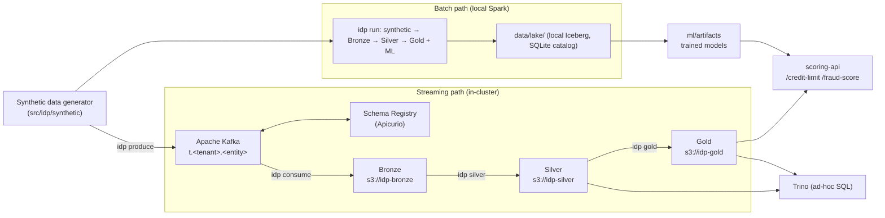
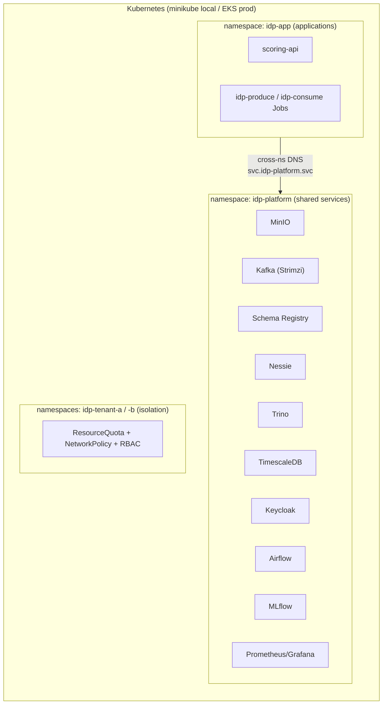

# Intelligent Data Platform

A telecom **data lakehouse** that ingests TM Forum entity/event data, curates it
through a **medallion architecture (Bronze → Silver → Gold)**, and serves two ML
use cases: **alternative credit-limit scoring** and **fraud detection**. It is
multi-tenant, GDPR-aware, batch-first, and Kubernetes-native (local **minikube**,
production **AWS EKS**).

- Full design: [`docs/architecture_and_implementation_plan.md`](docs/architecture_and_implementation_plan.md)
- Deployment details: [`deploy/README.md`](deploy/README.md) · Kafka setup: [`deploy/platform/kafka/README.md`](deploy/platform/kafka/README.md)

> **Engines.** Silver and Gold run on **Apache Spark**, with one implementation
> (`src/idp/transforms`) used by the CLI, the cluster, Airflow and the tests.
> Locally and in CI it runs as `local[*]`. In the cluster, Silver, Gold, Score,
> publish and maintenance run as **Spark Operator SparkApplications**: a driver plus
> executors, sized per stage in `spark.profiles` (ADR-0027, ADR-0029).
> scikit-learn fits the models on a bounded, stratified sample, and pandas scores
> one Spark partition at a time; no process holds a whole table.
> scikit-learn `HistGradientBoosting*` stands in for LightGBM/XGBoost. The lake is **Apache Iceberg** in a JDBC catalog: the
> platform Postgres in the cluster, a local SQLite file in dev/CI (ADR-0028). Flink is
> represented by the deployed services and the design docs.

---

## Table of Contents
1. [Introduction](#1-introduction)
   - [1.1 What this project is](#11-what-this-project-is)
   - [1.2 Platform services](#12-platform-services)
   - [1.3 Applications](#13-applications)
   - [1.4 System integration architecture](#14-system-integration-architecture)
   - [1.5 Deployment architecture](#15-deployment-architecture)
2. [Project structure](#2-project-structure)
3. [Installation & deployment](#3-installation--deployment)
   - [3.1 Batch mode](#31-batch-mode-local-vs-production)
   - [3.2 Streaming mode](#32-streaming-mode-local-vs-production)
4. [Functional implementation](#4-functional-implementation)
   - [4.1 Bronze pipeline](#41-bronze-pipeline)
   - [4.2 Silver pipeline](#42-silver-pipeline-batch-vs-stream)
   - [4.3 Gold pipeline](#43-gold-pipeline-batch-vs-stream)
   - [4.4 ML algorithms](#44-ml-algorithms)
   - [4.5 Serving layer](#45-serving-layer)
   - [4.6 MCP analytics server](#46-mcp-analytics-server)

---

## 1. Introduction

### 1.1 What this project is

Telecoms hold rich behavioural data (usage, recharges, tenure) that can power
decisions traditional bureaus can't. This platform turns raw TM Forum
entity/event records into two decisioning products:

- **Alternative credit-limit** — a probability-of-default model plus affordability
  sizing, using recharge reliability, spend, and tenure as alternative-credit signals.
- **Fraud detection** — layered rules + gradient boosting + anomaly detection for
  SIM-box, recharge/card, and roaming fraud.

Data flows through a **medallion lakehouse**: **Bronze** (raw, immutable) →
**Silver** (clean, canonical, tenant-isolated, PII-tokenized) → **Gold**
(per-subscriber feature tables + ML scores). Two execution paths produce the same
layers with the same code: a **batch** path (local, Spark `local[*]`) and a
**streaming** path (Kafka → in-cluster jobs).

### 1.2 Platform services

Shared infrastructure, deployed by `make platform-services` (+ `make kafka`) into the
**`idp-platform`** namespace.

| Service | Purpose | Status in prototype |
|---|---|---|
| **MinIO** | S3-compatible object store; holds the lake (`idp-bronze` / `idp-silver` / `idp-gold`) | **Active** |
| **Apache Kafka** (Strimzi) | Event streaming backbone for the ingestion path | **Active** (streaming mode) |
| **Apicurio Schema Registry** | Avro schema management, Confluent-compatible API | **Active** (schemas registered) |
| **Nessie** | Git-like Iceberg catalog | Provisioned (not the lake's catalog: its REST catalog keeps only the current snapshot; ADR-0028) |
| **Trino** | Distributed SQL over the lake for ad-hoc queries | **Active** (query Silver/Gold) |
| **TimescaleDB** | Low-latency **Gold serving** store (indexed by `service_id`) | **Active** (`idp publish` mirrors Gold here) |
| **Keycloak** | OIDC identity for multi-tenant RBAC | Provisioned (RBAC design, §1.5) |
| **Apache Airflow** | Batch orchestration (schedules the medallion DAG) | Provisioned (DAG in `pipelines/airflow`) |
| **MLflow** | Experiment tracking + model registry | Provisioned (registry target) |
| **Prometheus + Grafana** | Metrics & dashboards; node-exporter + kube-state-metrics; K8s cluster + Kafka produce/consume dashboards | **Active** (`make monitoring` + `make grafana-ui`) |
| **Kafka UI** (Kafbat) | Web UI to manage topics/messages/schemas | Optional (`make kafka-ui`) |

> "Provisioned" = installed and part of the target architecture, but not yet
> wired into the runnable prototype. This is called out honestly so you
> know what's exercised end-to-end today.

### 1.3 Applications

Workloads that use the platform, deployed into the **`idp-app`** namespace.

| Application | Purpose |
|---|---|
| **scoring-api** (FastAPI) | On-demand `/credit-limit` and `/fraud-score` endpoints; loads trained models |
| **idp-produce** (K8s Job) | Publishes synthetic data to `t.<tenant>.<entity>` Kafka topics |
| **idp-consume** (K8s Job) | **Bronze stage**: drains topics → Bronze (S3). Does not chain into Silver/Gold |
| **idp-silver** (K8s Job) | **Silver stage**: Bronze (S3) → canonical Silver (S3) |
| **idp-gold** (K8s Job) | **Gold stage**: Silver (S3) → feature tables (+scores) (S3) |
| **`idp` CLI** | `produce` · `consume` · `silver` · `gold` · `train` · `run` (local compose) · `serve` |

### 1.4 System integration architecture



**Key idea:** both paths run the *same* curation and feature logic
(`curate()`, `build_*_features()`); they differ only in transport (in-process vs
Kafka) and storage (local dirs vs MinIO). ML **training** happens on the batch
path (it needs labels); the streaming path builds Gold feature tables and
**applies** already-trained models.

### 1.5 Deployment architecture



- **Namespace split** (per your recommendation): platform services in
  `idp-platform`, application workloads in `idp-app`; apps reach services via
  cross-namespace DNS (`idp-kafka-kafka-bootstrap.idp-platform.svc`).
- **Tenant isolation** (`deploy/platform/base/`): per-tenant namespaces with
  `ResourceQuota`, `NetworkPolicy` (default-deny cross-tenant), and RBAC roles.
- **Overlays, split by team**: platform base in `deploy/platform/overlays/{local,aws}`
  (namespaces/RBAC/isolation); the scoring-api app in `deploy/app/overlays/{local,aws}`
  (`imagePullPolicy: Never` dev image locally; ECR image + IRSA on EKS). Two Argo CD
  apps in `deploy/platform/argocd` sync the platform base then the app.

---

## 2. Project structure

```
src/idp/                     # the platform package
  common/                    #   config, multi-tenancy guards, GDPR PII, S3/local storage,
                             #   model feature contract (feature_contract.py)
  synthetic/generator.py     #   synthetic data generator (labelled, multi-tenant)
  ingestion/                 #   source side: file landing zone for `idp generate` (landing.py);
                             #   TM Forum JSON:API source adapter (jsonapi.py). Bronze itself
                             #   is written by pipeline.to_bronze (Iceberg), not here
  transforms/                #   Spark Silver/Gold (single engine): silver.py, features.py,
                             #   tokens.py, session.py, lake.py (Iceberg writes),
                             #   incremental.py (incremental Silver facts)
  ml/                        #   credit_model.py (PD + limit), fraud_model.py (rules+GBM+iforest)
  streaming/                 #   Kafka producer.py + consumer.py
  serving/api.py             #   FastAPI scoring service
  mcp/                       #   MCP analytics server + tools
  pipeline.py                #   stage functions (to_silver/to_gold/to_scores/train/...) + local run()
  cli.py                     #   `idp` entrypoint
config/                      # platform.yaml + Avro schema contracts (config/avro)
data_samples/                # reference TM Forum JSON:API documents
deploy/                      # split by owning team (ADR-0018)
  platform/                  #   PLATFORM TEAM — shared infrastructure
    base/ overlays/ argocd/  #     namespaces, RBAC, isolation; base local/aws overlays; GitOps
    kafka/                   #     Kafka cluster, schema registry, topics, admin UI
    keycloak/ timescaledb/   #     per-service manifests
    trino/ nessie/ airflow/  #     per-service Helm values / DAG image
    monitoring/              #     Prometheus/Grafana values, dashboards, Kafka PodMonitor
    install-infra.sh *-tune.sh #   install all services (Helm) + self-healing reinstalls
  app/                       #   APPLICATION TEAM — workloads on the platform
    deployment/              #     scoring-api base (Deployment/Service)
    overlays/local|aws/      #     env patches for scoring-api (dev image / ECR+IRSA)
    jobs/                    #     produce/consume/silver/gold/score/labels/train/publish Jobs
pipelines/airflow/dags/      # Airflow DAG for the batch pipeline
tests/                       # 63 pytest tests across every layer
docs/                        # architecture & implementation plan
Makefile                     # all workflows (run `make help`)
Dockerfile                   # scoring-api / jobs image (idp package)
```

Run `make help` to list every target with a description.
### Path B — streaming through your deployed Kafka
0. **Prereqs**: platform deployed (`make platform-services`), Kafka up with topics (`make kafka`).

1. **Rebuild the app image with the streaming deps** (kafka-python, s3fs) and
   load it into minikube:
   ```bash
   make image
   ```
2. **Produce + consume** (two Kubernetes Jobs in the **`idp-app`** namespace, so
   they use in-cluster DNS — external Kafka access from a Mac/minikube is
   unreliable). `make stream` runs produce, **waits for it to finish**, then
   runs consume (ordering matters):
   ```bash
   make stream
   ```
   - `idp-produce` publishes synthetic records to `t.<tenant>.<entity>` topics
     (small default volume: 150 subscribers × 14 days, via env, to fit memory).
   - `idp-consume` drains the topics into the Iceberg Bronze tables on MinIO
     (Bronze only; Silver and Gold are separate stages).

   **Or stream through the landing zone** (source files → landing → Kafka → Bronze,
   the path the architecture plan describes for NiFi):
   ```bash
   make stream-from-landing   # generate -> s3://idp-landing -> produce --from-landing -> consume
   ```
   - `idp-generate` writes the synthetic source files to
     `s3://idp-landing/tenant=<id>/<entity>.json`, one tenant at a time.
   - `idp-produce-from-landing` checks every file's tenant and publishes it. A file
     whose folder names an unknown tenant, or whose records belong to another
     tenant, is **not published**; the Job fails and consume doesn't run.
   - `idp-consume` lands the records in Bronze, exactly as with `make stream`.
   - `make stream-replay` re-publishes the landing files already there, without
     regenerating them (replay). `make generate-job` writes them only.
   - Inspect the source files: `make minio-ls` (the `idp-landing` bucket). Locally,
     `idp generate` writes them to `data/landing/`, and
     `idp produce --from-landing` publishes them.
   - Run one streaming target at a time. They share the topics and the consumer.
3. **Watch / verify** (jobs are in `idp-app`):
   ```bash
   kubectl -n idp-app logs -f job/idp-produce      # per-topic message counts
   kubectl -n idp-app logs -f job/idp-consume      # bronze/silver/gold counts
   ```
   - In **Kafka UI** (`make kafka-ui`) you'll see messages in the topics.
   - Inspect the lake in MinIO (one bucket per layer):
     ```bash
     make minio-ls          # lists idp-landing / idp-bronze / idp-silver / idp-gold
     make minio-console     # web UI at http://localhost:9001 (minioadmin/minioadmin123)
     ```

> **Namespaces:** platform services (Kafka, MinIO, Trino, Nessie…) run in
> `idp-platform`; application workloads (scoring API, streaming jobs) run in
> `idp-app` and reach the platform via cross-namespace DNS
> (`<svc>.idp-platform.svc`).

> Tip: the default synthetic volume (~1M usage events) is a lot to stream on a
> small node. For a quicker demo, lower `synthetic.subscribers_per_tenant` and
> `synthetic.days` in `config/platform.yaml` before `make stream`.

---

## 3. Installation & deployment

**Prerequisites (local):** Python 3.10+, a **JDK 11 or 17** (Silver/Gold run on
Spark; e.g. Temurin 17 with `JAVA_HOME` set — `make install` checks for it),
Docker, `minikube`, `kubectl`, `helm`, `kustomize`. A comfortable minikube is `--cpus=8 --memory=16384` — the full stack
is heavy; under-provisioning causes pods to OOM/crashloop.

There are **two execution modes**. Batch is the simplest and always works;
streaming exercises the deployed Kafka + MinIO.

### 3.1 Batch mode (local vs production)

Batch = one process does synthetic → Bronze → Silver → Gold **and trains models**.

**Local (no cluster needed):**
```bash
make install      # create .venv, install package + dev deps
make test         # 63 tests (~30s)
make run          # full pipeline -> writes data/lake/{bronze,silver,gold}/ + ml/artifacts/
make serve        # scoring API at http://localhost:8000
```
`make run` prints out-of-sample metrics, e.g.:
```json
{ "counts": {"subscribers": 1000, "usage_events": 1000000, "recharge_events": 31000},
  "credit_metrics": {"auc": 0.72, "ks": 0.36}, "fraud_metrics": {"pr_auc": 0.68, "precision_at_20": 1.0} }
```

**Production:** the medallion is run as **separate stages** (not one monolith) —
Silver/Gold orchestrated by Airflow (`pipelines/airflow/dags/idp_medallion_dag.py`)
and Spark, reading and writing Iceberg tables in the lake's JDBC catalog. `idp run`
(below) is for local dev/testing and offline model training, not production ELT.

> **Is batch mode obsolete?** No — its role changes. The *medallion transforms*
> are now the standalone stages (`idp silver`, `idp gold`) used by both on-demand
> and orchestrated runs, so there is **no duplicated logic**. `idp run` remains
> useful as (a) the **local dev/test harness** (runs the whole flow with no
> cluster) and (b) the **training path** — training needs ground-truth labels
> that never enter the lake, so it stays a distinct concern (`idp train`). `run`
> simply *composes* `to_bronze → to_silver → train → to_gold` locally.

### 3.2 Streaming mode (local vs production)

Streaming = synthetic data flows through **Kafka** into the lake on **MinIO**.

**Local (minikube) — one-time platform bring-up:**
```bash
make mk-up                              # start minikube (ingress, metrics-server, storage)
make image                              # build the idp/scoring-api:dev image into minikube
make platform-base                      # namespaces (idp-platform, idp-app, tenants), RBAC, isolation
make platform-services                  # install platform services (MinIO, Kafka operator, Trino, ...)
make app-deploy                         # deploy/redeploy scoring-api into idp-app (rolls pods to the new image)
make lake-catalog                       # the lake's Iceberg catalog database (`iceberg` in TimescaleDB)
make kafka                              # Kafka cluster + Schema Registry + topics + Avro schemas
```
Health checks & fixes if a component is unhappy:
`make strimzi-fix` · `make trino-fix` · `make nessie-fix` (see [`deploy/README.md`](deploy/README.md)).

**Run the medallion stages — each is a separate job (separation of concerns):**
```bash
make stream        # 1) produce -> Kafka, then consume -> BRONZE (S3). Bronze only.
                   #    (or: make stream-from-landing — via the s3://idp-landing source files)
make silver        # 2) Silver stage: Bronze (S3) -> canonical Silver (S3)
make labels        # 3) Seed the labels/outcomes store -> s3://idp-ml/labels (training input)
make gold          # 4) Gold stage:  Silver (S3) -> feature tables ONLY (S3)
make train         # 5) Train stage: Gold features + labels -> models (s3://idp-ml)
make score         # 6) Score stage: Gold features + models -> credit/fraud SCORES (S3)
make publish       # 7) Serving stage: Gold (S3) -> TimescaleDB (indexed by service_id)
```
> **Training vs scoring are separate** (phase-13). `train` (fit) learns from
> **historical Gold features + the labels store** — no synthetic regeneration — and
> writes a model to the shared MinIO model store (`s3://idp-ml`). `score`
> (inference) applies that model to the latest Gold features to produce
> `credit_scores`/`fraud_scores`. Skip `score` (or `train`) and Gold/TimescaleDB
> hold **features only** — which is why a `gold.credit_features`-only TimescaleDB
> means scoring hasn't run. In Airflow this is **three dataset-driven DAGs**:
> `idp_features` (`silver → gold`), `idp_training` (`labels → train`), and
> `idp_inference` (`score → publish`) — the last is scheduled on the *gold-features*
> **or** *model* dataset, so it re-runs automatically when either refreshes (a new
> model auto-re-scores; no manual second pass). `make airflow-trigger` unpauses all
> three and kicks features + training.
- `idp-produce` publishes synthetic records to `t.<tenant>.<entity>` topics
  (small demo volume via `IDP_SUBSCRIBERS`/`IDP_DAYS`).
- `idp-consume` drains topics and writes **only Bronze**.
- `idp-silver` (`deploy/app/jobs/silver-job.yaml`) reads Bronze → writes Silver.
- `idp-gold` (`deploy/app/jobs/gold-job.yaml`) reads Silver → writes Gold.
- Models: run `idp train` (offline) to populate `ml/artifacts`; then Gold also
  emits `credit_scores` / `fraud_scores`. Without models, Gold = feature tables only.

**Verify:**
```bash
kubectl -n idp-app logs job/idp-produce         # per-topic message counts
kubectl -n idp-app logs job/idp-consume         # bronze counts
kubectl -n idp-app logs job/idp-silver          # silver counts
kubectl -n idp-app logs job/idp-gold            # gold tables
make kafka-ui                                   # browse topics/messages/schemas
make minio-ls                                   # objects in idp-bronze / idp-silver / idp-gold
make minio-reset                                # clean re-run: recreate the buckets AND clear the Iceberg catalog
```

**Production (orchestrated Silver/Gold):**
- **Airflow** — three dataset-driven DAGs (`idp_features`: `silver >> gold`;
  `idp_inference`: `score >> publish`; `idp_training`: `labels >> train`) plus the
  daily `idp_maintenance` DAG (`idp maintain`: compaction, snapshot expiry, orphan
  cleanup; it triggers nothing). **Airflow is the orchestrator, and every stage
  runs the `idp` image.**
  - The Spark stages (silver, gold, score, publish, maintain) are submitted as
    SparkApplications (`SparkKubernetesOperator`) and fail if the application
    fails.
  - labels and train run as pods (`KubernetesPodOperator`).
  - The code is the same as `idp silver` / `idp gold` / …; there is no engine
    switch (ADR-0027).
  - `publish` (Gold→TimescaleDB) stays a **separate** task.
  Wire + trigger:
  ```bash
  make airflow-wire       # build DAG image into minikube + install Airflow + RBAC
  make airflow-trigger    # or: make airflow-ui  then Trigger in the UI
  ```
  `airflow-wire` (see [`deploy/platform/airflow/`](deploy/platform/airflow)):
  - **Bakes the DAGs into a local image** (`deploy/platform/airflow/Dockerfile`, built into
    minikube) instead of git-sync — the repo is private, so git-sync-init can't
    clone it without credentials and crashloops with an auth error.
  - Pins the chart to `1.15.0` (Airflow 2.9.3 — so the UI service is
    `airflow-webserver`; Airflow 3.x charts rename it to `airflow-api-server`).
  - Reuses the in-cluster **TimescaleDB** as Airflow's metadata store (a dedicated
    `airflow` database it creates on first run), disabling the chart's bundled
    PostgreSQL/Redis — the retired Bitnami images no longer pull, which otherwise
    leaves `run-airflow-migrations` hanging and the init containers in
    `CrashLoopBackOff`.
- **Spark in the cluster (ADR-0029).** `make silver|gold|score|publish|maintain`
  each render the stage's SparkApplication from its profile
  (`idp spark-manifest <stage>`), apply it, and wait for `COMPLETED` or `FAILED`.
  - **Entrypoints:** `pipelines/spark/<stage>_job.py`, thin wrappers over the same
    `idp` stages.
  - **Scaling:** raise `spark.profiles.<stage>.executor.instances` (or memory),
    then run `make mk-check` and `make spark-manifests`. There's no code change.
  - **Distributed stages:** scoring runs per partition with the models broadcast,
    and publish loads staging tables over JDBC and swaps them in atomically.
  - **Training** fits on at most `ml.train_max_rows` rows, sampled per
    (tenant, label).
- **Upgrading from the engine switch:** remove the old Airflow Variables and script
  ConfigMaps once (`airflow variables delete idp_silver_engine` / `idp_gold_engine`
  in the scheduler; `kubectl -n idp-app delete configmap idp-silver-spark
  idp-gold-spark`) — see [`deploy/README.md`](deploy/README.md).
- **Full step-by-step (both):** [`docs/triggering.md`](docs/triggering.md).
- EKS: `deploy/platform/overlays/aws` (ECR, IRSA, S3, External Secrets) via Argo CD; the
  stages use the same Iceberg JDBC catalog (on RDS Postgres). See plan §2B.

---

## 4. Functional implementation

**Separation of concerns.** Each medallion stage is an independent function in
`pipeline.py` that reads its input layer and writes its output layer, exposed as a
distinct CLI command / job:

| Stage | Function | CLI / Job | Reads | Writes |
|---|---|---|---|---|
| Bronze | `to_bronze` | `idp consume` | Kafka | `s3://idp-bronze` |
| Silver | `to_silver` | `idp silver [--full-refresh]` | new Bronze snapshots | `s3://idp-silver` |
| Gold | `to_gold` | `idp gold` | `s3://idp-silver` | `s3://idp-gold` |
| Serving | `publish_serving` | `idp publish` | `s3://idp-gold` | **TimescaleDB** (`gold.*` tables) |
| ML train | `train` | `idp train` | labelled data | `ml/artifacts` (MLflow target) |

`idp run` is the **local dev orchestrator** — it composes the same stage functions
end-to-end against local storage (see the note at the end of §4).

### 4.1 Bronze pipeline

**Purpose:** capture raw records immutably, tenant-partitioned. **Bronze is the
only thing the consumer does** — it does not chain into Silver/Gold.

- `streaming/consumer.py:consume_to_bronze()` subscribes to all
  `t.<tenant>.<entity>` topics, deserializes JSON, and **returns** per-entity
  frames (read-only — no writes here).
- `idp consume` (`cli.py`) then calls `pipeline.to_bronze()`, which appends each
  entity to the Iceberg table `bronze.<entity>` as one snapshot. The table is
  partitioned by `(tenant_id, ingest_date)`, and every record carries
  `_ingested_at`. Kafka offsets are committed only after the append, so a crash
  replays and never loses records. That's the end of the Bronze job.
- Every record is **tenant-stamped** at ingestion (`common/tenancy.py`), the
  leading partition column that guarantees physical isolation.

#### The `idp-bronze` bucket: what's in it

`idp-bronze` is the **Bronze layer's bucket**. It holds the raw, append-only
record of everything ingested, as Iceberg tables. (Source files waiting to be
published live in `idp-landing`; Silver and Gold have their own buckets,
ADR-0008.) Every entity is one Iceberg table, `bronze.<entity>`, stored under
`tables/<entity>/`. Here is `accounts` after its first landing:

```
idp-bronze/tables/accounts/
├── data/                                         <- the records (Parquet)
│   ├── tenant_id=tenant_a/ingest_date=2026-09-28/00000-1-02df54c1-….parquet
│   └── tenant_id=tenant_b/ingest_date=2026-09-28/00000-0-02df54c1-….parquet
└── metadata/                                     <- how to read them (Iceberg)
    ├── 00000-8737….metadata.json                 table created (schema, location)
    ├── 00001-9a9e….metadata.json                 partition spec added (tenant_id, ingest_date)
    ├── 00002-0f16….metadata.json                 first append committed = CURRENT version
    ├── snap-6417943028689728948-0-02df54c1-….avro   manifest list of snapshot 6417…
    └── 02df54c1-…-m0.avro                        manifest: the data files that snapshot added
```

| Path | What it is |
|---|---|
| `data/tenant_id=<t>/ingest_date=<d>/` | **Partitions.** `tenant_id` comes first, so each tenant's records sit in their own files (physical tenant isolation, REQ-FND-02). `ingest_date` is the UTC day the batch landed. Readers filter on both without opening other tenants' or other days' files. |
| `00000-<n>-<write-uuid>.parquet` | **Data files.** One file per partition per commit. `<n>` is the number of the write task that produced it (here `1` and `0`, one per tenant partition), and `<write-uuid>` ties the file to the commit that wrote it (the same uuid as that commit's manifest and manifest list). The columns are the landed record, plus `_ingested_at` (the UTC landing time) and `ingest_date`. |
| `NNNNN-<uuid>.metadata.json` | **Table metadata versions.** Each commit writes a new version with the schema, the partition spec, the table properties and the snapshot history. The first landing makes three versions: create the table (`00000`), add the partition spec (`00001`), and append (`00002`). Later appends add one each. |
| `snap-<snapshot-id>-<attempt>-<commit-uuid>.avro` | **Manifest list.** One per snapshot (commit). It lists that snapshot's manifests. |
| `<commit-uuid>-m<k>.avro` | **Manifest.** It lists data files, with their partition values, row counts and column stats, so a query can skip files without opening them. |

**How a reader finds the data.** The Iceberg catalog (the `iceberg` database on
TimescaleDB; locally `data/lake/catalog.db`) records only one thing per table: the
path of its *current* `metadata.json` (here `00002-…`). A reader follows it:
current metadata → current snapshot → manifest list → manifests → the Parquet
files. Nothing lists the directories. So:
- **A commit is atomic.** New files are invisible until the catalog pointer moves
  to the new `metadata.json`. A reader sees the table before or after an append,
  never half of it.
- **Old files stay until maintenance.** Every append adds files and a snapshot;
  nothing is rewritten. `idp maintain` compacts small files and expires old
  snapshots. Bronze records themselves are never deleted, and old objects can be
  moved to a colder storage class (`make lake-archive-policy`).
- **Bucket and catalog must match.** If the bucket is emptied but the catalog
  isn't, the catalog points at deleted `metadata.json` files, and every stage fails
  with `FileNotFoundError`. `make minio-reset` resets both together (see
  `deploy/README.md`, Troubleshooting).
- **Silver reads Bronze by snapshot.** Each `idp consume` (or `idp run` /
  `idp migrate-lake`) appends one snapshot per entity. Incremental Silver
  remembers the last Bronze snapshot it processed (its streaming checkpoint in
  `idp-silver/_checkpoints/`), and next time reads only the files that later
  snapshots added.

To look inside: `make minio-ls` lists the objects. To read a table rather than its
files, use Spark or `pyiceberg`, for example
`catalog.read_table(cfg, "bronze", "accounts")` in `idp.common.catalog`.

### 4.2 Silver pipeline (batch vs stream)

**Purpose:** turn raw per-entity records into clean, canonical, joinable,
PII-safe tables. The stage is `pipeline.to_silver()`: it **reads Bronze from the
lake** (`s3a://idp-bronze`, or the local `data/lake/bronze`), applies the Spark
transforms in `transforms/silver.py:curate()`, and **writes Silver**
(`s3://idp-silver` / `data/lake/silver`). The code is identical for on-demand
(`idp silver`), orchestrated (Airflow), and local (`idp run`) — only the trigger
and the Spark master differ.

**Incremental.** The event facts (`fact_usage`, `fact_recharge`,
`fact_fee_charge`) process only the Bronze snapshots appended since the last
run. This uses Structured Streaming with `Trigger.Once` and a checkpoint per
fact/source under `<silver>/_checkpoints/`, and each batch is `MERGE`d
insert-if-absent on `(tenant_id, id)`. A failed run resumes without loss or
duplicates. `dim_subscriber` is rebuilt in full each run.
`idp silver --full-refresh` resets the checkpoints and replays all of Bronze.

**Transformations:**
- **Id canonicalization:** strip `UUID(...)` wrappers from entity and relationship
  ids so relationships join their targets. (Unwrapping whole TM Forum JSON:API
  envelopes is the ingestion adapter's job, `ingestion/jsonapi.py`; Silver curates
  canonical records.)
- **Money normalization:** `gross_amount = net_amount + tax_amount`.
- **GDPR PII tokenization** (`common/pii.py`): MSISDN/IMSI/IMEI/other-party →
  `tok_<sha256(per-tenant-salt + value)>`. Deterministic per tenant, so tokens
  join across tables while raw identifiers never land in Silver.
- **Dedup** on natural keys; timestamps normalized to UTC.

**Silver tables (the "Data"):**

| Table | Grain | Built by | Notable columns |
|---|---|---|---|
| `dim_subscriber` | 1 row / MSISDN | `build_dim_subscriber` | account_type, segment, tenure_days, num_products, has_device_agreement, consent flags |
| `fact_usage` | 1 row / usage event | `build_fact_usage` | event_type, started_at, gross_amount, qty, is_roaming, traffic_case, other_party_number |
| `fact_recharge` | 1 row / recharge | `build_fact_recharge` | created_at, amount, payment_method, status, failure_reason_code |

Output: Iceberg tables `silver.*`, locally under `data/lake/silver/tables/` and in
the cluster under `s3://idp-silver/tables/`. The facts are partitioned by
`(tenant_id, day(event time))`, and `dim_subscriber` by `tenant_id`. Each run
commits atomically, so readers never see a partial write.

#### The `idp-silver` bucket: what's in it

`idp-silver` is the **Silver layer's bucket**: the curated, canonical, PII-tokenized
tables that Gold, the ML stages and the MCP analytics read. It has two top-level
folders:

```
idp-silver/
├── tables/                          <- the four Silver Iceberg tables
│   ├── dim_subscriber/              1 row per subscriber; rebuilt in full each run
│   ├── fact_usage/                  voice + data usage events; incremental
│   ├── fact_recharge/               recharges; incremental
│   └── fact_fee_charge/             product fee charges; incremental
└── _checkpoints/                    <- how far incremental Silver has read Bronze
    ├── fact_usage/voice_events/     one checkpoint per (fact, Bronze source)
    ├── fact_usage/data_events/
    ├── fact_recharge/recharge_events/
    └── fact_fee_charge/fee_charges/
```

**`tables/<table>/`** has the same Iceberg layout as Bronze (see the `idp-bronze`
section above): `data/` holds Parquet files, and `metadata/` holds the
`metadata.json` versions, manifest lists (`snap-….avro`) and manifests
(`…-m0.avro`). What differs in Silver:

| | `dim_subscriber` | `fact_usage` / `fact_recharge` / `fact_fee_charge` |
|---|---|---|
| Partitioning | `tenant_id` | `tenant_id`, then **day** of the event time (`started_at_day`, `created_at_day`, `charged_at_day`) |
| Example path | `data/tenant_id=tenant_a/00000-13-…-00002.parquet` | `data/tenant_id=tenant_a/created_at_day=2026-01-03/00164-1054-…-00002.parquet` |
| How it's written | **Rebuilt in full** from the Bronze reference tables each run: an `overwrite` snapshot replaces the tenants' rows | **Incremental**: each run `MERGE`s only the new Bronze records, inserting a record only if its `(tenant_id, id)` isn't there yet. Each run adds an `append` snapshot, with no rewrite of existing files. |
| Why this partitioning | One small row per subscriber; per-tenant reads | The day partition lets feature windows (7/30/90 days) and the MCP time-range tools skip whole days |

- **File names.** Spark writes these files, so the names differ from Bronze's
  (which pyiceberg writes): `<spark partition>-<task>-<write id>-<n>.parquet`.
  Files from one commit share the write id.
- **The first snapshot is empty.** A table's first snapshot is an empty `append`
  (`rows +0`). The table is created from the output schema, then the first batch
  is merged in. `make lake-table-show TABLE=silver.fact_recharge` shows it.

**`_checkpoints/<fact>/<source>/`** is Spark Structured Streaming's bookkeeping for
incremental Silver. It isn't table data: it records which **Bronze** snapshots have
already been merged into that fact.

| File | Content (example from `fact_recharge/recharge_events`) |
|---|---|
| `metadata` | the stream's id |
| `sources/0/offsets/0` | where the stream **started**: the first Bronze snapshot it saw, `{"snapshot_id": 323716817858676295, "position": 0}` |
| `offsets/<n>` | the end point of batch `n`: the Spark settings, then `{"snapshot_id": 323716817858676295, "position": 2}`. That's the current snapshot of `bronze.recharge_events`; `position` 2 means both of its files have been read |
| `commits/<n>` | written only **after** batch `n`'s `MERGE` committed. An `offsets/<n>` without `commits/<n>` means the batch failed, and the next run redoes it (exactly once) |

On the next `idp silver`, each stream resumes after its last committed offset and
reads only the Bronze snapshots appended since. Other consequences:
- **Checkpoints and tables go together.** `idp silver --full-refresh` deletes the
  checkpoints and empties the facts, then replays all of Bronze. Deleting
  checkpoints by hand without emptying the facts isn't harmful, since the `MERGE`
  skips existing keys, but it makes the next run re-read all of Bronze.
- **Maintenance respects the checkpoints.** `idp maintain` never expires a Bronze
  snapshot that one of these offsets still references (REQ-ORC-06).
- **One Silver run at a time.** Only one streaming query may use a checkpoint at
  once. That's why the Airflow features DAG runs with `max_active_runs=1`, and why
  a manual `make silver` shouldn't overlap it.
- **A bucket reset loses them too.** `make minio-reset` recreates `idp-silver`,
  which removes the checkpoints, and clears the catalog. The next Silver run then
  starts from all of Bronze.

### 4.3 Gold pipeline (batch vs stream)

**Purpose:** analytics-ready, per-subscriber tables for ML and serving. The stage
is `pipeline.to_gold()`: it **reads Silver from the lake**, builds the feature
tables on Spark (`transforms/features.py`), and **writes Gold** (`s3://idp-gold` /
`data/lake/gold`). Gold is **features only**; scores are written by the separate
Score stage (`idp score`, REQ-ML-07). The same code runs for `idp gold`, the
Airflow `gold` task and `idp run`.

**Features** (`transforms/features.py`, aggregated per `(tenant_id, service_id)`
over the configured 7/30/90-day windows; the ordered model feature lists are
`idp.common.feature_contract.CREDIT_FEATURES` / `FRAUD_FEATURES`):

| Feature set | Signals |
|---|---|
| **Credit** (`build_credit_features`) | recharge success rate, avg/total/max recharge, windowed recharge totals, `days_since_last_recharge`, `share_credit_card`, ARPU, `spend_to_recharge_ratio`, tenure, products |
| **Fraud** (`build_fraud_features`) | `calls_per_active_day`, `originating_ratio` (SIM-box), `unique_called_numbers`, `roaming_share`, `failed_recharge_count`, per-tenant `recharge_amount_zscore` |

The join that makes this work: the tokenized `service_id` is identical in
`dim_subscriber` and the facts (same tenant salt), so facts aggregate back onto
the dimension without exposing the raw MSISDN.

#### The `idp-gold` bucket: what's in it

`idp-gold` is the **Gold layer's bucket**: one analytics-ready row per subscriber
(the model features), plus the history of every scoring run. The ML stages and the
serving copy in TimescaleDB are built from it. Everything is under `tables/`:

```
idp-gold/tables/
├── credit_features/     1 row per (tenant_id, service_id): credit-model features   <- idp gold
├── fraud_features/      1 row per (tenant_id, service_id): fraud-model features    <- idp gold
├── credit_scores/       credit limit + default probability, one set per scoring run <- idp score
└── fraud_scores/        fraud score + flag, one set per scoring run                <- idp score
```

Each table has the Iceberg layout described for `idp-bronze`: `data/` holds
Parquet files, and `metadata/` holds the `metadata.json` versions, manifest lists
and manifests. What differs in Gold:

| | `credit_features` / `fraud_features` | `credit_scores` / `fraud_scores` |
|---|---|---|
| Written by | `idp gold` (Spark), from Silver | `idp score` (pandas + the trained models), from the feature tables |
| Partitioning | `tenant_id` → `data/tenant_id=tenant_a/…parquet` | `tenant_id`, then **day** of `scored_at` → `data/tenant_id=tenant_a/scored_at_day=2026-09-28/…parquet` |
| How it's written | **Full recompute**, each run: the tenant partitions are overwritten atomically, so each run adds an `overwrite` snapshot | **Append**: each run adds its rows, stamped with the run's `scored_at`, as one snapshot. Old runs stay. |
| Content | the current features; no history in the table's current state | every scoring run: the history behind the MCP 7/15/30-day score distributions |
| Key | `(tenant_id, service_id)`, unique | `(tenant_id, service_id, scored_at)` |

What that looks like in practice:
- **Feature files pile up until maintenance.** Each `idp gold` writes a new file per
  tenant partition and a new `overwrite` snapshot. The previous run's files leave
  the current table, but they stay in the bucket because the older snapshot still
  references them (time travel). So `credit_features/data/tenant_id=tenant_a/` holds
  one file per run. `idp maintain` expires the old snapshots and deletes their
  files. `make lake-table-show TABLE=gold.credit_features` shows each run as an
  `overwrite` with the same 269 rows.
- **Consent is applied here.** Gold keeps only subscribers who consent to analytics
  (`consent_analytics`, REQ-FND-05). That's why Gold has fewer rows than Silver's
  `dim_subscriber` (e.g. 269 of 300), and why the scores and serving tables have
  that count too.
- **Scores need a model.** `idp score` loads the trained models from `idp-ml`
  (`make train`). Without them it writes nothing and says so, so the score tables
  are missing after a reset until `make labels` and `make train` have run.
- **Serving reads the latest run only.** `idp publish` copies the feature tables and
  each tenant's **latest** scoring run (the maximum `scored_at`) into TimescaleDB
  (`gold.*` tables, keyed by `(tenant_id, service_id)`), replacing the previous
  copy. The full score history stays in the lake, and only the MCP score tools read
  it.

What's *not* in this bucket: the trained models and the labels. They live in
`idp-ml` (`s3://idp-ml/*.joblib`, `s3://idp-ml/labels/`), deliberately outside the
lake, so that labels never leak into features or serving (REQ-ML-06).

### 4.4 ML algorithms

**Credit-limit** (`ml/credit_model.py`) — two-stage:
1. **PD model**: gradient-boosted classifier (`HistGradientBoostingClassifier`,
   a drop-in for LightGBM/XGBoost) predicting probability of default; a logistic
   scorecard is trained alongside as an interpretable baseline. Features include
   recharge, usage/spend, tenure **and product fee-charge signals** (fee total /
   recurring / overage — attributed to a subscriber via the product's agreement).
2. **Limit sizing**: `recommended_limit = affordability(recharge, tenure) × (1 − PD)`,
   clipped to policy bands. Metrics: AUC, KS, Gini (out-of-sample holdout).
3. **Adverse-action reason codes** (`reason_codes`): top features raising the PD,
   via SHAP (`TreeExplainer`) when the optional `shap` extra is installed, else the
   logistic-scorecard contributions. Returned in the `/credit-limit` response.

**Fraud** (`ml/fraud_model.py`) — layered hybrid, fused into one score:
- **Rules** (`rule_flags`): SIM-box / recharge-burst / roaming thresholds (zero training).
- **Supervised**: gradient-boosted classifier with balanced weights, optimized for PR-AUC.
- **Anomaly**: `IsolationForest` for novel/unlabelled fraud.
- Fusion: `0.6·proba + 0.2·anomaly + 0.2·rules`. Metrics: PR-AUC, precision@k.

**Training vs. inference (phase-13).** `train` (fit) is a separate offline job that
reads **historical Gold features + a labels/outcomes store** (`s3://idp-ml/labels`,
kept out of the serving path so labels never leak) and writes a model — it does
**not** regenerate synthetic data. `score` (inference) applies the model to the
latest Gold features to produce `credit_scores`/`fraud_scores`; `to_gold` builds
features only. Both the model store and labels store live under MinIO `s3://idp-ml`
(local dir otherwise) via `common/storage.py`, shared across the `train`, `score`
and `scoring-api` pods (MLflow registry is the longer-term prod target). Orchestrated
as **three dataset-driven DAGs**: `idp_features` (`silver → gold`), `idp_training`
(`labels → train`), and `idp_inference` (`score → publish`) — inference is scheduled
on the gold-features **or** model dataset, so a new model or fresh features
auto-re-scores with no manual re-run.

### 4.5 Serving layer

Two serving paths:

**1. On-demand scoring** — `serving/api.py`, a **FastAPI** service (`scoring-api`,
namespace `idp-app`) that computes a score from features using the loaded models:

| Endpoint | Returns |
|---|---|
| `GET /health` | liveness |
| `POST /credit-limit` | `{pd, affordability_base, recommended_limit}` computed from features |
| `POST /fraud-score` | `{fraud_proba, anomaly_score, rule_score, fraud_score}` |
| `GET /serving/{table}/{tenant_id}/{service_id}` | a **precomputed** Gold row from TimescaleDB |

**2. Precomputed serving (TimescaleDB)** — `pipeline.publish_serving()`
(`idp publish`, stage 4) mirrors the Gold tables into **TimescaleDB**
(`serving/timescale.py`), replacing each table and indexing it by
`(tenant_id, service_id)`. Dashboards/APIs then read a ready-made score with a
single indexed lookup instead of recomputing — the plan's Gold serving layer
(Q4/Q6). The `GET /serving/...` endpoint above reads from it.

Every request carries a `tenant_id` (from the validated OIDC token in production,
via Keycloak) and is served only within that tenant's scope — tenant isolation at
the edge. Models are loaded lazily; scoring endpoints return `503` until models
are trained, and the serving endpoint returns `503` until TimescaleDB is enabled.

Run locally: `make serve` then:
```bash
curl -s localhost:8000/health
curl -s -X POST localhost:8000/credit-limit -H 'content-type: application/json' \
  -d '{"tenant_id":"tenant_a","service_id":"tok_demo","features":{"recharge_avg_amount":40,"account_tenure_days":500,"recharge_success_rate":0.95}}'
```
Inspect the TimescaleDB serving tables: `make timescale-psql`.

### 4.6 MCP analytics server

A [Model Context Protocol](https://modelcontextprotocol.io) server exposes the
curated lake to AI agents (e.g. Claude Desktop) as **seven read-only, tenant-scoped
analytics tools** — five over the Silver tables, two over the Gold score tables.
Every tool takes a `tenant_id`, reads only that tenant's data, and returns compact
aggregated JSON — never raw PII, never cross-tenant (`src/idp/mcp/`, ADR-0021).

| Tool | Answers |
|---|---|
| `analyze_subscribers_tool` | subscription vs device counts, business-line mix, roamer/non-roamer split |
| `analyze_usage_events_tool` | event counts, revenue & duration per event type, usage over time |
| `analyze_recharges_tool` | total/avg/count top-ups, splits by recharge type / payment method / time |
| `analyze_recharge_anomalies_tool` | amount & volume spikes, subscriber-day anomalies, weekly/monthly views |
| `analyze_fee_charges_tool` | product fee revenue, revenue distribution, charge-type & product/category/month/quarter breakdowns |
| `analyze_fraud_score_tool` | fraud probability, rule-score & fused fraud-score distributions over the last 7/15/30 days |
| `analyze_credit_score_tool` | probability-of-default, affordability, recommended-limit & affordability-vs-limit gap distributions over 7/15/30 days |

> The two score tools read the Gold `fraud_scores` / `credit_scores` tables written
> by `idp score`. Meaningful 7/15/30-day windows need accumulated timestamped score
> history (multiple `idp score` runs); with a single snapshot every window shows the
> same distribution and the result says so.

**Prerequisites.** The `mcp` package (installed by `make install`) and **Silver
data in the lake** the server reads. The lake is chosen by config: a local
directory (`data/lake/silver`) by default, or MinIO/S3 when `IDP_S3_ENDPOINT` is
set. Populate the local lake with `make run` (or, in-cluster, `make silver`).

**Step 1 — install deps and populate Silver (local):**
```bash
make install                 # includes the `mcp` runtime dependency
make run                     # writes data/lake/silver/ (Bronze/Silver/Gold + models)
```

**Step 2 — verify the tools return data:**
```bash
make mcp-smoke               # runs the pipeline if the lake is empty, then calls two tools
```
Expected (abridged):
```json
{ "tenant_id": "tenant_a", "subscriber_count": 500,
  "subscription_count": 351, "device_count": 149,
  "business_line_mix": {"mobile": 74, "broadband": 71, "...": 0},
  "roamers": 143, "non_roamers": 357 }
```

**Step 3 — start the server (stdio):**
```bash
make mcp                     # = idp mcp ; a stdio MCP server for a client to launch
```
The server speaks MCP over stdio, so it is normally **launched by a client**, not
used standalone. Three ways to connect:

- **Claude Desktop** — print a ready-made config and paste it in:
  ```bash
  make mcp-config            # prints the "mcpServers" block with absolute paths
  ```
  Add it to `claude_desktop_config.json` (macOS:
  `~/Library/Application Support/Claude/`, Windows: `%APPDATA%\Claude\`) and restart
  Claude Desktop. The generated command `cd`s into this repo so the local
  `data/lake/silver` resolves. Then ask Claude, e.g. *"Using idp-analytics, what's
  the roamer split and top products by fee revenue for tenant_a?"*
- **MCP Inspector** (interactive UI, needs Node/npx):
  ```bash
  .venv/bin/mcp dev src/idp/mcp/server.py
  ```
- **Register into Claude Desktop automatically** (equivalent to Step-by-hand):
  ```bash
  .venv/bin/mcp install src/idp/mcp/server.py --name idp-analytics
  ```

#### Serving Silver from the cluster's MinIO

Instead of the local `data/lake/silver` dir, the host MCP server can read Silver
straight from the cluster's MinIO. Setting `IDP_S3_ENDPOINT` flips the server into
S3 mode (`lake_uri` → `s3://idp-silver`).

**1. Make sure Silver exists in MinIO.** Deploying the app (`make image` +
`make app-deploy`) does *not* populate the lake — run the in-cluster stages once:
```bash
make stream    # produce -> Kafka -> consume -> Bronze (s3://idp-bronze)
make silver    # Bronze -> Silver (s3://idp-silver)
make minio-ls  # confirm idp-silver has dim_subscriber/ fact_usage/ fact_recharge/ fact_fee_charge/
```

**2. Port-forward the MinIO S3 API to your host** (keep it running in its own terminal):
```bash
make minio-api   # = kubectl -n idp-platform port-forward svc/minio 9000:9000
```

**3. Point the MCP server at MinIO and verify.** Use `127.0.0.1` (not `localhost`)
— an IP endpoint forces S3 path-style addressing, which MinIO needs:
```bash
export IDP_S3_ENDPOINT=http://127.0.0.1:9000
export IDP_S3_ACCESS_KEY=minioadmin
export IDP_S3_SECRET_KEY=minioadmin123
export IDP_S3_BUCKET_PREFIX=idp
make mcp-smoke   # reads Silver from MinIO (skips the local-pipeline fallback)
make mcp         # start the server for a client
```

**4. Claude Desktop (MinIO mode).** No `cd` is needed (it reads MinIO, not the
local dir); put the S3 env in the config's `env` block. The port-forward from
step 2 must be running whenever Claude Desktop launches the server:
```json
{
  "mcpServers": {
    "idp-analytics": {
      "command": "/ABSOLUTE/PATH/TO/repo/.venv/bin/python",
      "args": ["-m", "idp.cli", "mcp"],
      "env": {
        "IDP_S3_ENDPOINT": "http://127.0.0.1:9000",
        "IDP_S3_ACCESS_KEY": "minioadmin",
        "IDP_S3_SECRET_KEY": "minioadmin123",
        "IDP_S3_BUCKET_PREFIX": "idp"
      }
    }
  }
}
```

Make targets: `make mcp` (start), `make mcp-smoke` (verify, local or MinIO),
`make mcp-config` (local-dir Claude Desktop config), `make minio-api` (forward the
S3 API).

---

## Testing

```bash
make test        # 63 pytest tests
```
Covers synthetic generation & referential integrity, tenant isolation, GDPR
tokenization, JSON:API unwrap (against the real `data_samples/`), ingestion,
Silver curation, feature engineering, both ML models, the streaming
`process_bronze`, the end-to-end batch pipeline, and the scoring API.

## Further reading
- [`docs/architecture_and_implementation_plan.md`](docs/architecture_and_implementation_plan.md) — full architecture, ML design, phased plan
- [`deploy/README.md`](deploy/README.md) — deployment, overlays, troubleshooting
- [`deploy/platform/kafka/README.md`](deploy/platform/kafka/README.md) — Kafka cluster, topics, schema registration
