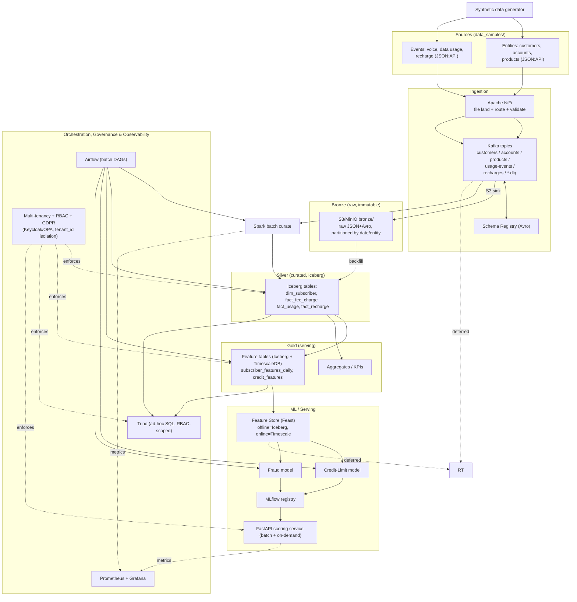

# Intelligent Data Platform — Architecture & Implementation Plan

> **Status: DRAFT FOR REVIEW.** No implementation will start until this plan is approved.
> Scope: A Telecom Data Lakehouse (medallion architecture) that ingests the entity
> and event data in `data_samples/`, curates it, and serves two ML use cases:
> **(A) Alternative Credit-Limit scoring** and **(B) Fraud detection**.

This plan extends the reference design in `skills/lakehouse_prototyping.md` (a CDR-only
lakehouse) to the richer **TM Forum SID / JSON:API** data model actually present in
`data_samples/` (parties, accounts, agreements, products, usage events, recharge events).

---

## Table of Contents
1. [System Architecture Design](#1-system-architecture-design)
2. [Step-by-Step Installation & Deployment Plan](#2-step-by-step-installation--deployment-plan)
3. [Data Ingestion Pipeline Plan](#3-data-ingestion-pipeline-plan)
4. [Feature Engineering Plan (Credit Limit & Fraud)](#4-feature-engineering-plan)
5. [ML Algorithm — Credit-Limit Prediction](#5-ml-algorithm--credit-limit-prediction)
6. [ML Algorithm — Fraud Detection](#6-ml-algorithm--fraud-detection)
7. [Phased Implementation Roadmap](#7-phased-implementation-roadmap)
8. [Resolved Decisions (PR #1 review)](#9-resolved-decisions)

---

## 0. Data Model (from `data_samples/`)

The samples are JSON:API documents modeled on the TM Forum SID. Understanding them drives
everything downstream.

| Entity | File | Key attributes (grounded in samples) | Role in ML |
|---|---|---|---|
| **parties** | `parties_v1.json` | role (owner/payer/user/…), personal-details (name, DOB, language), company-details, contact-media (phone/email/postal), privacy-consent (purposes, valid-for) | KYC, demographics, consent gating |
| **accounts** | `accounts_v1.json` | account-type (company/salaried/self-employed/student/retired/normal), segment (B2C/B2B/B2B2C), lifecycle-status, characteristics, valid-from | Credit segment, tenure |
| **agreements** | `agreements_v1.json` | agreement-type (device/subscription), business-line (mobile/broadband/iptv/iot/energy/insurance), characteristics (msisdn, imsi), lifecycle-status | Product holding, device financing exposure |
| **products** | `products_v1.json` | product-type (addon), name (e.g. "Data 1 GB"), product-offering, parent/child links, lifecycle | Plan value, add-on appetite |
| **voice usage** | `voice_usage_events_v1.json` | charged amount (tax-free + tax, EUR), seconds, used-service-units, is-roaming, other-party-number, traffic-case (originating/terminating), network destination, service-id (msisdn) | Spend/usage behavior, SIM-box & roaming fraud |
| **data usage** | `data_usage_events_v1.json` | charged amount, kilobytes, used-service-units, is-roaming, imei, network-technology (2G…5G), APN, location, service-id | Usage behavior, data fraud |
| **recharge** | `recharge_events_v1.json` | recharge-amount (EUR), payment-method (credit-card/…), event-status (successful/failed), failure-reason-code, source (web/…), recharge-type (manual/auto), service-id | Payment ability/reliability, recharge fraud |

**Join keys (canonical):** `party_id ↔ account_id ↔ agreement_id ↔ product_id`; usage/recharge
events link to a subscriber via `service-id` (MSISDN) and to `agreements/products` via the
`relationships.target`. `imsi`/`imei` provide device/SIM linkage for fraud graphs.

> **Note on samples:** the sample files show *enumerations as arrays* (e.g. `account-type` is a
> list of possible values) — they are schema/illustrative documents, not single records. The
> ingestion contracts (Avro/JSON schemas) below pin each field to one concrete value per record.

---

## 1. System Architecture Design

### 1.1 Guiding principles
*(Reflects reviewer decisions on PR #1 — see [§9 Resolved Decisions](#9-resolved-decisions).)*
- **Medallion architecture** (Bronze → Silver → Gold) as in the skill, extended with a
  **Feature Store** and **ML Serving** layer for the two use cases.
- **Lakehouse table format = Apache Iceberg** on object storage (S3 / MinIO) for Silver:
  ACID, schema evolution, time-travel (matches skill's Q6 recommendation).
- **Iceberg catalog = Nessie** (git-like, branchable catalog) — reviewer decision.
- **TimescaleDB = Gold serving layer** for low-latency features/aggregates and APIs
  (matches skill's Q4/Q6).
- **Batch-first**: Spark + Airflow drive feature engineering, credit scoring, and fraud
  scoring in the prototype. Kafka + Flink real-time scoring is **deferred to a later phase**
  (reviewer: *"start with batch"*). Kafka is still used for ingestion decoupling.
- **Kafka = Apache Kafka (open source)**, deployed via the **Strimzi** operator — reviewer
  decision (no Confluent/Redpanda).
- **Kubernetes-native, prototype-first**: the prototype runs on **local Kubernetes
  (minikube)**; production targets **AWS (EKS)**. Same Helm charts/manifests across both —
  reviewer decision.
- **Multi-tenancy, data isolation & RBAC are first-class** architectural requirements (not
  add-ons) — see [§1.5](#15-multi-tenancy-data-isolation--rbac). **GDPR** compliance baked in
  from Phase 1.

### 1.2 Logical architecture (medallion + ML)



### 1.3 Component inventory & rationale

| Layer | Component | Why (rationale anchored in skill) |
|---|---|---|
| Ingestion | **Apache NiFi** | File landing, CSV/JSON→Avro, routing, DLQ, backpressure (skill §Components.1) |
| Streaming bus | **Apache Kafka (open source)** via **Strimzi** + **Schema Registry** (Apicurio, open source) | Central event backbone, Avro contracts, compatibility (skill §2,§3); reviewer: open-source Kafka |
| Object store | **MinIO** (prod: **AWS S3**) | S3-compatible, cheap, decoupled compute/storage (skill §4) |
| Stream proc | **Apache Flink (PyFlink)** — **DEFERRED** | Real-time fraud scoring; added in later phase (reviewer: batch first) |
| Table format | **Apache Iceberg** + **Nessie** catalog | ACID, schema/partition evolution, time-travel, branchable catalog (skill Q6; reviewer: Nessie) |
| Batch proc | **Apache Spark** | Curation, heavy joins, feature batches, Gold aggregation, **batch scoring** (skill §Phase 4) |
| Serving DB | **TimescaleDB** | Low-latency feature/KPI serving, time-series (skill Q4/Q6) |
| Query | **Trino** | Ad-hoc SQL across Iceberg + Timescale, **RBAC-scoped per tenant** (skill §Query) |
| Orchestration | **Apache Airflow** | Data-first DAGs, backfill, SLAs (skill Q5 recommendation) |
| Feature store | **Feast** | Offline/online parity; train-serve consistency (new, for ML) |
| Experiment/registry | **MLflow** | Tracking, model registry, staging→prod promotion (new) |
| Serving API | **FastAPI** | Credit/fraud scoring endpoints (new) |
| **AuthN/AuthZ** | **Keycloak** (OIDC) + **OPA** (policy) | Multi-tenant identity, RBAC, attribute-based row/column policies (new — reviewer) |
| **Secrets** | **External Secrets / Vault** | GDPR-grade secret & key management (new — reviewer) |
| Observability | **Prometheus + Grafana (LGTM)** | Pipeline + data-quality + model metrics (skill §Monitoring) |
| Data quality | **Great Expectations** (+ Soda optional) | Contract & quality gates at Bronze→Silver (new) |
| Local K8s | **minikube** | Local prototype runtime (reviewer) |
| Prod K8s | **AWS EKS** | Production runtime (reviewer) |

### 1.4 Storage layout

Every layer is **partitioned by `tenant_id` first** to guarantee physical data isolation
(see §1.5).

```
s3://idp-lakehouse/
  bronze/  tenant=<id>/{entity}/year=/month=/day=/*.avro|*.json   # raw, immutable, 90d→glacier
  silver/  iceberg/{dim_*,fact_*}/  (tenant_id partition col)     # curated Iceberg tables
  gold/    iceberg/feature_*/ + mirrored to TimescaleDB           # features + aggregates
  ml/      models/<tenant>/, features/, checkpoints/
  flink-checkpoints/ , flink-savepoints/   (deferred phase)
```

### 1.5 Multi-tenancy, data isolation & RBAC

*(Reviewer requirement: "Architecture shall support multi-tenancy with data isolation with
RBAC policy" + "GDPR".)*

**Tenancy model — shared-platform, isolated-data (pooled with hard guardrails):**
- A `tenant_id` is stamped on every record at ingestion (NiFi sets it from the source
  channel / API key) and carried through Bronze → Silver → Gold as a **leading partition
  column** and a **mandatory predicate** on all reads.
- **Kafka:** per-tenant topic prefixes (`t.<tenant>.tmf.*`) and ACLs (Strimzi
  `KafkaUser` + `AclRule`) so a tenant's consumers/producers cannot cross boundaries.
- **Object store:** per-tenant prefixes + bucket policies; optional per-tenant KMS keys.
- **Iceberg/Nessie:** namespace-per-tenant (`silver_<tenant>`) and/or `tenant_id`
  partitioning; Nessie branches enable per-tenant isolated experimentation.
- **Compute isolation:** Kubernetes **namespace + NetworkPolicy + ResourceQuota per
  tenant** on EKS; for the minikube prototype, namespaces simulate this.

**RBAC / AuthZ:**
- **Keycloak (OIDC)** issues tokens carrying `tenant_id` + roles
  (`data_engineer`, `ds_credit`, `ds_fraud`, `analyst`, `fraud_ops`, `admin`).
- **Open Policy Agent (OPA)** enforces row-level (tenant) and column-level (PII) policies;
  **Trino** uses an OPA/Ranger access-control plugin so every SQL query is tenant- and
  role-scoped; **FastAPI** validates the token and injects the `tenant_id` filter server-side.

**GDPR controls:**
- **PII minimization & tokenization** at Silver (hash MSISDN/IMSI/IMEI/email/phone with
  per-tenant salt; reversible vault tokens only where lawful).
- **Consent enforcement:** the `privacy-consent` block in `parties` gates feature/ML usage
  (e.g., analytics consent required to include a subscriber in training).
- **Right-to-erasure / RTBF:** Iceberg row-level deletes + a delete-propagation DAG across
  Bronze/Silver/Gold/Feature-store/online-store; audited.
- **Data retention & lineage:** lifecycle policies (Bronze 90d→Glacier), full lineage
  (OpenLineage/Marquez), immutable audit log of access and erasure.
- **Data residency:** per-tenant region pinning on AWS (EKS + S3 region per tenant if required).

---

## 2. Step-by-Step Installation & Deployment Plan

**Kubernetes-native on both tiers** (reviewer decision): **(2A) Local = minikube**,
**(2B) Production = AWS EKS**. The *same* Helm charts / Kustomize overlays deploy to both —
only the overlay (resource sizes, storage class, ingress, secrets backend) differs. No
Docker Compose.

**Proposed repo layout to be created (Phase 0):**
```
deploy/
  platform/        # PLATFORM team: shared infrastructure services
    base/          # Kustomize base (namespaces, RBAC, quotas, NetworkPolicy)
    overlays/local/  # minikube base overlay (namespaces/RBAC/isolation)
    overlays/aws/    # EKS base overlay (namespaces/RBAC/isolation)
    argocd/        # Argo CD Applications (platform base + app, GitOps)
    kafka/         # Strimzi Kafka cluster, schema registry, topics, admin UI
    keycloak/  timescaledb/  trino/  nessie/  airflow/   # per-service manifests/values
    install-infra.sh  *-tune.sh                          # platform install/repair scripts
  app/             # APPLICATION team: workloads that run ON the platform
    deployment/    # scoring-api base (Deployment/Service)
    overlays/local|aws/  # scoring-api env patch (dev image / ECR+IRSA), `make app-deploy`
    jobs/          # produce/consume/silver/gold/publish/spark-gold Jobs
config/   (kafka topics, nifi flow, nessie, trino+OPA, airflow, keycloak realms)
schemas/avro/*.avsc
ingestion/ (nifi templates, kafka-connect s3-sink config)
synthetic/ (synthetic data generator)
pipelines/spark/ , pipelines/airflow/dags/   (pipelines/flink/ added in deferred phase)
features/ (feast repo) , ml/ (training, serving)
tests/ , Makefile
```

### 2A. Local prototype (minikube)

**Prereqs:** Docker, **minikube** (≥ 8 CPU / 16–24 GB allotted), `kubectl`, `helm`,
`kustomize`, Python 3.11.

**Bring-up order (each a `make` target wrapping helm/kubectl):**
1. `make mk-up` — `minikube start` with addons (ingress, metrics-server, storage-provisioner).
2. `make platform-base` — create platform + per-tenant namespaces with **ResourceQuota +
   NetworkPolicy + RBAC** (multi-tenancy guardrails, §1.5).
3. `make platform-services` — MinIO (S3), **Strimzi → Apache Kafka** + Apicurio Schema Registry,
   **Nessie** + Iceberg, TimescaleDB, Redis, **Keycloak**, **OPA**.
4. `make topics` — create per-tenant Kafka topics/ACLs + register Avro schemas.
5. `make catalog` — init Nessie namespaces (`silver`, `gold`) via Spark/Trino.
6. `make proc` — Spark (Spark-on-K8s), Trino (with OPA access-control plugin).
   *(Flink deferred — not deployed in the batch-first prototype.)*
7. `make orch` — Airflow (KubernetesExecutor), NiFi.
8. `make ml` — MLflow, Feast registry, FastAPI scorer.
9. `make obs` — Prometheus, Grafana (preloaded dashboards), OpenLineage/Marquez.
10. `make seed` — run the **synthetic data generator** → land files for ingestion.
11. `make smoke` — end-to-end: ingest → Bronze → Silver → feature row → one batch score,
    asserting tenant isolation (a tenant-A token cannot read tenant-B rows via Trino/API).

**Validation gates:** each component exposes a readiness probe; `make smoke` is the
end-to-end + isolation acceptance test.

### 2B. Production deployment (AWS EKS)
- **Cluster:** EKS (managed node groups + optional Karpenter autoscaling), per-tenant
  namespaces with quotas/NetworkPolicy; **IRSA** for pod-level S3 access.
- **Packaging/GitOps:** same Helm charts via `overlays/aws`; **Argo CD** continuous deploy.
  GitHub Actions build/test/scan images → push to ECR → Argo CD syncs (skill Q5 hybrid:
  Airflow-for-data, Argo-for-CICD).
- **Storage:** **S3** (lifecycle: Glacier after 90 days, skill §Bronze); per-tenant KMS keys.
- **Data services:** Strimzi Kafka on EKS; TimescaleDB (RDS/self-managed); MSK optional later.
- **Security/GDPR:** **External Secrets + AWS Secrets Manager/KMS**, Keycloak + OPA for RBAC,
  private subnets, per-tenant data residency via region pinning.
- **Scaling:** Kafka partitions = 12 (skill §2); Spark dynamic allocation; autoscaling.
- **Observability:** LGTM stack, model-drift + data-quality SLA alerts.

---

## 3. Data Ingestion Pipeline Plan

Driven by the seven sample entities. **Batch-first** in the prototype (reviewer): all sources
ingest as micro-batches through Kafka into Bronze, then Spark curates to Silver. Kafka remains
the decoupling backbone so the *deferred* real-time path can attach later without re-plumbing.

### 3.0 Synthetic data generator (reviewer: required)
The `data_samples/` files are single illustrative schema docs — insufficient for ML training.
A **synthetic data generator** (`synthetic/`, Python + Faker/NumPy) is a Phase-0 deliverable:
- Generates coherent, referentially-consistent records across all 7 entities
  (party→account→agreement→product, with matching `service-id`/MSISDN, IMSI, IMEI).
- Emits realistic **multi-tenant** volumes (configurable: N tenants × M subscribers ×
  T days of usage/recharge events).
- Injects **labeled signals** so ML is trainable: a configurable fraction of fraud cases
  (SIM-box, recharge/card fraud, roaming fraud) and credit-outcome labels (default/repay),
  with controllable base rates and class imbalance.
- Produces JSON:API files into `/data/landing/<tenant>/{entity}/` for NiFi to pick up, plus
  a holdout ground-truth file for evaluation.

### 3.1 Source classification (prototype = batch)
| Source | Cadence | Prototype mode | Topic |
|---|---|---|---|
| parties, accounts, agreements, products | slowly-changing (reference) | **batch / CDC** | `t.<tenant>.tmf.parties/accounts/agreements/products` |
| voice & data usage events | high-volume | **micro-batch** (stream deferred) | `t.<tenant>.tmf.usage.voice/data` |
| recharge events | medium-volume | **micro-batch** (stream deferred) | `t.<tenant>.tmf.recharge` |
| any failed/invalid record | — | DLQ | `*.dlq` |

### 3.2 Bronze ingestion flow
1. **Landing:** generator/source files arrive at `/data/landing/<tenant>/{entity}/`.
2. **NiFi** `ListFile→FetchFile→ (stamp tenant_id) →ValidateRecord→ConvertRecord
   (JSON→Avro via Schema Registry)→PublishKafka` to the tenant-scoped topic.
3. **Kafka Connect S3 Sink** writes raw Avro to `bronze/tenant=<id>/{entity}/…`
   (immutable backup, skill Q2), time-partitioned (hourly).
4. Invalid records → `{entity}.dlq` with error annotation.

### 3.3 Silver curation (Bronze → Iceberg, Spark batch)
A **Spark** flatten + canonicalize job (one engine for all entities in the batch-first
prototype) that:
- Unwraps JSON:API envelope (`data.attributes`, `data.relationships`).
- Carries `tenant_id` as the leading partition column (data isolation, §1.5).
- Resolves IDs (strip `UUID(...)` wrapper seen in samples → clean UUID).
- Normalizes money: split `tax-free-amount` + `tax-amounts` → `gross_amount`, `tax_amount`, `currency`.
- Normalizes units: voice→seconds, data→kilobytes→bytes; standardize timestamps to UTC.
- **PII handling (GDPR):** hash/tokenize MSISDN, IMSI, IMEI, email, phone with per-tenant
  salt; respect `privacy-consent` purposes from `parties`; keep salted hash for joins (skill
  CDM `MASK_PII`).
- Deduplicate (record `id` + event window), enforce schema, write to Iceberg.

**Proposed Silver tables** (Iceberg, partitioned by `tenant_id` + date; events also by network/region):
- `dim_party`, `dim_account`, `dim_agreement`, `dim_product` (SCD-2 with `valid-from`/`valid-to`).
- `fact_usage` (unified voice+data: `tenant_id, service_id, event_type, started_at, gross_amount,
  tax_amount, qty, unit, is_roaming, network_tech, traffic_case, other_party_number, imei,
  location, agreement_id`).
- `fact_recharge` (`tenant_id, service_id, created_at, amount, payment_method, status,
  failure_reason_code, source, recharge_type, agreement_id`).

### 3.4 Data quality gates (Great Expectations)
Per entity, at Bronze→Silver: non-null keys (`id`, `service-id`), valid enums (account-type,
event-status, payment-method), money ≥ 0, timestamps within range, MSISDN/IMSI length checks,
referential integrity (event `service-id` resolves to an agreement). Failures route to DLQ and
emit a data-quality metric to Grafana.

### 3.5 Gold build
Airflow-scheduled Spark jobs read Silver Iceberg → compute the feature/aggregate tables in §4 →
write to Gold Iceberg and mirror serving slices to TimescaleDB (skill §Phase-4 example flow).

---

## 4. Feature Engineering Plan

All features are computed per **subscriber (service-id / MSISDN)** and per **account**, at a
daily snapshot grain with multiple lookback windows (7/30/90 days). Built in Spark for batch and
mirrored in Flink for the real-time subset; registered in **Feast** for train/serve parity.

### 4.1 Shared base features (from entities)
| Feature | Source | Notes |
|---|---|---|
| `account_type`, `account_segment` | accounts | one-hot / target-encoded |
| `account_tenure_days` | accounts.valid-from → now | proxy for stability |
| `customer_age`, `language`, `is_company` | parties | from DOB / company-details |
| `num_agreements`, `business_lines_held` | agreements | breadth of relationship |
| `num_active_products`, `has_device_agreement` | products, agreements | device-financing exposure |
| `lifecycle_status` flags | accounts/agreements | active/terminated counts |
| `consent_marketing/analytics` | parties.privacy-consent | gating for model usage |

### 4.2 Credit-limit features (behavioral creditworthiness)
Telecom alt-credit signals (ability + reliability to pay):
- **Recharge ability:** `recharge_total_30d/90d`, `recharge_avg_amount`, `recharge_count`,
  `recharge_max`, `days_since_last_recharge`, `recharge_amount_trend` (slope).
- **Payment reliability:** `recharge_success_rate`, `failed_recharge_count`,
  `failure_reason_mix`, `share_credit_card` vs other payment-methods, `recharge_regularity`
  (coefficient of variation of inter-recharge gaps), `auto_recharge_flag`.
- **Spend capacity:** `usage_charged_amount_30d/90d` (voice+data EUR), `arpu_3m`,
  `spend_to_recharge_ratio`, `data_gb_30d`, `voice_minutes_30d`.
- **Stability:** `account_tenure_days`, `tenure_x_arpu`, `active_months`, `churn_risk_proxy`
  (declining usage trend), `num_business_lines`.
- **Engagement quality:** `roaming_spend_share`, `premium_product_flag`, `addon_purchase_count`.

> **Why these proxy creditworthiness:** in prepaid telecom there is often no bureau score.
> Consistent, sizeable recharges via card + long tenure + stable/rising ARPU are strong
> ability-and-willingness-to-pay signals — the basis of "alternative credit scoring."

### 4.3 Fraud-detection features
Targeting telecom fraud types: **SIM-box / interconnect bypass, subscription fraud, recharge /
payment fraud, roaming fraud, usage anomalies**.
- **Velocity / volume:** calls per minute/hour, `unique_called_numbers_24h`,
  `call_count_zscore`, `data_volume_zscore`, burst detection.
- **SIM-box signatures:** high `originating` ratio, very high call volume + low call diversity,
  always-on, low/zero inbound (`traffic_case` mix), many distinct `other_party_number` to few
  IMSIs, single IMEI ↔ many IMSIs (device-SIM graph), constant cell/location.
- **Recharge/payment fraud:** rapid successive recharges, many `failed` then `successful`,
  card recharges far above tenure norm, `recharge_amount_zscore`, new account + large card
  recharge, `external-reference-id` reuse.
- **Roaming fraud:** sudden `is_roaming=true` high spend, roaming spend ≫ historical,
  early high-usage on new agreement.
- **Account/identity:** `account_age_at_event`, multiple agreements sharing IMEI/contact-media,
  velocity of new agreements per party.
- **Graph features (Phase 4+):** connected-component size over IMSI↔IMEI↔other-party-number,
  PageRank/degree on the call graph for collusion/SIM-box rings.

### 4.4 Feature store design (Feast)
- **Entities:** `service_id` (MSISDN), `account_id`, `party_id`.
- **Offline store:** Iceberg/Gold (point-in-time correct training joins).
- **Online store:** Redis (real-time fraud) + TimescaleDB (credit serving).
- **Feature views:** `subscriber_recharge_fv`, `subscriber_usage_fv`, `account_profile_fv`,
  `fraud_velocity_fv`. Versioned; same definitions feed batch training and Flink/online scoring
  to guarantee **train–serve consistency**.

---

## 5. ML Algorithm — Credit-Limit Prediction

### 5.1 Problem framing
There is **no direct credit-limit label** in the data. We use a **two-stage credit decisioning
design** (industry-standard for alt-credit), with a cold-start fallback:

```
Stage 0 (cold start): heuristic affordability scorecard  → bootstrap limits + collect outcomes
Stage 1 (risk):       P(default) classifier              → probability of default (PD)
Stage 2 (limit):      affordability × (1 − PD) sizing    → recommended credit limit (EUR)
```

### 5.2 Stage 0 — Cold-start affordability heuristic
Before labels exist, derive an interim limit:
`limit₀ = k · avg_recharge_30d · tenure_factor · success_rate · segment_factor`, capped by
policy bands. Purpose: deploy safely, gather repayment outcomes that become the PD label.

### 5.3 Stage 1 — Probability-of-Default model (primary)
- **Label:** default / delinquency on extended credit (airtime advance, device EMI, postpaid
  bill) — defined once Stage 0 outcomes accrue (e.g., 60+ days non-payment).
- **Algorithm (recommended):** **Gradient-boosted trees — LightGBM** (binary). Rationale:
  best tabular performance, handles mixed/missing features, native categorical, fast.
- **Interpretable baseline (required for credit/regulatory):** **Logistic Regression scorecard
  with WoE binning + IV feature selection** — gives monotonic, explainable points; run alongside
  LightGBM and compare.
- **Explainability:** **SHAP** for global + per-decision reason codes (adverse-action notices).
- **Imbalance/calibration:** class weights; **probability calibration** (Platt/Isotonic) so PD
  is a true probability for limit sizing.
- **Features:** §4.1 + §4.2.

### 5.4 Stage 2 — Limit sizing
`recommended_limit = affordability_base · risk_multiplier(PD) · policy_caps`, where
`affordability_base ≈ disposable-spend proxy` (ARPU, recharge capacity) and `risk_multiplier`
decreases with PD. Optionally train a **LightGBM regressor** to predict an
"approved-limit" target once a labeled book of approved limits exists (supervised regression),
with the affordability formula as guardrail.

### 5.5 Evaluation
- PD model: **AUC-ROC, KS, Gini, PR-AUC**, calibration curve, **PSI** for drift.
- Limit policy: expected-loss vs revenue back-test, approval rate, override rate.
- Fairness/compliance: disparate-impact checks across segments; reason-code coverage.
- **Validation discipline:** time-based split (train past → test future), point-in-time
  feature joins via Feast (no leakage).

### 5.6 Serving
Batch nightly scores all subscribers → Gold/TimescaleDB; FastAPI endpoint `/credit-limit`
for on-demand scoring; MLflow registry gates staging→prod; monitor PSI/KS drift in Grafana.

---

## 6. ML Algorithm — Fraud Detection

### 6.1 Problem framing
Fraud is **rare, evolving, and adversarial** → a **hybrid, layered** approach (no single model).
**Batch-first** (reviewer): the prototype runs all layers as scheduled batch scoring; the
real-time (Flink) variant of Layer 1 is **deferred** to a later phase.

```
Layer 1: Rules engine                  → known patterns, zero training   [batch now; Flink real-time DEFERRED]
Layer 2: Supervised classifier         → labeled fraud, high precision   [batch]
Layer 3: Unsupervised anomaly          → novel/unknown fraud             [batch]
Layer 4: Graph analytics               → SIM-box rings / collusion       [batch]
→ score fusion + analyst feedback loop
```

### 6.2 Layer 1 — Rules engine (batch-first; Flink real-time deferred)
Deterministic velocity/threshold rules (call-velocity, recharge burst, new-account-high-card-
recharge, originating-ratio for SIM-box). **Prototype:** evaluated in scheduled **Spark/SQL
batch** over `fact_usage`/`fact_recharge` to flag cases for the case queue. **Deferred phase:**
the *same rule definitions* are ported to **Flink** on `t.<tenant>.tmf.*` streams for sub-second
blocking — kept as portable predicates so no rewrite is needed.

### 6.3 Layer 2 — Supervised classifier (primary when labels exist)
- **Algorithm (recommended):** **XGBoost** (binary classification). Strong on imbalanced tabular
  fraud; alternative LightGBM.
- **Imbalance handling:** `scale_pos_weight` / class weights, **SMOTE or undersampling**,
  optimize **PR-AUC** (not accuracy), threshold tuned to precision/recall trade-off & cost matrix.
- **Features:** §4.3 (velocity, SIM-box signatures, recharge/roaming anomalies).
- **Explainability:** SHAP reason codes for analyst triage.

### 6.4 Layer 3 — Unsupervised anomaly detection
For novel fraud and cold-start (few labels):
- **Isolation Forest** (recommended baseline) on engineered features.
- **Autoencoder** (reconstruction error) for complex multivariate anomalies (Phase 4+).
- Per-subscriber **z-score / robust statistics** on usage & recharge for drift from personal norm.

### 6.5 Layer 4 — Graph analytics (batch, Spark GraphFrames)
Build graph over `IMSI ↔ IMEI ↔ other_party_number ↔ account/contact-media`; detect SIM-box
rings and collusion via connected components, community detection, degree/PageRank. Feeds graph
features back to Layer 2.

### 6.6 Score fusion, feedback & serving
- Combine layer outputs into a unified fraud score + reason set; route high scores to a case-
  management queue; **analyst dispositions become new labels** (active-learning loop).
- **Batch path (prototype):** scheduled scoring (rules + classifier + anomaly), nightly retrain
  candidates, graph refresh, drift monitoring; scores written to Gold/TimescaleDB + FastAPI
  `/fraud-score` for on-demand lookups.
- **Real-time path (deferred phase):** Flink (rules + online model via Feast/Redis) → block/alert.
- **Metrics:** PR-AUC, precision@k, recall, false-positive rate, fraud-$ caught, alert volume,
  detection latency; drift via PSI.

---

## 7. Phased Implementation Roadmap

> Execution begins **only after this plan is approved**. Each phase ends with a working,
> demoable increment and tests.

| Phase | Goal | Key deliverables | Exit criteria |
|---|---|---|---|
| **0. Foundations** | Repo + **minikube** stack + multi-tenancy skeleton + synthetic data | Helm/Kustomize (local overlay), Makefile, MinIO/**Strimzi Kafka**/**Nessie**+Iceberg/Trino/TimescaleDB up, **Keycloak+OPA** + per-tenant namespaces/quotas/NetworkPolicy, **synthetic data generator**, CI skeleton, schemas/avro | `make smoke` green incl. **tenant-isolation test**; synthetic data lands in Bronze |
| **1. Ingestion → Bronze/Silver** | Canonical, tenant-isolated lakehouse | NiFi flow (tenant stamping), Kafka topics+ACLs+SR, S3 sink, **Spark** flatten jobs, Iceberg `dim_/fact_` (tenant-partitioned), Great Expectations gates, **GDPR PII masking + consent** | All 7 entities queryable in Silver via Trino with **RBAC/row-level isolation**; DQ gates pass |
| **2. Gold + Feature Engineering** | Feature tables | Spark feature jobs (§4), Gold Iceberg + TimescaleDB mirror, Feast repo, Airflow DAGs | Point-in-time, tenant-scoped feature retrieval works; daily DAG runs |
| **3. Credit-Limit ML (batch)** | Credit use case | Stage-0 heuristic, LightGBM PD + scorecard baseline, SHAP, limit sizing, MLflow, FastAPI `/credit-limit` (batch + on-demand) | Back-tested PD (AUC/KS) + limit policy report; endpoint serves (tenant-scoped) |
| **4. Fraud ML (batch)** | Fraud use case | **Batch** rules, XGBoost classifier, Isolation Forest, graph features (GraphFrames), score fusion, FastAPI `/fraud-score` | PR-AUC + precision@k report; case-queue demo |
| **5. AWS + real-time + hardening** | Prod + deferred streaming | **AWS EKS** overlay + Argo CD/ECR, **Flink real-time** scoring (ported rules + online Feast/Redis), drift monitoring, dashboards, runbooks, security/GDPR review | Deployed to EKS; real-time alert demo; dashboards + alerts live |

**Cross-cutting (every phase):** unit/integration tests, data contracts, **multi-tenancy &
RBAC enforcement**, **GDPR** (PII masking, consent, retention, RTBF), lineage, docs, observability.

---

## 9. Resolved Decisions

Decisions captured from reviewer comments on **PR #1** (all incorporated above):

| # | Topic | Decision | Where applied |
|---|---|---|---|
| 1 | Deployment target | **Local = K8s minikube; Prod = AWS (EKS)** — no Docker Compose | §1.1, §2 |
| 2 | Kafka | **Apache Kafka (open source)** via Strimzi (+ Apicurio Schema Registry) | §1.3, §2, §3 |
| 3 | Iceberg catalog | **Nessie** | §1.1, §1.3, §2 |
| 4 | Synthetic data | **Required** — generator is a Phase-0 deliverable | §3.0, §7 (Phase 0) |
| 5 | Compliance | **GDPR + RBAC + multi-tenancy** as first-class requirements | §1.5, §3.3, §7 |
| 6 | Multi-tenancy | **Data isolation + RBAC** (tenant_id partitioning, Keycloak+OPA, namespace isolation) | §1.4, §1.5 |
| 7 | Real-time vs batch | **Start with batch**; Flink real-time deferred to Phase 5 | §1.1, §6.2, §6.6, §7 |

### Remaining inputs (non-blocking — sensible defaults assumed unless you say otherwise)
- **Credit/fraud labels:** assumed **synthetically generated** (per decision #4) so models are
  trainable now; will swap to real labels when available.
- **Tenancy granularity for prod data residency** (per-tenant AWS region) — confirm only if needed.

---

*Updated per PR #1 review. On approval, I will start at **Phase 0** (minikube stack +
multi-tenancy skeleton + synthetic data generator) and proceed phase-by-phase, committing
working increments to `claude/lakehouse-prototyping-plan-8igpny`.*
