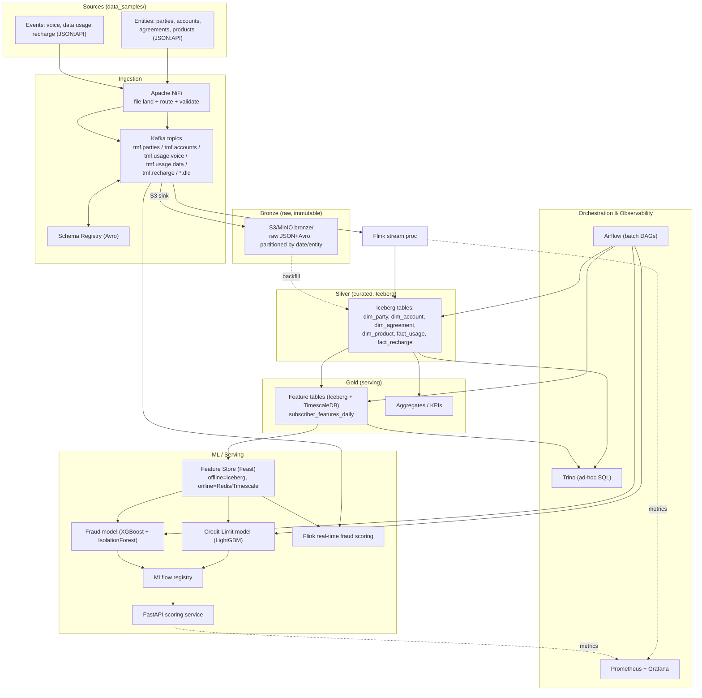

# Intelligent Data Platform — Architecture & Implementation Plan

> **Status: DRAFT FOR REVIEW.** No implementation will start until this plan is approved.
> Scope: A Telecom Data Lakehouse (medallion architecture) that ingests the entity
> and event data in `data_samples/`, curates it, and serves two ML use cases:
> **(A) Alternative Credit-Limit scoring** and **(B) Fraud detection**.

This plan extends the reference design in `skills/lakehouse_prototyping.md` (a CDR-only
lakehouse) to the richer **TM Forum SID / JSON:API** data model actually present in
`data_samples/` (parties, accounts, agreements, products, usage events, recharge events).

---

## Table of Contents
1. [System Architecture Design](#1-system-architecture-design)
2. [Step-by-Step Installation & Deployment Plan](#2-step-by-step-installation--deployment-plan)
3. [Data Ingestion Pipeline Plan](#3-data-ingestion-pipeline-plan)
4. [Feature Engineering Plan (Credit Limit & Fraud)](#4-feature-engineering-plan)
5. [ML Algorithm — Credit-Limit Prediction](#5-ml-algorithm--credit-limit-prediction)
6. [ML Algorithm — Fraud Detection](#6-ml-algorithm--fraud-detection)
7. [Phased Implementation Roadmap](#7-phased-implementation-roadmap)
8. [Open Questions for Reviewer](#8-open-questions-for-reviewer)

---

## 0. Data Model (from `data_samples/`)

The samples are JSON:API documents modeled on the TM Forum SID. Understanding them drives
everything downstream.

| Entity | File | Key attributes (grounded in samples) | Role in ML |
|---|---|---|---|
| **parties** | `parties_v1.json` | role (owner/payer/user/…), personal-details (name, DOB, language), company-details, contact-media (phone/email/postal), privacy-consent (purposes, valid-for) | KYC, demographics, consent gating |
| **accounts** | `accounts_v1.json` | account-type (company/salaried/self-employed/student/retired/normal), segment (B2C/B2B/B2B2C), lifecycle-status, characteristics, valid-from | Credit segment, tenure |
| **agreements** | `agreements_v1.json` | agreement-type (device/subscription), business-line (mobile/broadband/iptv/iot/energy/insurance), characteristics (msisdn, imsi), lifecycle-status | Product holding, device financing exposure |
| **products** | `products_v1.json` | product-type (addon), name (e.g. "Data 1 GB"), product-offering, parent/child links, lifecycle | Plan value, add-on appetite |
| **voice usage** | `voice_usage_events_v1.json` | charged amount (tax-free + tax, EUR), seconds, used-service-units, is-roaming, other-party-number, traffic-case (originating/terminating), network destination, service-id (msisdn) | Spend/usage behavior, SIM-box & roaming fraud |
| **data usage** | `data_usage_events_v1.json` | charged amount, kilobytes, used-service-units, is-roaming, imei, network-technology (2G…5G), APN, location, service-id | Usage behavior, data fraud |
| **recharge** | `recharge_events_v1.json` | recharge-amount (EUR), payment-method (credit-card/…), event-status (successful/failed), failure-reason-code, source (web/…), recharge-type (manual/auto), service-id | Payment ability/reliability, recharge fraud |

**Join keys (canonical):** `party_id ↔ account_id ↔ agreement_id ↔ product_id`; usage/recharge
events link to a subscriber via `service-id` (MSISDN) and to `agreements/products` via the
`relationships.target`. `imsi`/`imei` provide device/SIM linkage for fraud graphs.

> **Note on samples:** the sample files show *enumerations as arrays* (e.g. `account-type` is a
> list of possible values) — they are schema/illustrative documents, not single records. The
> ingestion contracts (Avro/JSON schemas) below pin each field to one concrete value per record.

---

## 1. System Architecture Design

### 1.1 Guiding principles
- **Medallion architecture** (Bronze → Silver → Gold) as in the skill, extended with a
  **Feature Store** and **ML Serving** layer for the two use cases.
- **Lakehouse table format = Apache Iceberg** on object storage (S3 / MinIO) for Silver:
  ACID, schema evolution, time-travel (matches skill's Q6 recommendation).
- **TimescaleDB = Gold serving layer** for low-latency features/aggregates and APIs
  (matches skill's Q4/Q6).
- **Streaming + batch (Lambda-style)**: Kafka + Flink for real-time fraud scoring;
  Spark + Airflow for batch feature/credit-scorecard refresh.
- **Prototype-first**: everything runs locally via Docker Compose; the same component
  choices map 1:1 to a Kubernetes production deployment later.

### 1.2 Logical architecture (medallion + ML)



### 1.3 Component inventory & rationale

| Layer | Component | Why (rationale anchored in skill) |
|---|---|---|
| Ingestion | **Apache NiFi** | File landing, CSV/JSON→Avro, routing, DLQ, backpressure (skill §Components.1) |
| Streaming bus | **Apache Kafka** + **Schema Registry** | Central event backbone, Avro contracts, compatibility (skill §2,§3) |
| Object store | **MinIO** (prod: S3/ADLS) | S3-compatible, cheap, decoupled compute/storage (skill §4) |
| Stream proc | **Apache Flink (PyFlink)** | Exactly-once, real-time enrich + fraud scoring (skill §5, Q3) |
| Table format | **Apache Iceberg** + REST catalog (Nessie/Polaris) | ACID, schema/partition evolution, time-travel (skill Q6) |
| Batch proc | **Apache Spark** | Heavy joins, feature batches, Gold aggregation (skill §Data Flow Phase 4) |
| Serving DB | **TimescaleDB** | Low-latency feature/KPI serving, time-series (skill Q4/Q6) |
| Query | **Trino** | Ad-hoc SQL across Iceberg + Timescale (skill §Query) |
| Orchestration | **Apache Airflow** | Data-first DAGs, backfill, SLAs (skill Q5 recommendation) |
| Feature store | **Feast** | Offline/online parity; train-serve consistency (new, for ML) |
| Experiment/registry | **MLflow** | Tracking, model registry, staging→prod promotion (new) |
| Serving API | **FastAPI** | Synchronous credit/fraud scoring endpoints (new) |
| Observability | **Prometheus + Grafana (LGTM)** | Pipeline + data-quality + model metrics (skill §Monitoring) |
| Data quality | **Great Expectations** (+ Soda optional) | Contract & quality gates at Bronze→Silver (new) |

### 1.4 Storage layout

```
s3://idp-lakehouse/
  bronze/  {entity}/year=/month=/day=/*.avro|*.json     # raw, immutable, 90d→glacier
  silver/  iceberg/{dim_*,fact_*}/...                    # curated Iceberg tables
  gold/    iceberg/feature_*/ + mirrored to TimescaleDB  # features + aggregates
  ml/      models/, features/, checkpoints/
  flink-checkpoints/ , flink-savepoints/
```

---

## 2. Step-by-Step Installation & Deployment Plan

Two tracks: **(2A) Local prototype via Docker Compose** (default for this repo), and
**(2B) Production on Kubernetes** (target). Local first.

### 2A. Local prototype (Docker Compose)

**Prereqs:** Docker ≥ 24, Docker Compose v2, ≥ 16 GB RAM (24 GB comfortable), Python 3.11, `make`.

**Proposed repo layout to be created (Phase 0):**
```
deploy/compose/docker-compose.yml      # all services
deploy/compose/.env                    # ports, creds (dev only)
config/ (kafka topics, nifi flow, iceberg catalog, trino, airflow)
schemas/avro/*.avsc                    # ingestion contracts
ingestion/ (nifi templates, kafka-connect s3-sink config)
pipelines/flink/ , pipelines/spark/ , pipelines/airflow/dags/
features/ (feast repo) , ml/ (training, serving)
tests/ , Makefile
```

**Bring-up order (each becomes a `make` target):**
1. `make net` — create Docker network + MinIO buckets (`bronze/silver/gold/ml`).
2. `make infra-up` — MinIO, Kafka (Redpanda or Confluent), Schema Registry, Nessie (Iceberg REST catalog), TimescaleDB, Redis (online store).
3. `make topics` — create Kafka topics + register Avro schemas.
4. `make catalog` — initialize Iceberg namespaces (`silver`, `gold`) via Spark/Trino.
5. `make proc-up` — Flink JobManager/TaskManager, Spark, Trino.
6. `make orch-up` — Airflow (webserver/scheduler), NiFi.
7. `make ml-up` — MLflow, Feast registry, FastAPI scorer.
8. `make obs-up` — Prometheus, Grafana (preloaded dashboards).
9. `make smoke` — health checks + load `data_samples/` → assert rows in Silver.

**Validation gates:** each step exposes a health endpoint; `make smoke` runs an
end-to-end sample (ingest → Bronze → Silver → one feature row → one model score).

### 2B. Production deployment (Kubernetes) — outline
- **Packaging:** Helm charts per component; Strimzi (Kafka), Flink Kubernetes Operator,
  Spark Operator, Airflow Helm (KubernetesExecutor — per skill Q5), Trino Helm.
- **Storage:** real S3 (+ lifecycle: Glacier after 90d per skill §Bronze).
- **CI/CD:** GitHub Actions build/test → push images → Argo CD deploy (skill's hybrid
  Airflow-for-data / Argo-for-CICD suggestion, Q5).
- **Secrets:** External Secrets / Vault; no creds in repo.
- **Scaling:** Kafka partitions = 12 (skill §2), Flink parallelism = 12, autoscaled.
- **Observability:** LGTM stack, model-drift alerts, data-quality SLAs.

---

## 3. Data Ingestion Pipeline Plan

Driven by the seven sample entities. Two ingest modes, mirroring skill §Data-Flow Phases 1–3.

### 3.1 Source classification
| Source | Cadence | Mode | Topic |
|---|---|---|---|
| parties, accounts, agreements, products | slowly-changing (reference) | **batch / CDC** | `tmf.parties`, `tmf.accounts`, `tmf.agreements`, `tmf.products` |
| voice & data usage events | high-volume stream | **streaming** | `tmf.usage.voice`, `tmf.usage.data` |
| recharge events | medium-volume stream | **streaming** | `tmf.recharge` |
| any failed/invalid record | — | DLQ | `*.dlq` |

### 3.2 Bronze ingestion flow
1. **Landing:** files dropped to `/data/landing/{entity}/` (prototype seeds from `data_samples/`).
2. **NiFi** `ListFile→FetchFile→ValidateRecord→ConvertRecord (JSON→Avro via Schema Registry)→PublishKafka`.
3. **Kafka Connect S3 Sink** writes raw Avro to `bronze/{entity}/…` (immutable backup, skill Q2),
   time-partitioned (hourly).
4. Invalid records → `{entity}.dlq` with error annotation.

### 3.3 Silver curation (Bronze → Iceberg)
A **flatten + canonicalize** step (Flink for events, Spark for entities) that:
- Unwraps JSON:API envelope (`data.attributes`, `data.relationships`).
- Resolves IDs (strip `UUID(...)` wrapper seen in samples → clean UUID).
- Normalizes money: split `tax-free-amount` + `tax-amounts` → `gross_amount`, `tax_amount`, `currency`.
- Normalizes units: voice→seconds, data→kilobytes→bytes; standardize timestamps to UTC.
- **PII handling:** hash/tokenize MSISDN, IMSI, IMEI, email, phone (respect `privacy-consent`
  purposes from `parties`); keep salted hash for joins (skill CDM `MASK_PII`).
- Deduplicate (record `id` + event window), enforce schema, write to Iceberg.

**Proposed Silver tables** (Iceberg, partitioned by date; events also by network/region):
- `dim_party`, `dim_account`, `dim_agreement`, `dim_product` (SCD-2 with `valid-from`/`valid-to`).
- `fact_usage` (unified voice+data: `service_id, event_type, started_at, gross_amount, tax_amount,
  qty, unit, is_roaming, network_tech, traffic_case, other_party_number, imei, location, agreement_id`).
- `fact_recharge` (`service_id, created_at, amount, payment_method, status, failure_reason_code,
  source, recharge_type, agreement_id`).

### 3.4 Data quality gates (Great Expectations)
Per entity, at Bronze→Silver: non-null keys (`id`, `service-id`), valid enums (account-type,
event-status, payment-method), money ≥ 0, timestamps within range, MSISDN/IMSI length checks,
referential integrity (event `service-id` resolves to an agreement). Failures route to DLQ and
emit a data-quality metric to Grafana.

### 3.5 Gold build
Airflow-scheduled Spark jobs read Silver Iceberg → compute the feature/aggregate tables in §4 →
write to Gold Iceberg and mirror serving slices to TimescaleDB (skill §Phase-4 example flow).

---

## 4. Feature Engineering Plan

All features are computed per **subscriber (service-id / MSISDN)** and per **account**, at a
daily snapshot grain with multiple lookback windows (7/30/90 days). Built in Spark for batch and
mirrored in Flink for the real-time subset; registered in **Feast** for train/serve parity.

### 4.1 Shared base features (from entities)
| Feature | Source | Notes |
|---|---|---|
| `account_type`, `account_segment` | accounts | one-hot / target-encoded |
| `account_tenure_days` | accounts.valid-from → now | proxy for stability |
| `customer_age`, `language`, `is_company` | parties | from DOB / company-details |
| `num_agreements`, `business_lines_held` | agreements | breadth of relationship |
| `num_active_products`, `has_device_agreement` | products, agreements | device-financing exposure |
| `lifecycle_status` flags | accounts/agreements | active/terminated counts |
| `consent_marketing/analytics` | parties.privacy-consent | gating for model usage |

### 4.2 Credit-limit features (behavioral creditworthiness)
Telecom alt-credit signals (ability + reliability to pay):
- **Recharge ability:** `recharge_total_30d/90d`, `recharge_avg_amount`, `recharge_count`,
  `recharge_max`, `days_since_last_recharge`, `recharge_amount_trend` (slope).
- **Payment reliability:** `recharge_success_rate`, `failed_recharge_count`,
  `failure_reason_mix`, `share_credit_card` vs other payment-methods, `recharge_regularity`
  (coefficient of variation of inter-recharge gaps), `auto_recharge_flag`.
- **Spend capacity:** `usage_charged_amount_30d/90d` (voice+data EUR), `arpu_3m`,
  `spend_to_recharge_ratio`, `data_gb_30d`, `voice_minutes_30d`.
- **Stability:** `account_tenure_days`, `tenure_x_arpu`, `active_months`, `churn_risk_proxy`
  (declining usage trend), `num_business_lines`.
- **Engagement quality:** `roaming_spend_share`, `premium_product_flag`, `addon_purchase_count`.

> **Why these proxy creditworthiness:** in prepaid telecom there is often no bureau score.
> Consistent, sizeable recharges via card + long tenure + stable/rising ARPU are strong
> ability-and-willingness-to-pay signals — the basis of "alternative credit scoring."

### 4.3 Fraud-detection features
Targeting telecom fraud types: **SIM-box / interconnect bypass, subscription fraud, recharge /
payment fraud, roaming fraud, usage anomalies**.
- **Velocity / volume:** calls per minute/hour, `unique_called_numbers_24h`,
  `call_count_zscore`, `data_volume_zscore`, burst detection.
- **SIM-box signatures:** high `originating` ratio, very high call volume + low call diversity,
  always-on, low/zero inbound (`traffic_case` mix), many distinct `other_party_number` to few
  IMSIs, single IMEI ↔ many IMSIs (device-SIM graph), constant cell/location.
- **Recharge/payment fraud:** rapid successive recharges, many `failed` then `successful`,
  card recharges far above tenure norm, `recharge_amount_zscore`, new account + large card
  recharge, `external-reference-id` reuse.
- **Roaming fraud:** sudden `is_roaming=true` high spend, roaming spend ≫ historical,
  early high-usage on new agreement.
- **Account/identity:** `account_age_at_event`, multiple agreements sharing IMEI/contact-media,
  velocity of new agreements per party.
- **Graph features (Phase 4+):** connected-component size over IMSI↔IMEI↔other-party-number,
  PageRank/degree on the call graph for collusion/SIM-box rings.

### 4.4 Feature store design (Feast)
- **Entities:** `service_id` (MSISDN), `account_id`, `party_id`.
- **Offline store:** Iceberg/Gold (point-in-time correct training joins).
- **Online store:** Redis (real-time fraud) + TimescaleDB (credit serving).
- **Feature views:** `subscriber_recharge_fv`, `subscriber_usage_fv`, `account_profile_fv`,
  `fraud_velocity_fv`. Versioned; same definitions feed batch training and Flink/online scoring
  to guarantee **train–serve consistency**.

---

## 5. ML Algorithm — Credit-Limit Prediction

### 5.1 Problem framing
There is **no direct credit-limit label** in the data. We use a **two-stage credit decisioning
design** (industry-standard for alt-credit), with a cold-start fallback:

```
Stage 0 (cold start): heuristic affordability scorecard  → bootstrap limits + collect outcomes
Stage 1 (risk):       P(default) classifier              → probability of default (PD)
Stage 2 (limit):      affordability × (1 − PD) sizing    → recommended credit limit (EUR)
```

### 5.2 Stage 0 — Cold-start affordability heuristic
Before labels exist, derive an interim limit:
`limit₀ = k · avg_recharge_30d · tenure_factor · success_rate · segment_factor`, capped by
policy bands. Purpose: deploy safely, gather repayment outcomes that become the PD label.

### 5.3 Stage 1 — Probability-of-Default model (primary)
- **Label:** default / delinquency on extended credit (airtime advance, device EMI, postpaid
  bill) — defined once Stage 0 outcomes accrue (e.g., 60+ days non-payment).
- **Algorithm (recommended):** **Gradient-boosted trees — LightGBM** (binary). Rationale:
  best tabular performance, handles mixed/missing features, native categorical, fast.
- **Interpretable baseline (required for credit/regulatory):** **Logistic Regression scorecard
  with WoE binning + IV feature selection** — gives monotonic, explainable points; run alongside
  LightGBM and compare.
- **Explainability:** **SHAP** for global + per-decision reason codes (adverse-action notices).
- **Imbalance/calibration:** class weights; **probability calibration** (Platt/Isotonic) so PD
  is a true probability for limit sizing.
- **Features:** §4.1 + §4.2.

### 5.4 Stage 2 — Limit sizing
`recommended_limit = affordability_base · risk_multiplier(PD) · policy_caps`, where
`affordability_base ≈ disposable-spend proxy` (ARPU, recharge capacity) and `risk_multiplier`
decreases with PD. Optionally train a **LightGBM regressor** to predict an
"approved-limit" target once a labeled book of approved limits exists (supervised regression),
with the affordability formula as guardrail.

### 5.5 Evaluation
- PD model: **AUC-ROC, KS, Gini, PR-AUC**, calibration curve, **PSI** for drift.
- Limit policy: expected-loss vs revenue back-test, approval rate, override rate.
- Fairness/compliance: disparate-impact checks across segments; reason-code coverage.
- **Validation discipline:** time-based split (train past → test future), point-in-time
  feature joins via Feast (no leakage).

### 5.6 Serving
Batch nightly scores all subscribers → Gold/TimescaleDB; FastAPI endpoint `/credit-limit`
for on-demand scoring; MLflow registry gates staging→prod; monitor PSI/KS drift in Grafana.

---

## 6. ML Algorithm — Fraud Detection

### 6.1 Problem framing
Fraud is **rare, evolving, and adversarial** → a **hybrid, layered** approach (no single model):

```
Layer 1: Rules engine (Flink)        → known patterns, instant block, zero training
Layer 2: Supervised classifier        → labeled fraud, high precision
Layer 3: Unsupervised anomaly         → novel/unknown fraud
Layer 4: Graph analytics (batch)       → SIM-box rings / collusion
→ score fusion + analyst feedback loop
```

### 6.2 Layer 1 — Real-time rules (Flink)
Deterministic velocity/threshold rules (e.g., call-velocity, recharge burst, new-account-high-card-recharge,
originating-ratio for SIM-box). Runs in Flink on `tmf.usage.*` / `tmf.recharge` streams for
sub-second blocking; cheap, explainable, catches known fraud immediately.

### 6.3 Layer 2 — Supervised classifier (primary when labels exist)
- **Algorithm (recommended):** **XGBoost** (binary classification). Strong on imbalanced tabular
  fraud; alternative LightGBM.
- **Imbalance handling:** `scale_pos_weight` / class weights, **SMOTE or undersampling**,
  optimize **PR-AUC** (not accuracy), threshold tuned to precision/recall trade-off & cost matrix.
- **Features:** §4.3 (velocity, SIM-box signatures, recharge/roaming anomalies).
- **Explainability:** SHAP reason codes for analyst triage.

### 6.4 Layer 3 — Unsupervised anomaly detection
For novel fraud and cold-start (few labels):
- **Isolation Forest** (recommended baseline) on engineered features.
- **Autoencoder** (reconstruction error) for complex multivariate anomalies (Phase 4+).
- Per-subscriber **z-score / robust statistics** on usage & recharge for drift from personal norm.

### 6.5 Layer 4 — Graph analytics (batch, Spark GraphFrames)
Build graph over `IMSI ↔ IMEI ↔ other_party_number ↔ account/contact-media`; detect SIM-box
rings and collusion via connected components, community detection, degree/PageRank. Feeds graph
features back to Layer 2.

### 6.6 Score fusion, feedback & serving
- Combine layer outputs into a unified fraud score + reason set; route high scores to a case-
  management queue; **analyst dispositions become new labels** (active-learning loop).
- **Real-time path:** Flink (rules + online model via Feast/Redis) → block/alert.
- **Batch path:** nightly retrain candidates, graph refresh, drift monitoring.
- **Metrics:** PR-AUC, precision@k, recall, false-positive rate, fraud-$ caught, alert volume,
  detection latency; drift via PSI.

---

## 7. Phased Implementation Roadmap

> Execution begins **only after this plan is approved**. Each phase ends with a working,
> demoable increment and tests.

| Phase | Goal | Key deliverables | Exit criteria |
|---|---|---|---|
| **0. Foundations** | Repo + local stack | Compose stack, Makefile, MinIO/Kafka/Iceberg/Trino up, CI skeleton, schemas/avro contracts | `make smoke` green; sample data lands in Bronze |
| **1. Ingestion → Bronze/Silver** | Canonical lakehouse | NiFi flow, Kafka topics+SR, S3 sink, Flink/Spark flatten jobs, Iceberg dim_/fact_ tables, Great Expectations gates | All 7 entities queryable in Silver via Trino; DQ gates pass |
| **2. Gold + Feature Engineering** | Feature tables | Spark feature jobs (§4), Gold Iceberg + TimescaleDB mirror, Feast repo, Airflow DAGs | Point-in-time feature retrieval works; daily DAG runs |
| **3. Credit-Limit ML** | Credit use case | Stage-0 heuristic, LightGBM PD + scorecard baseline, SHAP, limit sizing, MLflow, FastAPI `/credit-limit` | Back-tested PD (AUC/KS) + limit policy report; endpoint serves |
| **4. Fraud ML** | Fraud use case | Flink rules, XGBoost classifier, Isolation Forest, graph features, score fusion, real-time scoring | PR-AUC + precision@k report; real-time alert demo |
| **5. Hardening / Prod** | K8s + observability | Helm/Argo CD, drift monitoring, dashboards, runbooks, security review | Deploy to K8s target; dashboards + alerts live |

**Cross-cutting (every phase):** unit/integration tests, data contracts, PII masking, lineage,
docs, observability.

---

## 8. Open Questions for Reviewer

1. **Deployment target:** Local Docker Compose prototype first (recommended), or go straight to
   Kubernetes/cloud (which cloud — AWS/Azure/GCP)?
2. **Kafka distribution:** Confluent Platform vs **Redpanda** (lighter for local) — preference?
3. **Iceberg catalog:** **Nessie** (git-like, recommended) vs Polaris vs Hive Metastore vs AWS Glue?
4. **Credit-limit label:** Is there (or will there be) any ground-truth on credit limits /
   defaults / postpaid bill payment? This decides Stage-0-only vs full supervised PD.
5. **Fraud labels:** Any historical confirmed-fraud cases to seed supervised training, or start
   unsupervised + rules only?
6. **Data volume & realism:** `data_samples/` are single illustrative docs. Should Phase 0 include
   a **synthetic data generator** to produce realistic volumes for ML training?
7. **Compliance scope:** Any specific regulatory constraints (GDPR, fair-lending/adverse-action,
   model explainability requirements) to bake in from Phase 1?
8. **Real-time vs batch priority:** Is real-time fraud scoring required for the prototype, or is
   batch sufficient initially (affects Flink investment in early phases)?

---

*Prepared for review. On approval, I will start at **Phase 0** and proceed phase-by-phase,
committing working increments to `claude/lakehouse-prototyping-plan-8igpny`.*
