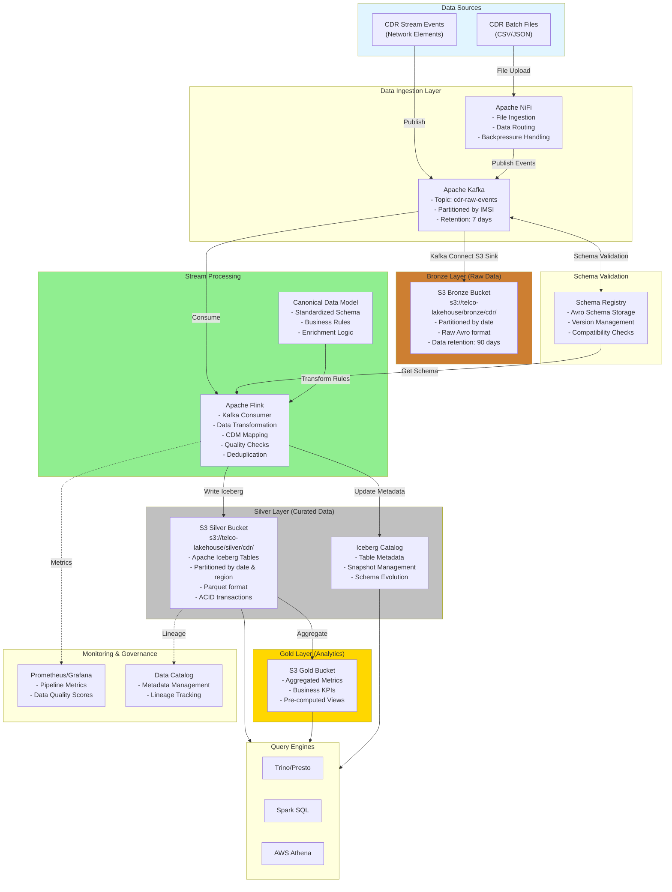

# Data Lakehouse Prototyping for Telecom (eg: CDR Processing)

## Table of Contents
1. [Architecture Overview](#architecture-overview)
2. [Components Description](#components-description)
3. [Data Flow](#data-flow)
4. [Appendix]

---

## Architecture Overview

This Data Lakehouse architecture implements a medallion architecture (Bronze-Silver-Gold) for processing Telecom Call Detail Records (CDRs). The solution provides real-time and batch processing capabilities with schema validation, data quality checks, and ACID transaction support through Apache Iceberg.

### Key Features
- **Multi-modal Ingestion**: Support for both streaming (Kafka) and batch (files) data ingestion
- **Schema Evolution**: Managed through Confluent Schema Registry with Avro serialization
- **Medallion Architecture**: Bronze (raw), Silver (cleaned/enriched), Gold (aggregated)
- **ACID Transactions**: Apache Iceberg for time-travel and data versioning
- **Real-time Processing**: Apache Flink for stream processing
- **Scalable Storage**: S3-based object storage with cost-effective tiering

### Architecture Diagram (ASCII)
```
┌─────────────────┐
│  CDR Sources    │
│  ┌───┐  ┌───┐  │
│  │CSV│  │API│  │
│  └─┬─┘  └─┬─┘  │
└────┼──────┼────┘
     │      │
     v      v
┌────────────────┐      ┌──────────────┐
│  Apache NiFi   │─────>│    Kafka     │
│  Data Router   │      │  (Events)    │
└────────────────┘      └──────┬───────┘
                               │
                    ┌──────────┼──────────┐
                    │          │          │
                    v          v          v
            ┌─────────┐ ┌──────────┐ ┌──────────┐
            │ Schema  │ │ S3       │ │ Flink    │
            │Registry │ │ Bronze   │ │ Consumer │
            └─────────┘ └──────────┘ └────┬─────┘
                                           │
                                           v
                                    ┌─────────────┐
                                    │ Transform   │
                                    │ Validate    │
                                    │ Enrich      │
                                    └──────┬──────┘
                                           │
                                           v
                                    ┌─────────────┐
                                    │ S3 Silver   │
                                    │ (Iceberg)   │
                                    └──────┬──────┘
                                           │
                    ┌──────────────────────┼──────────────────────┐
                    │                      │                      │
                    v                      v                      v
            ┌──────────┐           ┌──────────┐          ┌──────────┐
            │  Trino   │           │  Spark   │          │  Athena  │
            │  Query   │           │Analytics │          │  Query   │
            └──────────┘           └──────────┘          └──────────┘
```

### Key Architecture Decisions

**Q1: Explain schema validation and purpose of Kafka topics**
- **Answer**: Schema validation happens via Schema Registry during produce/consume
- Flink consumes directly from `cdr-raw-events` topic
- Flink performs additional business validation and routes bad records to `cdr-dlq`

**Q2: How does data get written to Bronze layer (S3)?**
- **Answer**: **Kafka Connect S3 Sink Connector** writes data to Bronze layer
- Operates in parallel to Flink processing (independent backup)
- Automatically consumes from `cdr-raw-events` and writes to S3 in Avro format
- Provides immutable backup of all raw events
- Configured with time-based partitioning (hourly folders)

**Q3: Python vs Java for Flink?**
- **Answer**: This implementation uses **PyFlink (Python)** for easier development and maintenance
- All Flink code is provided in Python
- PyFlink provides both Table API and DataStream API
- Python is more accessible for data engineers familiar with Python ecosystem

**Q4: Can Gold layer be data serving layer?**
- **Answer**: Yes, absolutely. Gold layer ie. Aggregated data can be stored in TimeScale DB for serving for channels.

**Q5: Which orchestration tool - Airflow vs Argo Workflows?**

**Orchestration Requirements:**
- Schedule batch aggregation jobs (Gold layer)
- Coordinate multi-step data pipelines
- Manage dependencies between Flink, Spark, and batch jobs
- Handle data backfill and reprocessing
- Monitor job execution and retry failures
- Integrate with existing Kubernetes infrastructure

**Comparison:**

| Aspect | Apache Airflow | Argo Workflows |
|--------|---------------|----------------|
| **Kubernetes Native** | Partial (KubernetesExecutor) | ✅ Fully native |
| **Simplicity** | Complex, more learning curve | ✅ Simpler for K8s users |
| **Data Pipeline Focus** | ✅ Built for data pipelines | General workflow engine |
| **UI/Monitoring** | ✅ Rich, mature UI | Basic UI, good for DevOps |
| **DAG Definition** | Python-based | YAML-based |
| **Ecosystem** | ✅ Large data ecosystem | Growing ecosystem |
| **Scheduling** | ✅ Advanced (cron, sensors) | Basic scheduling |
| **Dynamic Pipelines** | ✅ Python flexibility | Limited dynamism |
| **Resource Efficiency** | Higher overhead | ✅ Lightweight |
| **Learning Curve** | Steeper | ✅ Easier for K8s teams |

**Recommendation: Apache Airflow**

**Why Airflow for Telecom Lakehouse:**

1. **Data-First Design**: Airflow is purpose-built for data pipelines with concepts like sensors, data-aware scheduling, and backfilling
2. **Rich Integrations**: Native operators for Spark, Kafka, S3, Iceberg, and most data tools
3. **Complex Dependencies**: Better support for complex DAGs with conditional logic, branching, and dynamic task generation
4. **Monitoring & Alerting**: Superior observability for data pipeline health and SLA tracking
5. **Python Flexibility**: Easy to write custom logic for CDR processing, validation, and transformations
6. **Proven at Scale**: Battle-tested in telecom and large-scale data processing

**When to Choose Argo:**
- If team is primarily DevOps/SRE with strong Kubernetes expertise
- For simpler, CI/CD-style workflows
- When minimizing resource overhead is critical
- If workflows are mostly container orchestration with minimal data logic

**Hybrid Approach:**
Use **Airflow for data orchestration** (scheduling, monitoring, complex pipelines) and **Argo for CI/CD** (deploying Flink jobs, infrastructure management). This leverages strengths of both tools.

**Implementation:**
- Deploy Airflow with KubernetesExecutor on same K8s cluster
- Use Airflow to schedule Spark jobs for Gold layer aggregations
- Use Airflow sensors to trigger based on S3 events or Kafka lag
- Integrate with LGTM stack for unified monitoring

**Q6: Apache Iceberg vs TimescaleDB for Silver Layer?**

**Comparison:**

| Aspect | Apache Iceberg | TimescaleDB |
|--------|---------------|-------------|
| **Type** | Data lake table format | PostgreSQL extension (database) |
| **Storage** | Object storage (S3, ADLS) | Database storage (disk/SSD) |
| **Scalability** | ✅ Petabyte scale | Limited to database capacity |
| **Cost** | ✅ Very cost-effective (S3) | Higher (compute + storage coupled) |
| **Query Engines** | ✅ Multiple (Spark, Flink, Trino, Presto, Athena) | PostgreSQL only |
| **ACID** | ✅ Full ACID | ✅ Full ACID |
| **Schema Evolution** | ✅ Easy, no rewrites | Complex, requires migrations |
| **Time Travel** | ✅ Built-in snapshots | Limited (via hypertables) |
| **Partition Evolution** | ✅ Change without rewrites | Requires re-chunking |
| **Analytical Queries** | ✅ Optimized (columnar) | Good but not optimized |
| **Point Queries** | Slower | ✅ Faster (B-tree indexes) |
| **Streaming Integration** | ✅ Native Flink/Spark support | Requires custom integration |
| **Operational Overhead** | ✅ Minimal (serverless) | High (DB management) |
| **Use Case** | ✅ **Analytical Silver layer** | **Operational Gold/serving** |

**Recommendation: Apache Iceberg for Silver Layer**

**Why Iceberg for Silver:**

1. **Massive Scale**: CDR data grows to billions of records; Iceberg handles petabyte-scale data on cost-effective S3
2. **Analytics-First**: Silver layer is for analytical processing (aggregations, joins, complex queries)
3. **Multiple Query Engines**: Query same data from Spark (batch), Flink (streaming), Trino (ad-hoc), Athena (serverless)
4. **Schema Evolution**: Telecom schemas evolve (new CDR fields); Iceberg handles this without rewriting data
5. **Time Travel**: Critical for debugging, compliance, and reprocessing ("what did data look like yesterday?")
6. **Streaming Integration**: Flink writes directly to Iceberg with exactly-once semantics
7. **Cost Efficiency**: Pay only for S3 storage; no dedicated database servers
8. **Decoupled Storage/Compute**: Scale compute (query engines) independently from storage

**When TimescaleDB is Better (Gold Layer):**

1. **Real-time Serving**: Low-latency point queries for dashboards and APIs
2. **Time-Series Queries**: Optimized for time-range queries (recent CDRs, trends)
3. **Continuous Aggregates**: Pre-computed views for fast dashboard queries
4. **Operational Workloads**: Serving layer for applications (subscriber lookup, billing)
5. **Smaller Datasets**: Gold aggregated data is much smaller than Silver raw data
6. **Index Support**: Fast lookups by IMSI, phone number, customer_id

**Recommended Architecture:**

```
Silver Layer (Iceberg):
├─ Curated CDR data (billions of records)
├─ Partitioned by date + region
├─ Queried by Spark, Flink, Trino
├─ Used for: Analytics, ML, batch processing
└─ Storage: S3 (cheap, scalable)

Gold Layer (TimescaleDB):
├─ Aggregated metrics (millions of records)
├─ Pre-computed summaries (hourly/daily)
├─ Indexed by customer, region, time
├─ Used for: Dashboards, APIs, reporting
└─ Storage: TimescaleDB (fast queries)
```

**Example Data Flow:**
```sql
-- Spark reads from Iceberg Silver (nightly batch)
SELECT 
    customer_id,
    DATE(call_start_time) as day,
    SUM(call_duration) as total_minutes,
    SUM(bytes_total) as total_data,
    SUM(revenue) as total_revenue
FROM iceberg_catalog.silver.cdr_transactions
WHERE record_date >= CURRENT_DATE - INTERVAL '1' DAY
GROUP BY customer_id, DATE(call_start_time)

-- Write aggregates to TimescaleDB Gold
INSERT INTO timescale.gold.daily_customer_metrics
VALUES (...)
ON CONFLICT (customer_id, day) 
DO UPDATE SET ...

-- Fast serving queries from TimescaleDB
SELECT * FROM gold.daily_customer_metrics
WHERE customer_id = '123456' 
  AND day >= CURRENT_DATE - INTERVAL '30' DAY
ORDER BY day DESC;
```

**Key Takeaway:**
- **Silver Layer = Iceberg** (massive scale, analytical, schema evolution)
- **Gold Layer = TimescaleDB** (fast serving, operational, time-series optimized)

---

## Flow Diagram



---

## Components Description

### 1. **Apache NiFi** (Data Ingestion)
**Purpose**: Orchestrate data ingestion from multiple sources with reliability and backpressure handling.

**Key Responsibilities**:
- Monitor directories for new CDR batch files
- Parse CSV/JSON files
- Convert to Avro format using Schema Registry
- Publish to Kafka topics
- Handle retry logic and dead letter queues
- Route data based on content (e.g., different CDR types)

**Configuration**:
```properties
# NiFi Processors Flow
1. GetFile / ListFile + FetchFile
2. ConvertRecord (CSV/JSON → Avro)
3. PublishKafka_2_6
4. PutS3Object (backup to Bronze)
```

### 2. **Apache Kafka** (Message Broker)
**Purpose**: Serve as the central event streaming platform for CDR data.

**Topics**:
- `cdr-raw-events`: Raw CDR events from NiFi/producers (Flink consumes from this topic)
- `cdr-dlq`: Dead letter queue for failed records (written by Flink for invalid records)

**Note**: We use a single topic `cdr-raw-events` for simplicity. Schema validation happens via Schema Registry during production and consumption. Flink performs additional business validation and routes bad records to DLQ.

**Configuration**:
```properties
# Topic Configuration
partitions=12 (based on throughput)
replication.factor=3
retention.ms=604800000 (7 days)
compression.type=snappy
min.insync.replicas=2
```

### 3. **Confluent Schema Registry** (Schema Management)
**Purpose**: Centralized schema management with versioning and compatibility.

**Avro Schema Example** (CDR Short Format):
```json
{
  "type": "record",
  "name": "CDRRecord",
  "namespace": "com.telco.cdr",
  "fields": [
    {"name": "record_id", "type": "string"},
    {"name": "call_type", "type": ["null", "string"], "default": null},
    {"name": "imsi", "type": "string"},
    {"name": "imei", "type": ["null", "string"], "default": null},
    {"name": "calling_number", "type": "string"},
    {"name": "called_number", "type": "string"},
    {"name": "call_start_time", "type": "long", "logicalType": "timestamp-millis"},
    {"name": "call_duration", "type": "int"},
    {"name": "cell_id", "type": "string"},
    {"name": "lac", "type": "string"},
    {"name": "event_type", "type": "string"},
    {"name": "bytes_uploaded", "type": ["null", "long"], "default": null},
    {"name": "bytes_downloaded", "type": ["null", "long"], "default": null},
    {"name": "charging_id", "type": ["null", "string"], "default": null},
    {"name": "record_timestamp", "type": "long", "logicalType": "timestamp-millis"}
  ]
}
```

**Compatibility Mode**: `BACKWARD` (allows removing fields, adding optional fields)

### 4. **Amazon S3** (Storage Layer)

#### Bronze Layer
**Path Structure**:
```
s3://telco-lakehouse/bronze/cdr/
  └── year=2026/
      └── month=02/
          └── day=23/
              └── hour=14/
                  └── cdr-raw-20260223-140000.avro
```

**Write Mechanism**: Kafka Connect S3 Sink Connector automatically writes all events from `cdr-raw-events` topic to S3 Bronze layer in Avro format. This provides a backup of all raw events independent of Flink processing.

**Characteristics**:
- Immutable raw data
- Avro format for schema evolution
- Lifecycle policy: Move to Glacier after 90 days
- Versioning enabled for audit
- Written by Kafka Connect S3 Sink (not Flink)

#### Silver Layer
**Path Structure**:
```
s3://telco-lakehouse/silver/cdr/
  └── cdr_transactions/
      ├── metadata/
      │   └── v1.metadata.json
      └── data/
          └── year=2026/month=02/day=23/
              └── region=north/
                  └── 00000-0-data-file.parquet
```

**Characteristics**:
- Iceberg table format
- Parquet files with Snappy compression
- Partitioned by date and region
- Supports time-travel and ACID transactions

### 5. **Apache Flink** (Stream Processing)
**Purpose**: Real-time stream processing with exactly-once semantics.

**Processing Logic**:
1. **Consume**: Read from Kafka with checkpointing
2. **Deserialize**: Use Schema Registry for Avro deserialization
3. **Validate**: Data quality checks (nulls, ranges, business rules)
4. **Enrich**: Lookup dimension data (customer info, location)
5. **Transform**: Map to Canonical Data Model (CDM)
6. **Deduplicate**: Based on record_id and time window
7. **Write**: Commit to Iceberg table in Silver layer

**Flink Job Configuration**:
```yaml
execution:
  checkpointing:
    interval: 60s
    mode: EXACTLY_ONCE
    timeout: 10min
  parallelism: 12
  
state:
  backend: rocksdb
  checkpoints.dir: s3://telco-lakehouse/flink-checkpoints/
  
kafka:
  consumer.group.id: flink-cdr-processor
  auto.offset.reset: earliest
```

### 6. **Apache Iceberg** (Table Format)
**Purpose**: Provide ACID transactions, schema evolution, and time-travel capabilities.

**Key Features**:
- Snapshot isolation for concurrent reads/writes
- Hidden partitioning (no partition predicates needed in queries)
- Schema evolution without rewriting data
- Time-travel queries (query historical data)
- Partition evolution (change partitioning scheme without rewriting)

**Table Configuration**:
```sql
CREATE TABLE silver.cdr_transactions (
    record_id STRING,
    call_type STRING,
    imsi STRING,
    calling_number STRING,
    called_number STRING,
    call_start_time TIMESTAMP,
    call_duration INT,
    cell_id STRING,
    region STRING,
    bytes_total BIGINT,
    revenue DECIMAL(10,2),
    record_date DATE,
    processing_timestamp TIMESTAMP
)
USING iceberg
PARTITIONED BY (days(record_date), region)
TBLPROPERTIES (
    'write.format.default' = 'parquet',
    'write.parquet.compression-codec' = 'snappy',
    'commit.retry.num-retries' = '3'
);
```

### 7. **Canonical Data Model (CDM)**
**Purpose**: Standardize data structure across the organization.

**CDM Mapping Rules**:
```yaml
cdm_mapping:
  - source: "raw.calling_number"
    target: "cdm.a_party_number"
    transformation: "MASK_PII(calling_number, 'PHONE')"
  
  - source: "raw.called_number"
    target: "cdm.b_party_number"
    transformation: "MASK_PII(called_number, 'PHONE')"
  
  - source: "raw.bytes_uploaded + raw.bytes_downloaded"
    target: "cdm.bytes_total"
    transformation: "SUM"
  
  - derived: true
    target: "cdm.revenue"
    transformation: "CALCULATE_REVENUE(call_duration, call_type, customer_tier)"
  
  - derived: true
    target: "cdm.region"
    transformation: "LOOKUP_REGION(cell_id, lac)"
```

---

## Data Flow

### Detailed Flow Steps

#### Phase 1: Ingestion (Batch)
1. CDR batch files (CSV) arrive in landing zone: `/data/landing/cdr/`
2. NiFi GetFile processor monitors directory
3. NiFi ConvertRecord converts CSV → Avro using Schema Registry
4. Validated Avro records published to Kafka topic `cdr-raw-events`
5. NiFi PutS3Object writes raw Avro to Bronze layer as backup
6. Original file moved to `/data/processed/` with timestamp

#### Phase 2: Ingestion (Streaming)
1. Network elements push CDR events to Kafka directly
2. Producer validates schema against Schema Registry
3. Events written to `cdr-raw-events` topic
4. **Kafka Connect S3 Sink Connector** automatically writes all events to Bronze layer in parallel (immutable backup)

#### Phase 3: Stream Processing
1. Flink job consumes from Kafka with consumer group `flink-cdr-processor`
2. Avro deserialization using Schema Registry client
3. **Data Quality Checks**:
   - Required fields present (IMSI, phone numbers, timestamps)
   - Valid phone number format
   - Duration > 0 for voice calls
   - Timestamp within acceptable range (not future, not too old)
4. **Enrichment**:
   - Lookup customer tier from dimension table
   - Map cell_id to region/location
   - Calculate revenue based on business rules
5. **Transformation to CDM**:
   - Apply mapping rules
   - Mask PII fields
   - Add derived fields
6. **Deduplication**:
   - Window-based deduplication (5-minute tumbling window)
   - Key: record_id
   - Keep first occurrence
7. **Write to Silver**:
   - Flink Iceberg sink writes to Silver table
   - Automatic partitioning by date and region
   - Atomic commits with snapshot creation

#### Phase 4: Gold Layer (Batch)
1. Scheduled Spark jobs (hourly/daily)
2. Read from Silver Iceberg tables
3. Compute aggregations:
   - Total calls/data per customer
   - Regional traffic patterns
   - Revenue by service type
   - Network utilization metrics
4. Write to Gold layer (pre-aggregated tables)

#### Phase 5: Query & Analytics
1. Analysts connect via Trino/Presto
2. Query Silver tables for detailed analysis
3. Query Gold tables for dashboards
4. Time-travel queries for historical comparison

---

## Appendix

### A. CDR Short Format Specification
```
Field Name          | Type      | Description
--------------------|-----------|----------------------------------
record_id           | STRING    | Unique identifier for the record
call_type           | STRING    | VOICE, SMS, DATA
imsi                | STRING    | International Mobile Subscriber Identity
imei                | STRING    | International Mobile Equipment Identity
calling_number      | STRING    | A-party phone number
called_number       | STRING    | B-party phone number
call_start_time     | TIMESTAMP | Call initiation timestamp
call_duration       | INT       | Duration in seconds
cell_id             | STRING    | Cell tower identifier
lac                 | STRING    | Location Area Code
event_type          | STRING    | MOC, MTC, SMS-MO, SMS-MT, DATA
bytes_uploaded      | BIGINT    | Uplink data volume
bytes_downloaded    | BIGINT    | Downlink data volume
charging_id         | STRING    | Charging session identifier
record_timestamp    | TIMESTAMP | Record generation timestamp
```

### B. Useful Commands

#### Kafka Management
```bash
# List consumer groups
kafka-consumer-groups --bootstrap-server kafka-broker:9092 --list

# Reset consumer offset
kafka-consumer-groups --bootstrap-server kafka-broker:9092 \
  --group flink-cdr-processor \
  --topic cdr-raw-events \
  --reset-offsets --to-earliest --execute

# Describe topic
kafka-topics --bootstrap-server kafka-broker:9092 \
  --topic cdr-raw-events --describe
```

#### S3 Management
```bash
# List objects with size
aws s3 ls s3://telco-lakehouse/silver/cdr/ --recursive --human-readable

# Sync to another region
aws s3 sync s3://telco-lakehouse/silver s3://telco-lakehouse-backup/silver

# Calculate total size
aws s3 ls s3://telco-lakehouse/silver/cdr/ --recursive --summarize | grep "Total Size"
```

#### Flink Management
```bash
# List running jobs
flink list

# Cancel job
flink cancel <job-id>

# Create savepoint
flink savepoint <job-id> s3://telco-lakehouse/flink-savepoints/

# Restore from savepoint
flink run -s s3://telco-lakehouse/flink-savepoints/savepoint-xxx \
  target/cdr-processor.jar
```

#### Iceberg Table Maintenance
```sql
-- Expire old snapshots (keep last 7 days)
CALL iceberg_catalog.system.expire_snapshots(
  table => 'default.cdr_transactions',
  older_than => TIMESTAMP '2026-02-16 00:00:00',
  retain_last => 10
);

-- Compact data files
CALL iceberg_catalog.system.rewrite_data_files(
  table => 'default.cdr_transactions',
  strategy => 'sort',
  sort_order => 'record_date DESC'
);

-- Remove orphan files
CALL iceberg_catalog.system.remove_orphan_files(
  table => 'default.cdr_transactions',
  older_than => TIMESTAMP '2026-02-16 00:00:00'
);
```

### C. Sample Data

#### Sample CDR CSV
```csv
record_id,call_type,imsi,calling_number,called_number,call_start_time,call_duration,cell_id,lac,event_type,bytes_uploaded,bytes_downloaded
rec-001,VOICE,123456789012345,1234567890,9876543210,2026-02-23T14:30:00Z,120,001-001,100,MOC,,
rec-002,SMS,123456789012346,2345678901,8765432109,2026-02-23T14:31:00Z,0,001-002,100,SMS-MO,,
rec-003,DATA,123456789012347,3456789012,7654321098,2026-02-23T14:32:00Z,300,002-001,200,DATA,1048576,5242880
```

#### Sample CDR JSON
```json
{
  "record_id": "rec-001",
  "call_type": "VOICE",
  "imsi": "123456789012345",
  "calling_number": "1234567890",
  "called_number": "9876543210",
  "call_start_time": "2026-02-23T14:30:00Z",
  "call_duration": 120,
  "cell_id": "001-001",
  "lac": "100",
  "event_type": "MOC",
  "bytes_uploaded": null,
  "bytes_downloaded": null,
  "record_timestamp": "2026-02-23T14:30:00Z"
}
```

## Conclusion

This Data Lakehouse architecture provides a robust, scalable solution for processing telecom CDR data. The medallion architecture (Bronze-Silver-Gold) ensures data quality progression, while Apache Iceberg provides ACID transactions and time-travel capabilities. The combination of streaming (Kafka + Flink) and batch processing enables both real-time and historical analytics.

### Key Takeaways:
1. **Schema Management**: Confluent Schema Registry ensures consistent data contracts
2. **Streaming Processing**: Apache Flink provides low-latency, exactly-once processing
3. **Data Lake Format**: Apache Iceberg enables efficient queries and data management
4. **Observability**: Comprehensive monitoring ensures system health and data quality
5. **Scalability**: Architecture scales horizontally at each layer

---